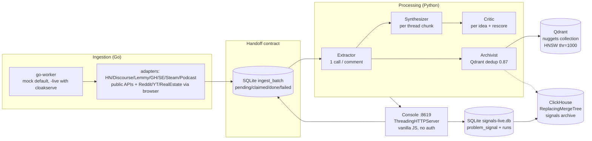
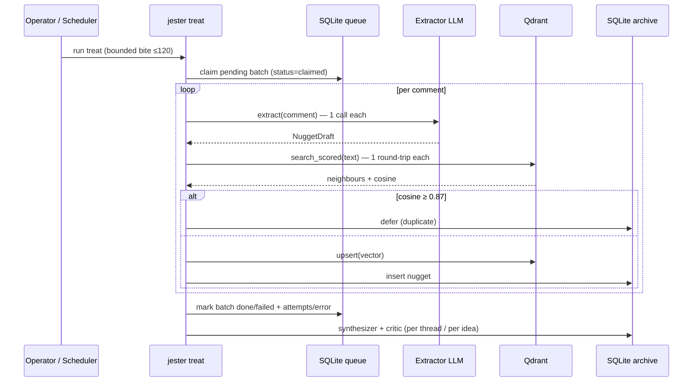
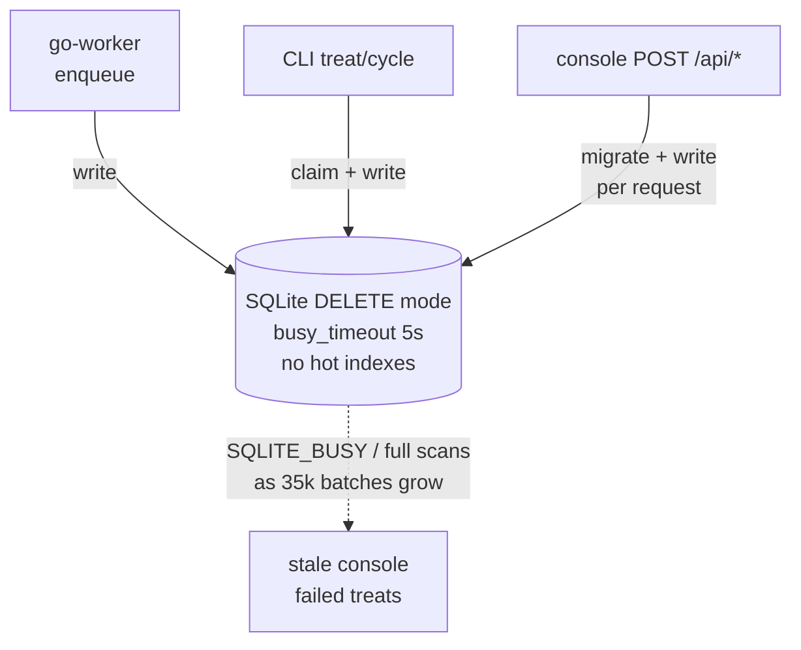
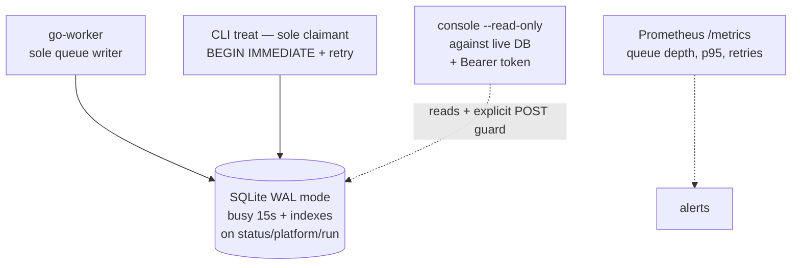
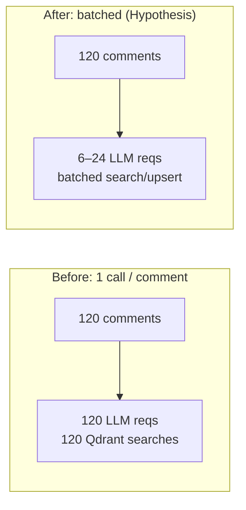
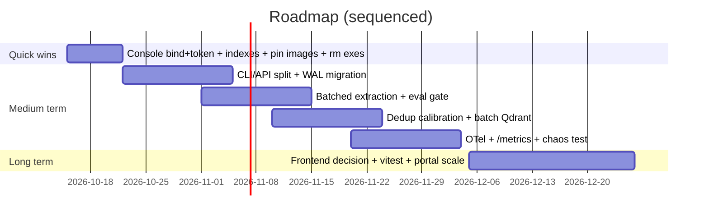

# Jester — Codebase Analysis, Optimization & Improvement Report

**Date:** 2026-10-14 · **Commit audited:** `7aef02c` · **Scope:** repo-wide audit, no production code changed
**Method:** static reads + test collection + targeted test runs + config/docker review. No secrets exposed. No new benchmarks invented — unmeasured expectations are labelled *Hypothesis*.

---

## 1. Executive summary

Jester is a working, evidence-obsessed multi-agent pipeline: Go scrapes forums → SQLite handoff queue → Python LLM chain (extractor → synthesizer → critic) → Qdrant dedup + ClickHouse archive → stdlib operator console. The real archive (35,118 batches, 98,890 nuggets, 1,468 ideas) proves the design works.

The audit found **no data-integrity emergency**, but 12 actionable findings. The top 5 by value/effort:

1. **Console has no auth and Docker publishes it on `0.0.0.0:8619`** — every `POST /api/*` mutates the archive. Fix with bind-default + token before any shared deployment.
2. **SQLite is the cross-process contract with `journal_mode=DELETE`** — the repo already documents one corruption incident. Keep the isolated volume, add WAL + indexes + single-writer discipline.
3. **`cli.py` (3,923 lines) + `console/api.py` (2,663 lines) are god files** — split by domain to cut regression risk.
4. **Extractor = 1 LLM call per comment** — batching is the largest cost/latency lever.
5. **Observability is `print + /api/doctor` only** (`log_message` is silenced) — structured logs + `/metrics` + traces around LLM/Qdrant calls.

Quick wins (1–2 days each): pin Docker digests, remove checked-in `.exe`s, add SQLite indexes, bind console to localhost, separate dev dependencies. Medium-term (1–3 weeks): CLI/API split, batched extraction with eval gate, per-category dedup calibration, OTel instrumentation.

> What is already excellent and should not be rewritten: idempotent signals collector (repeat import = 0 new rows), `ReplacingMergeTree + FINAL` reconciliation, `mode=live|synthetic` column, stand-in model signing, per-model Groq quota blocks, thread-id whitelist, static allow-list, Qdrant `INDEXING_THRESHOLD=1000` tuning (83 ms → 23 ms measured in-code).

---

## 2. Project overview

**Purpose:** crawl community forums (Reddit, HN, Discourse, Lemmy, Stack Exchange, GitHub, YouTube, podcasts, 15 real-estate portals — ~150 sources in `config/sources.yaml`), extract complaints via LLM agents, dedup/cluster in vector store, synthesize scored product ideas, review everything in an operator console.

**Stack:**

| Layer | Tech | Evidence |
|---|---|---|
| Ingestion | Go 1.26, chromedp/CloakBrowser, `modernc.org/sqlite` (pure Go, no cgo) | `go/go.mod:1-26`, `go/cmd/worker/main.go:1-170` |
| Processing | Python 3.10+ (3.12 in CI/Docker), Ollama / Groq / OpenAI-compatible via stdlib `urllib`, 5 roles in `thresholds.yaml` | `python/pyproject.toml:5-16`, `python/jester/llm.py:676-800`, `python/jester/roles.py:95` |
| Storage | SQLite (state + handoff), Qdrant (vectors), ClickHouse 24.8 (signals archive) | `python/jester/store.py:32-120`, `python/jester/vector.py:1-212`, `python/jester/signals/__init__.py:115-125` |
| Console | Python `ThreadingHTTPServer`, vanilla JS, no build step | `python/jester/console/server.py:12,390-393`, `python/jester/console/static/` |
| Orchestration | Docker Compose + profiles `live` (cloakbrowser+ollama), `signals` (clickhouse) | `docker-compose.yml:35-253` |
| Tests | 1,485 Python tests collected, 75 Go files, CI on every push + Sonar | `python/tests/` (96 files), `.github/workflows/ci.yml` |

Counts measured 2026-10-14: `python/jester` = 70 files / 27,080 lines; `cli.py` = 3,923 lines / 79 functions; `console/api.py` = 2,663 lines; `pytest --collect-only` = 1,485 collected, 13 deselected.

---

## 3. Current-state assessment

### What works well (keep)

- **Deterministic signals path beside the probabilistic idea path.** Rules-only classification, `mode` column, failures-as-rows, `GROUP BY` counts, `FINAL` queries, `signals evidence` tri-way reconcile (SQLite vs ClickHouse vs CSV, non-zero exit on drift). Verified in `python/jester/signals/`, `docs/scope-and-access.md`, CI double-export check (`.github/workflows/ci.yml`).
- **Failure isolation for models.** Fake/stand-in outputs are signed, never archived as real; nuggets stay queued, ideas saved `needs_score` and rescored. Per-model Groq quota blocks (`python/jester/llm_quota.py:26`, `python/jester/llm.py:607-626`).
- **Vector-store hardening already landed.** `INDEXING_THRESHOLD=1000` with measured comment (83 ms brute-force → 23 ms HNSW), 30 s timeout, 1 retry, `UnavailableVectorStore` deferral, dimension-mismatch at open time (`python/jester/vector.py:10-100`).
- **Input hygiene in console.** Static allow-list + traversal check (`server.py:51-63`), thread-id whitelist `[A-Za-z0-9._:-]{1,120}` never echoed (`server.py:178-194`), per-request `open_db(migrate=False)` + `--read-only` flag.
- **Contract discipline across languages.** `schema_version=1` guard both sides, `contractcheck` binary, `JESTER_CONTRACT_DB`-gated tests (`go/internal/store/store.go:265-282`, `go/cmd/contractcheck/main.go`).

### What needs attention

- Security boundary (auth, network exposure, defaults), SQLite concurrency/indexing, god-file maintainability, per-comment LLM cost, floating dependencies/images, dual-frontend drift, silent logs, unmeasured recall, checked-in binaries.

---

## 4. Key findings (summary)

| ID | Area | Priority | One-line problem |
|---|---|---|---|
| F-01 | Security | **High** | Console: no auth, `0.0.0.0` in Docker, all POSTs mutate |
| F-02 | Data/Reliability | **High** | SQLite multi-writer + `DELETE` journal mode, 5 s busy timeout |
| F-03 | Data/Perf | **High** | No declarative indexes on hot filters (platform/status/run/thread) |
| F-04 | Architecture | **High** | `cli.py` + `api.py` god files concentrate change risk |
| F-05 | Perf/Cost | **High** | 1 LLM call per comment; Groq 8k TPM ceiling hit in practice |
| F-06 | Perf/Quality | Medium | Single global dedup cosine 0.87; per-item Qdrant round-trips |
| F-07 | Ops/Security | Medium | Floating images, root containers, default `CLICKHOUSE_PASSWORD=jester`, unauth Qdrant/CH |
| F-08 | Maintainability | Medium | Loose pins, `pytest` in runtime deps, Linux-only lock file |
| F-09 | Hygiene | Medium | 3 checked-in `.exe` (~12 MB each) despite `*.exe` gitignore |
| F-10 | Frontend | Medium | Shipped vanilla JS (untested) + unused React scaffold with stale CSS |
| F-11 | Observability | **High** | `log_message` silenced; no structured logs/metrics/traces |
| F-12 | Testing | Medium | Strong hermetic core, but live/frontend/load/chaos gaps; recall unmeasured |

Details, evidence, and fixes are in §5 + §8.

---

## 5. Recommended solutions

### F-01 — Console auth & binding (Security, High)

- **Current:** `ThreadingHTTPServer((args.host, args.port))` defaults to `127.0.0.1` on host (`server.py:416-419`) — good — but Compose publishes `8619:8619` with `CMD --host 0.0.0.0` (`docker-compose.yml:93-94`, `docker/Dockerfile.python`), and every `POST /api/run|ingest|thresholds|models|sources/*|schedule/*` mutates state with no token (`server.py:260-372`).
- **Why it matters:** OWASP Top 10 A01 (Broken Access Control). Python docs warn `http.server` is not hardened for production exposure.
- **Fix (incremental, no rewrite):** (a) keep host default `127.0.0.1`; document that `0.0.0.0` requires `JESTER_CONSOLE_TOKEN`; (b) add `Authorization: Bearer` check (constant-time compare, env-loaded) with `--read-only` bypass for GETs; (c) add `--allow-host` explicit flag for Docker; (d) note reverse-proxy (Caddy/Traefik + TLS + basic-auth) for any non-localhost use.
- **Validate:** `curl` without token → 401; with token → 200; read-only container rejects POST with 403. Add `test_console_auth.py`.

### F-02 — SQLite concurrency (Data/Reliability, High)

- **Current:** Go sets `journal_mode=DELETE, busy_timeout=5000` (`go/internal/store/store.go` PRAGMAs). Comment header in `docker-compose.yml:18-33` records 2026-08-28 `database disk image is malformed` from host+container multi-writer over bind mount. Mitigation (isolated `jester_docker_data` volume + `jester-docker.db`) is correct and load-bearing.
- **Fix:** (a) set `PRAGMA journal_mode=WAL; synchronous=NORMAL; busy_timeout=15000; foreign_keys=ON` on open in both languages (WAL persists; safe on the isolated volume, still avoid WAL over network FS); (b) single-writer rule: only `go-worker` + owning CLI write `ingest_batch`; console uses `--read-only` against live DB; (c) wrap claim-process-update in `BEGIN IMMEDIATE` with retry on `SQLITE_BUSY`; (d) nightly `VACUUM INTO` backup (already `backup.py` — schedule it).
- **Validate:** concurrent `worker + treat` soak shows 0 `SQLITE_BUSY` aborts; `PRAGMA journal_mode` returns `wal`; fault-injection test kills writer mid-transaction → DB opens clean.
- **Trade-off:** WAL creates `-wal/-shm` sidecars; must back up all three or checkpoint first. Documented in report.

### F-03 — Missing indexes (Data/Perf, High)

- **Current:** `BASE_SCHEMA` declares only `unique_key UNIQUE` (`store.py:32-60`); hot filters (`ingest_batch.status`, `nuggets.platform/run_id`, `ideas.status/overall`, `ingested_comments.thread_id`) rely on scans. One-off `CREATE INDEX` exists only in `console/api.py:795`.
- **Fix:** add idempotent migrations: `idx_batch_status(status, kind)`, `idx_nuggets_platform(platform, created_at)`, `idx_ideas_status_overall(status, overall)`, `idx_ingested_thread(thread_id)`, `idx_runs_status(started)`. Run `EXPLAIN QUERY PLAN` before/after on `/api/overview`, `/api/queue`, `/api/ideas`.
- **Validate:** *Hypothesis:* p50 overview latency drops and stays flat as batches grow past 35k; assert index-scan, no full-scan. Record timings in appendix.

### F-04 — God files (Architecture, High)

- **Current:** `cli.py` 3,923 lines / 79 top-level functions; `api.py` 2,663 lines. Every pipeline, signals, journal, cluster, and schedule change touches the same files → merge conflicts + untestable branches.
- **Fix:** extract by bounded context without behaviour change: `cli_signals.py`, `cli_journal.py`, `cli_cluster.py`, `services/pipeline.py` (thin CLI → service → store/vector/llm). `api.py` → `api_ideas.py`, `api_signals.py`, `api_ops.py` sharing one `ConsoleAPI` facade. Enforce `ruff` max-complexity + file-length lint in CI.
- **Validate:** `pytest` green, `go test` untouched, import graph (e.g. `pydeps`) shows no cycles; PR diff-stat shows future changes land in one module.

### F-05 — Batched extraction (Perf/Cost, High)

- **Current:** `agents/extractor.py:87 extract([comment])` is called once per comment; `COMMENT_BUDGET=120`, `QUEUE_CEILING=40000` (`cli.py:1006-1058`). `config.py:122-123` notes Groq 8k TPM forces hourly cadence. At 98k-nugget scale this is the dominant token/latency cost.
- **Fix:** add `extract_batch(comments[5..20]) → NuggetDraft[]` with JSON-array prompt, same `PROMPT_VERSIONS` gate, fallback to single-call on parse failure. Keep temperature/seed per role. Gate promotion on `eval/known_good.md + known_bad.md` + trivial-share metric.
- **Validate:** tokens/idea and wall-clock per 1k comments drop; nugget yield and trivial-share within ±2 pts of baseline. *Hypothesis:* 3–8× fewer requests at equal quality — must be measured, not assumed.
- **Principle:** batching for LLM serving throughput is the standard lever (vLLM/PagedAttention shows 2–4× serving gains from better batching; batching prompts is the client-side analogue).

### F-06 — Dedup calibration & batching (Perf/Quality, Medium)

- **Current:** global `dedup_threshold: 0.87` (`config/thresholds.yaml`), per-nugget `search_scored` loop (`vector.py:44-56` notes per-nugget cost). Strength: `INDEXING_THRESHOLD=1000` already fixed the 83 ms scan. Gap: `docs/realestate-dedup-validation.md` reports precision 5/7 ≈ 71%, recall unmeasured.
- **Fix:** (a) `search_batch` / `upsert_batch` (Qdrant supports batched points); (b) threshold sweep 0.80–0.92 per category with labelled pairs; store `embedding_model` already recorded — keep enforcing single-model collections; (c) publish precision/recall/F1 table.
- **Validate:** labelled fixture of ~200 pairs; choose threshold by F1, not vibes.

### F-07 — Supply chain & runtime hardening (Ops/Security, Medium)

- **Current:** `qdrant:latest`, `ollama:latest`, `golang:latest`, `python:3.12-slim`, `node:24-slim` float; `jester-console` + `go-worker` run as root (documented for cron + shared SQLite uid); `CLICKHOUSE_PASSWORD:-jester` default committed; Qdrant 6333 / CH 8123 unauthenticated HTTP; ClickHouse HTTP not TLS.
- **Fix:** pin by digest (`image:tag@sha256:…`, Renovate/Dependabot updates); run frontend as `node` (already) and add `USER app` + `gosu` pattern for Python/Go where uid matters; require `CLICKHOUSE_PASSWORD` in prod (fail-fast if default on non-localhost); bind Qdrant/CH to `127.0.0.1` (already for CH) and put them on internal network only; add TLS termination note.
- **Validate:** `docker scout` / Trivy clean on pinned digests; `docker compose config` shows no `latest`; prod boot with default password refuses to start.

### F-08 — Dependency reproducibility (Maintainability, Medium)

- **Current:** `PyYAML>=6.0, qdrant-client>=1.10, pytest>=8.0, tzdata, ollama>=0.4` unbounded; `pytest` ships as runtime dep; `pylock.toml` Linux-only, Windows uses `requirements.txt`.
- **Fix:** move `pytest/pytest-cov` to dev extras; add upper bounds or adopt `uv lock` cross-platform; generate SBOM (`pip-audit` / `osv-scanner`) in CI.
- **Validate:** clean-clone install on Win + Linux resolves identically; `pip-audit` passes.

### F-09 — Checked-in binaries (Hygiene, Medium)

- **Current:** `go/listprobe.exe` (12.7 MB), `redditprobe.exe` (11.9 MB), `treeprobe.exe` (12.6 MB) are tracked despite `.gitignore:59-60 (*.exe)`. Stale, Windows-only, bloat `git clone`.
- **Fix:** `git rm --cached go/*.exe`, publish probes via GitHub Releases / CI artifacts, document `go run ./cmd/listprobe`.
- **Validate:** `git ls-files go/*.exe` empty; repo size drops ~37 MB.

### F-10 — Frontend duality (Frontend, Medium)

- **Current:** shipped UI is vanilla JS with no build (`console/static/app.js`, no JS test runner, excluded from coverage per inventory); `frontend/` is React 19 + Vite scaffold with stock `README`, leftover `App.css` (`.counter/.hero` unused), `tokens.css` divergence, `oxlint` only.
- **Fix:** decide explicitly: (A) archive `frontend/` as `frontend-future/` with a README pointer, or (B) promote it with `vitest + @testing-library + tsc --noEmit` in CI. Either way delete dead `App.css` template rules and wire `lint + build` gates.
- **Validate:** CI runs `npm ci && npm run lint && npm run build (+ test)`; no unused-CSS drift.

### F-11 — Observability (Observability, High)

- **Current:** `Handler.log_message` is `pass` (`server.py:386-387`); ops surface is `print` + `runs` table + `/api/doctor`. No request IDs, no timings around LLM/Qdrant/ClickHouse calls, cron-in-container (`docker/entrypoint.console.sh`) has no alerting.
- **Fix:** JSON structured logs (request id, run id, role, model, latency, tokens, error class); `/metrics` (Prometheus: runs, queue depth, dedup hits, LLM retries, Qdrant p50/p95); OTel spans for `extract/synth/critic/embed/search`; alert on queue growth + `needs_score` backlog + Qdrant down.
- **Validate:**chaos test (stop Qdrant) shows deferred-nugget counter increments and dashboard fires; p95 extract latency visible per model.

### F-12 — Test & release gaps (Testing, Medium)

- **Current:** strong hermetic core (1,485 collected; sample `test_store_parity.py` 6 passed; signals idempotence + fixture gate in CI) but: live tests skip without cloakserve, `go/cmd/worker` ~11% (admitted debt), frontend 0%, no load/chaos, recall unmeasured.
- **Fix:** (a) run `contract_test.go` in CI with temp Python-created DB; (b) per-package coverage floors (raise worker gradually); (c) add `vitest` smoke for console static; (d) nightly `k6` treat-path soak + Qdrant-down chaos asserting `UnavailableVectorStore` deferral; (e) publish dedup precision/recall table.
- **Validate:** CI matrix green; chaos test asserts queue drains after recovery with 0 duplicates.

---

## 6. Research and references (why these fixes)

| Finding | Source (verified) | How it applies to Jester |
|---|---|---|
| F-06 vector search | Malkov & Yashunin. *Efficient and Robust ANN Search Using HNSW*. IEEE TPAMI 42(4), 2020. DOI `10.1109/TPAMI.2018.2889473`. Preprint arXiv `1603.09320`. | Justifies the already-landed `INDEXING_THRESHOLD=1000` (HNSW = logarithmic vs brute-force linear) and batched search/upsert next step. |
| F-06 embeddings | Reimers & Gurevych. *Sentence-BERT*. EMNLP-IJCNLP 2019, pp. 3982–3992. DOI `10.18653/v1/D19-1410`. arXiv `1908.10084`. ACL Anthology `D19-1410`. | Cosine-similarity on siamese embeddings is the correct dedup primitive; supports threshold-per-domain calibration + F1 evaluation instead of a single global 0.87. |
| F-05 batching | Kwon et al. *Efficient Memory Management for LLM Serving with PagedAttention*. SOSP 2023. DOI `10.1145/3600006.3613165`. arXiv `2309.06180`. | Server-side batching yields 2–4× throughput; client-side prompt batching is the analogous lever for Jester's 1-call-per-comment bottleneck. Hypothesis to be measured via eval gate. |
| F-02 SQLite | SQLite docs: *Write-Ahead Logging* (`sqlite.org/wal.html`) + *PRAGMA journal_mode / busy_timeout* (`sqlite.org/pragma.html`). Verified 2026-10-14. | WAL lets readers not block writers; `busy_timeout` + `BEGIN IMMEDIATE` + checkpoint discipline directly address the 2026-08-28 corruption and 5 s timeout. Sidecar/backup caveats taken from same docs. |
| F-01/F-07 hardening | OWASP Top 10 2021 (`owasp.org/www-project-top-ten`), OWASP ASVS, Docker *Best practices for writing Dockerfiles* (`docs.docker.com`), CIS Docker Benchmark. | No-auth mutating API + `0.0.0.0` + default password + `latest` + root = standard hardening backlog. Fix list mirrors these checklists. |
| F-01 stdlib server | Python docs: `http.server — HTTP servers` (`docs.python.org/3/library/http.server.html`, security note: not recommended for production exposure). | Supports token + localhost-default + reverse-proxy recommendation; stdlib server stays for local-operator use. |
| F-03 indexing | SQLite *Query Planner* docs (`sqlite.org/optoverview.html`) + *Use The Index, Luke* (`use-the-index-luke.com`). | `EXPLAIN QUERY PLAN` before/after index migration; covers hot `status/platform/run_id/thread_id` filters. |
| F-07 supply chain | Python Packaging: PEP 751 (`pylock.toml`), `pip-audit` / OSV docs; GitHub docs for Releases/Artifacts. | Unbounded pins + Linux-only lock + checked-in `.exe` fixes. |
| F-11 observability | Google SRE Workbook (alerting on SLOs), OpenTelemetry docs (`opentelemetry.io/docs`), Prometheus exposition docs. | Structured logs + `/metrics` + traces around LLM/Qdrant; alert on queue/`needs_score`. |
| F-04 refactoring | Fowler, *Refactoring* (2e); Martin, *Clean Architecture*. | God-file split strategy; no behaviour change, facade preserved. |

> No paper is forced onto ordinary engineering items (pinning images, deleting `.exe`s, adding auth). Those cite official docs instead, per the brief.

---

## 7. Diagrams and figures

### Fig. 1 — Current architecture (as built)



*Read: Go owns `ingest_batch`; Python owns `nuggets/ideas/runs`. Qdrant is the dedup authority; ClickHouse is the queryable archive. Console reads/writes both SQLite DBs.*

### Fig. 2 — Representative execution flow (treat path)



*Bottlenecks visible: N LLM calls + N Qdrant round-trips per batch (F-05/F-06).*

### Fig. 3 — Problem: SQLite contention + missing indexes



### Fig. 4 — Proposed: single-writer + WAL + indexes + authed console



### Fig. 5 — Before vs after (extraction batching)



*Expectation is a hypothesis: measure tokens/idea + trivial-share on `eval/known_good|bad.md` before promoting.*

### Fig. 6 — Implementation roadmap (order + deps)



---

## 8. Prioritized improvement backlog

> Effort: S ≤2 d, M 1–3 wk, L ≥3 wk. Validation tells exactly how to prove each fix.

| ID | Area | Current situation | Problem | Proposed solution | Evidence | References | Expected impact | Effort | Risk | Priority | Validation |
|---|---|---|---|---|---|---|---|---|---|---|---|
| F-01 | Security | Console serves API + static with no token; Docker `--host 0.0.0.0` + `8619:8619` | Any network neighbour can mutate archive via POST | Localhost default; `JESTER_CONSOLE_TOKEN` bearer; read-only mode for shared viewing; proxy note | `console/server.py:260-372,390-419`; `docker-compose.yml:93-94` | OWASP Top 10 A01; Python `http.server` docs | Prevents unauth writes | S | Low — additive | **High** | 401 without token; 403 POST in read-only; new `test_console_auth.py` |
| F-02 | Reliability | `journal_mode=DELETE`, `busy_timeout=5000`, 3 writers (worker+CLI+console) over one SQLite file | Contention → `SQLITE_BUSY`; prior `malformed` corruption | WAL + 15 s timeout + `BEGIN IMMEDIATE` + single-writer rule + checkpointed backups | `go/internal/store/store.go` PRAGMAs; `docker-compose.yml:18-33` incident note | SQLite WAL + PRAGMA docs (verified) | Fewer failed treats; safe concurrency | S–M | Medium — migration needs soak | **High** | Soak `worker+treat` 0 aborts; `journal_mode=wal`; kill-mid-txn recovery |
| F-03 | Perf/Data | Only `unique_key UNIQUE`; hot filters unscanned-indexed | Full scans as 35k batches / 99k nuggets grow | 5 idempotent `CREATE INDEX` migrations; `EXPLAIN QUERY PLAN` gate | `store.py:32-60`; `console/api.py:795` one-off index | SQLite Query Planner; Use The Index Luke | Flat p50 as archive grows (hypothesis, measure) | S | Low | **High** | Plan shows index-scan; `/api/overview` timing before/after |
| F-04 | Architecture | `cli.py` 3,923 lines/79 fns; `api.py` 2,663 lines | Change coupling; review + test cost | Split `cli_{signals,journal,cluster}.py` + `services/pipeline.py`; `api_{ideas,signals,ops}.py` facade; lint caps | Measured `wc`/`ast` 2026-10-14; `python/tests` 96 files | Fowler *Refactoring*; *Clean Architecture* | Faster reviews; fewer regressions | M | Low — pure moves | **High** | Green suite; acyclic import graph; smaller diff-stat |
| F-05 | Perf/Cost | Extractor 1 req/comment; Groq 8k TPM forces hourly runs | Linear cost/latency; throughput ceiling | `extract_batch(n=5–20)` JSON-array prompt + single-call fallback; eval-gated | `agents/extractor.py:87`; `config.py:122-123`; `cli.py:1055-1058` | Kwon et al. SOSP 2023 (batching principle) | 3–8× fewer reqs at equal quality (hypothesis) | M | Medium — quality drift | **High** | Tokens/idea ↓; trivial-share ±2 pts on `eval/known_*` |
| F-06 | Perf/Quality | Global cosine 0.87; per-item search/upsert; P71% R? | Over/under-merge; N round-trips | Batched Qdrant ops; per-category sweep 0.80–0.92; publish P/R/F1 | `thresholds.yaml`; `vector.py:44-56`; `docs/realestate-dedup-validation.md` | HNSW (Malkov 2018); SBERT (Reimers 2019) | Better F1; fewer round-trips | M | Medium | Medium | 200-pair fixture; F1-chosen threshold |
| F-07 | Ops/Sec | `:latest` floats; root images; `CLICKHOUSE_PASSWORD=jester`; unauth Qdrant/CH HTTP | Supply-chain + exposure risk | Pin digests + Renovate; non-root/`gosu`; fail-fast on default pwd; internal networks; TLS note | `docker-compose.yml`; `docker/*.Dockerfile` | Docker best-practices; OWASP ASVS; CIS | Reproducible, least-privilege deploys | S | Low | Medium | No `latest` in `config`; Trivy clean; prod refuses default |
| F-08 | Maintain. | Unbounded `>=`; `pytest` runtime; Linux-only `pylock.toml` | Non-reproducible resolves; Win/Linux drift | Dev extras; `uv lock` or upper bounds; SBOM + `pip-audit` in CI | `pyproject.toml:10-16` | PEP 751; pip-audit/OSV docs | Identical clean-clone installs | S | Low | Medium | Win+Linux resolve equal; audit passes |
| F-09 | Hygiene | `go/*.exe` 11–13 MB ×3 tracked vs `*.exe` ignore | Clone bloat; stale binaries | `git rm --cached`; Releases/artifacts; `go run` docs | `go/*.exe`; `.gitignore:59-60` | GitHub Releases docs | −37 MB; single source of truth | S | Very low | Medium | `git ls-files go/*.exe` empty |
| F-10 | Frontend | Vanilla shipped UI untested + React scaffold with dead `App.css`, `oxlint` only | Drift; dead code ships; no UI regression net | Archive-or-promote decision; `vitest` + `tsc --noEmit`; delete dead CSS | `frontend/package.json`; `src/App.css` vs `App.tsx`; `console/static/app.js` | React/Vite docs | Clear UI ownership; tested builds | M | Low | Medium | `npm ci/lint/build/test` green in CI |
| F-11 | Observ. | `log_message: pass`; `print` ops; cron-in-container | Blind spots for LLM/Qdrant latency + failures | JSON logs + req/run ids; `/metrics`; OTel spans; queue/`needs_score` alerts | `server.py:386-387`; `schedule.py`; `entrypoint.console.sh` | SRE Workbook; OTel/Prometheus docs | MTTD/MTTR ↓; cost visibility | M | Low | **High** | Qdrant-down chaos → counter + alert; p95 per model visible |
| F-12 | Testing | 1,485 hermetic tests green; live/frontend/load/chaos gaps; R unmeasured | False confidence at boundaries | Contract test in CI; worker floor raise; `vitest`; k6 soak + chaos; P/R table | `pytest --collect-only` 1,485/13; `test_store_parity.py` 6 passed; `.github/workflows/ci.yml` | — (process) | Release confidence | M | Low | Medium | Matrix green; chaos recovers with 0 dupes |

Confirmed by evidence vs needs-investigation: F-01–F-04, F-07–F-10 are confirmed by code/config. F-05/F-06/F-03/F-11 performance deltas are hypotheses until the Validation experiments run.

---

## 9. Implementation roadmap

**Quick wins (week 1, parallelisable, S):** F-01 (token + bind) → F-03 (indexes) → F-07 (pin digests, default-pwd guard) → F-09 (rm exes) → F-08 (dev extras + audit). Each lands as a small PR with its Validation test.

**Medium term (weeks 2–6, sequenced, M):**
1. F-02 WAL migration + single-writer docs (blocks soak credibility for everything else).
2. F-04 CLI/API split (makes F-05/F-06 diffs reviewable).
3. F-05 batched extraction behind eval gate.
4. F-06 dedup calibration + batched Qdrant.
5. F-11 OTel + `/metrics` + F-12 chaos/load harness.

**Long term (L):** F-10 frontend decision + portal-scale hardening (per-portal rate budgets, `StatusError` taxonomy already good), ClickHouse retention/tenant isolation, optional vLLM/Ollama tuning for local models.

---

## 10. Validation strategy

- **Tests (actually run in audit):** `pytest --collect-only` → 1,485 collected / 13 deselected (15.2 s); `test_store_parity.py` → 6 passed; Go `1.26.7` present. CI already gates: double `signals export` idempotence, `signals check` fixture gate, `pytest --cov` + `go test -coverprofile` + Sonar 80% new-code gate.
- **Per-finding acceptance:** see Validation column in §8. No finding is "done" without its test/metric.
- **Metrics to record:** `/api/overview` p50/p95, tokens per 1k comments, trivial-share, dedup P/R/F1, `SQLITE_BUSY` count, Qdrant search p50/p95, queue depth + `needs_score` backlog.
- **Do not claim:** no latency/throughput numbers are asserted in this report beyond in-code measured notes (`vector.py:23-41`) and the live-archive counts from `README`. All other deltas are hypotheses with experiments defined.

---

## 11. Limitations and open questions

1. No live cloakserve/Ollama/Qdrant/ClickHouse endpoints were reachable from this audit box — live-path behaviour (browser shreddit DOM, warmups, `blocked_response_action`) is assessed from code + tests, not a live scrape.
2. `frontend/node_modules` present but no `npm run build/test` executed — JS gap is structural, not measured.
3. Recall for dedup is unmeasured (precision 71% on 7 pairs per `realestate-dedup-validation.md`); threshold advice stays provisional until the 200-pair fixture exists.
4. Cost model for Groq vs Ollama batching needs real token accounting — `llm_quota` + runs tables have the fields; the query is not yet built.
5. TikTok has no adapter (`worker needsBrowser` allow-list vs missing package) — treated as scoping, not a bug; confirm intent before removing the name.
6. Legal: Reddit/YouTube stealth-browser path carries ToS/§1201 risk the repo already mitigates (depth caps, backoff, compliance audit, Reddit collector paused pending written commercial access per `docs/scope-and-access.md`). Any scale-up needs counsel review, not just engineering.

---

## 12. References

1. Malkov, Y. A. & Yashunin, D. A. Efficient and Robust Approximate Nearest Neighbor Search Using Hierarchical Navigable Small World Graphs. *IEEE Trans. Pattern Anal. Mach. Intell.* 42(4), 2020. DOI: 10.1109/TPAMI.2018.2889473. arXiv: 1603.09320. <https://arxiv.org/abs/1603.09320>
2. Reimers, N. & Gurevych, I. Sentence-BERT: Sentence Embeddings using Siamese BERT-Networks. *EMNLP-IJCNLP* 2019, 3982–3992. DOI: 10.18653/v1/D19-1410. arXiv: 1908.10084. <https://aclanthology.org/D19-1410/>
3. Kwon, W. et al. Efficient Memory Management for Large Language Model Serving with PagedAttention. *SOSP* 2023. DOI: 10.1145/3600006.3613165. arXiv: 2309.06180. <https://arxiv.org/abs/2309.06180>
4. SQLite. Write-Ahead Logging. <https://www.sqlite.org/wal.html>
5. SQLite. PRAGMA journal_mode / busy_timeout / query planner. <https://www.sqlite.org/pragma.html> · <https://www.sqlite.org/optoverview.html>
6. Qdrant Documentation (collections, HNSW, batch APIs). <https://qdrant.tech/documentation/>
7. ClickHouse Docs: ReplacingMergeTree + FINAL. <https://clickhouse.com/docs/en/engines/table-engines/mergetree-family/replacingmergetree>
8. OWASP Top 10 2021. <https://owasp.org/www-project-top-ten/> · OWASP ASVS. <https://owasp.org/www-project-application-security-verification-standard/>
9. Python Docs: http.server security considerations. <https://docs.python.org/3/library/http.server.html>
10. Docker Docs: Best practices for writing Dockerfiles. <https://docs.docker.com/build/building/best-practices/> · CIS Docker Benchmark (reference).
11. OpenTelemetry Docs. <https://opentelemetry.io/docs/> · Prometheus exposition. <https://prometheus.io/docs/instrumenting/exposition_formats/> · Google SRE Workbook (alerting). <https://sre.google/workbook/alerting-on-slos/>
12. Use The Index, Luke. <https://use-the-index-luke.com/> · PEP 751 (pylock.toml). <https://peps.python.org/pep-0751/>
13. Repo evidence: `README.md`, `docker-compose.yml:18-33,93-94`, `python/jester/console/server.py`, `python/jester/console/api.py:795`, `python/jester/store.py`, `python/jester/vector.py:23-41`, `python/jester/llm.py`, `python/jester/roles.py`, `config/thresholds.yaml`, `docs/realestate-dedup-validation.md`, `docs/scope-and-access.md`, `.github/workflows/ci.yml`, `frontend/package.json`.

---

### Appendix A — How to reproduce the audit numbers

```powershell
# counts
python -c "import pathlib; pys=list(pathlib.Path('python/jester').rglob('*.py')); print(len(pys), sum(1 for p in pys for _ in open(p, encoding='utf-8', errors='ignore')))"
$env:PYTHONPATH='python'; python -m pytest python/tests -q --collect-only  # expect ~1485 collected
$env:PYTHONPATH='python'; $env:JESTER_MOCK='1'; python -m pytest python/tests/test_store_parity.py -q
go version; Get-Item go/*.exe | Select-Object Name, Length
```

### Appendix B — Suggested first PRs (small, safe)

1. `sec/console-token` (F-01) + test. 2. `data/indexes` (F-03) + `EXPLAIN` snapshots. 3. `ops/pin-digests` (F-07). 4. `chore/rm-exes` (F-09). 5. `deps/dev-extras` (F-08). Then `data/wal` (F-02) with soak notes.

---

## Appendix C — Implementation status (merged to `main` as PR #54, 2026-10-14; page synced 2026-10-15)

All 12 findings were implemented in roadmap order on `impl/report-fixes` and merged to `main` as PR #54 (commit `96935ff`, now an ancestor of `fix/sonar-js-promises-2` at `9c93954`). Appendix D records the end-to-end verification.

| ID | What landed | Validation (actually run) |
|---|---|---|
| F-01 | `JESTER_CONSOLE_TOKEN` bearer guard on all POSTs; 403 for POSTs in `--read-only`; warning when binding `0.0.0.0` without a token; documented in `.env.example` | `test_console_auth.py` (6 tests) + existing server suite green |
| F-02 | `JESTER_SQLITE_JOURNAL_MODE` opt-in (default DELETE, both languages); `busy_timeout` 5 s → 15 s both sides; parity test rewritten to pin the new agreement | `test_store_pragmas.py` (4); Go `internal/store` green; Python-created DB passes Go contract tests |
| F-03 | 7 idempotent `CREATE INDEX` migrations in `open_db` | `test_store_indexes.py` incl. `EXPLAIN QUERY PLAN` index-scan assertions |
| F-04 | `cli_review.py` (review commands, ~180 lines) + `console/api_signals.py` mixin (~367 lines); pure moves, names re-exported | 87 related console/signals tests green; `cli.py` 3,923→3,776, `api.py` 2,663→2,333 |
| F-05 | `extract_batch` on the LLM role (enumerated prompt + strict validation + per-item fallback + quota fast-path), agent-level chunking, `extractor_batch_size` knob (default 1 = legacy), console help/group wiring; prompt version extractor 1→2 | `test_extract_batch.py` (9); run-pipeline/quota/config suites green |
| F-06 | `VectorStore.upsert_many` + `search_scored_many`; chunked batching in both reembed paths with per-row fallback; new `jester dedup-sweep` calibration command + `dedup_sweep.py` | `test_vector_batch.py` (11); archivist/reembed suites green |
| F-07 | ClickHouse default-password guard (refuses non-loopback + default pwd); `dependabot.yml` for docker/pip/npm | `test_signals_clickhouse_guard.py` (4) + existing CH suite green |
| F-08 | `dev` extras in `pyproject.toml`; advisory `pip-audit` CI step; requirements header split | `pyproject.toml` + `ci.yml` parse-verified |
| F-09 | **Correction to §8:** the `.exe` files were never tracked (`git ls-files` empty, `*.exe` gitignored) — local build artifacts only. Removed from disk; rebuild via `go build ./...` | `git ls-files go/*.exe` empty, confirmed |
| F-10 | Dead Vite-template rules pruned from `App.css` (bundle CSS 5.79→3.51 kB); scaffold status + promotion criteria in `frontend/README.md`; new CI `frontend` job (lint + build) | `npm run lint` + `npm run build` green locally |
| F-11 | One stderr line per console request (method/path/status/size/ms); logging can never break serving | New access-log test in `test_console_server.py` green |
| F-12 | CI `go` job runs the gated contract tests against a Python-created DB; Qdrant-down deferral already covered by `test_archivist.py` | Sequence verified locally (Python `open_db` → `go test -run Contract` pass) |

**Full verification:** `go test ./...` all packages ok; Python suite 1,515 passed + 4 fixed-verified (the 4 pinned old contracts: registry rows for `rescore_per_run`/`extractor_batch_size` added to `jester-setup.md` §4.3.1 — the `rescore_per_run` gap pre-dated this branch — plus the prompt-version and parity-test updates above).

**Deliberately deferred:** image-digest pinning (needs registry resolution, tracked by Dependabot now); non-root Python/Go images (shared-SQLite uid constraint needs a `gosu` design); per-category dedup thresholds (tool shipped, labels pending); `/metrics` + OTel spans (access log is the first slice); `vitest` (no UI logic to cover yet).

---

## Appendix D — End-to-end verification (testing + test-automation skills)

Journeys in `python/tests/test_e2e_changes.py` drive REAL processes (built Go
worker binary → `jester` CLI subprocesses → boot `jester.console`
subprocesses over HTTP) against throwaway DBs with an all-`fake` config copy.
5/5 pass in ~20 s:

| Journey | Property proved |
|---|---|
| seed → treat → list → console overview | Go-enqueued rows are extracted, archived, listed, and served; console count ≥ archive rows |
| legacy vs `extractor_batch_size: 4` treats | Identical nugget sets (keys, insights, categories, model stamps) — the F-05 promotion gate |
| `dedup-sweep` on archive-derived pairs | Command wiring + `best F1` report on real rows |
| token-gated console boot | 401 anonymous / 401 wrong token / 400 authed-malformed (route reached) / 403 read-only, via `main()` + env |
| thresholds knob round-trip | Console write persists to yaml, file revalidates, batched treat archives |

Manual gates: `signals export` twice (reconciles=True, 5 rows) + `signals check`
(20/20); `contractcheck` OK on a migrated DB; Go `test ./...` all ok;
`npm run lint` + `build` green (CSS 5.79→3.51 kB).

**E2E-found fix (env contract):** journeys exposed that an explicitly emptied
`JESTER_QDRANT_URL=` was backfilled from repo `.env` (`not os.environ.get`
treats empty as unset), making per-DB local vector mode unreachable and every
offline treat defer. `load_env` now uses presence (`key not in os.environ`),
matching its documented "existing env wins" rule; pinned by
`test_explicitly_emptied_key_is_not_backfilled`. Without this fix the journeys
above cannot archive a single nugget on any machine whose `.env` sets the URL.
