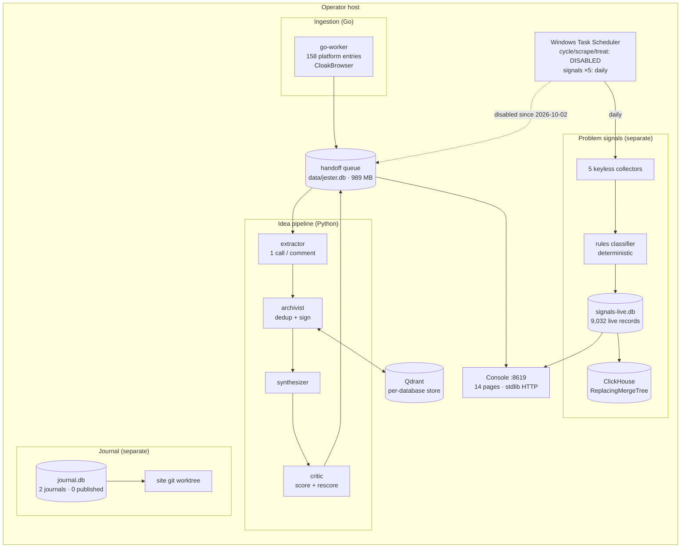
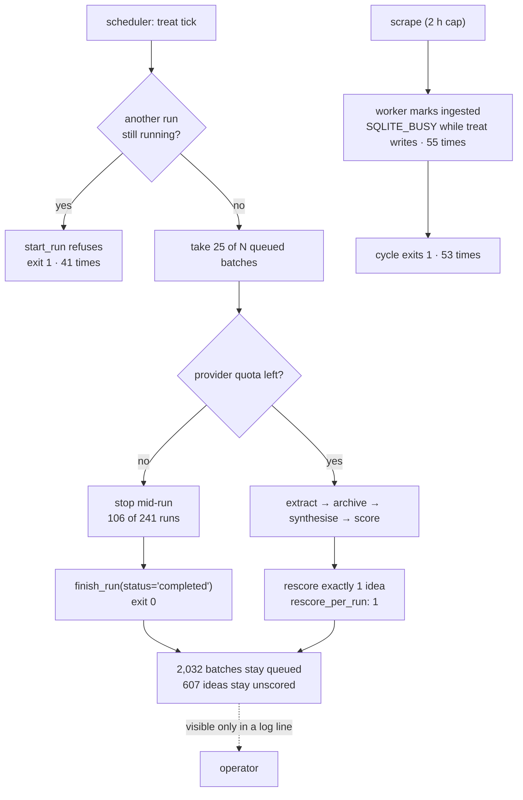
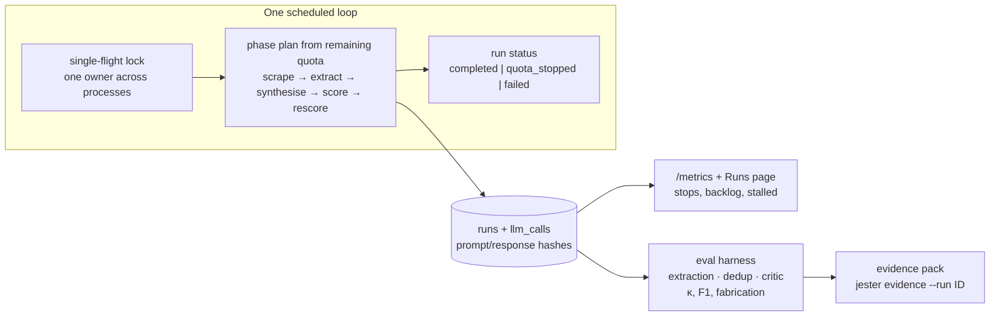

# Jester — Strategic Project Review and Next-Step Recommendations

> **Date:** 2026-10-31 · **Repository state:** `main` at `14bb5ba`, working tree clean, `main...origin/main` in sync · **Branch reviewed:** `main`
> **Scope:** repository reading at HEAD, fresh command evidence (Appendix A), and the operational state of the host this copy runs on.
> **Status of this document:** analysis and planning only. No application code was modified, no feature was implemented, no commit was created, no database content was changed, no production configuration was touched, and `data/jester.db` was not written to or queried. This document adds a new register (`S-*`); it does not rewrite the existing roadmaps, whose IDs keep their meanings.

---

## 0. How to read this document

Every claim carries one of these labels.

| Label | Meaning |
|---|---|
| **Observed** | Read directly from code, config, logs, scheduler state, or repository metadata at `14bb5ba`. The pointer is given. |
| **Measured** | Produced by a command run in this session; the command and output are in Appendix A. |
| **Documented** | Stated in a repo document and not independently re-verified here. |
| **Inferred** | My reading of observations; stated as inference, not fact. |
| **Hypothesis** | A testable guess, proposed with the experiment that would settle it. |
| **Recommendation** | Advice, with effort and an acceptance test. |

Nothing in this report is a score. The last independent critic score (8.9/10, 2026-10-29) is **not** treated as a current independent assessment of the code at HEAD, and this report does not issue a new one.

---

## 1. Executive summary

### 1.1 Verdict

Jester is no longer one system with uneven quality. It is **three products in one repository, in three different states**:

1. **The problem-signal collector is live and working.** **Observed:** five scheduled tasks are `Ready` with next runs on 2026-11-01 at 08:00–10:00; `data/signals-live.db` holds **9,032 `live` records** from **174 runs**, last written 2026-10-31T08:31Z; the fixture gate is 21/21 (**Measured**, Appendix A). The daily Reddit-hiring pass scored 895 archived posts, kept 114, and wrote 210 leads on 2026-10-31 (**Observed**, `data/schedule-leads-reddit.log`).
2. **The generative idea pipeline is stopped by configuration, not by a crash.** **Observed (this session):** `JesterNightly`, `JesterNightlyScrape` and `JesterNightlyTreat` are all `Disabled`, each with `Last Run Time` on 2026-10-02 and `Last Result: 0`. Nothing in the repository says this. The last export (2026-10-02) recorded 133,402 comments / 115,185 nuggets / 2,627 ideas, with **2,032 batches left queued** and, per the 2026-10-30 read-only re-measure, **607 of 2,627 ideas unscored**.
3. **The journal is the most rigorous machinery and the least used.** **Observed:** `data/journal.db` holds 2 journals, 7 experiments, 7 experiment runs, 12 checks, 5 snapshots, 2 approvals — and **0 publications, 0 channel metrics**. The gate that made `measured` reachable shipped in `ad52b87`; nobody has walked through it.

CI is green and honest about its environment (**Measured:** latest run at `14bb5ba`, success, 5m40s; full suite **1857 passed, 3 skipped, 13 deselected**, exit 0, 418.66s). That is a statement about build health, not production readiness: the service that matters most (the daily generative loop) is off, and the claim that justifies the project's existence has never been measured.

### 1.2 The answer to "what should I work on next?"

**Measure the extraction claim against the frozen archive, and make one unattended day complete before resuming the pipeline.**

In order:

1. **Declare and fix the operating state** (~2–3 days of code, plus two owner decisions). The tasks are disabled, but the code they run cannot survive an unattended day even if re-enabled: 106 of 241 logged `treat` runs hit a provider quota stop and still recorded `status="completed"` with exit 0; 41 `treat` ticks were refused because another run was in progress; 55 cycle ticks failed with `SQLITE_BUSY` from the Go worker; 9 ingests were killed at the 2-hour cap. See §4 and S-01–S-04.
2. **Build the extraction-quality baseline from the 115,185 archived nuggets** (~3–4 days of code, plus ~3 hours of your labelling). This is the single biggest *claim* improvement, and the pause makes it cheap: sampling and labelling need **no model calls and no quota**. See §5 and S-06.
3. **Sign the signals scope** (30 minutes, owner). It has been overdue since 2026-10-02 and blocks the only defensible version of the signal claim. See S-07.
4. **Drain the 607-idea backlog** once, after migrating the live database (30 minutes + quota), so the "scored ideas" population stops being a biased subset. See S-05.

What is **not** the next move: new console pages, god-module refactors, the React scaffold, threshold promotion, HNSW tuning, or a c-TF-IDF labeller. Each is real work; none of it changes what the project can prove this quarter.

### 1.3 Top five moves

| # | Move | Why now | Effort | Proof it worked |
|---|---|---|---|---|
| 1 | A run that stops on quota says so (`quota_stopped`), and the schedule cannot overlap itself | 106/241 runs truncated silently; 41 overlap refusals and 55 worker write failures in the logs | 2–3 d | Two concurrent ticks → one runs, one exits 0; a simulated TPD wall → run row + metric |
| 2 | Extraction baseline harness + 150-comment labelled sample | The central claim is unmeasured; the archive is frozen and free to sample | 3–4 d + 3 h | One command prints κ, P/R/F1, fabrication %, nuggets/comment; CI gate |
| 3 | Drain policy: rescore gets its own budget, not a leftover | `rescore_per_run: 1` and rescoring is skipped on quota-stopped runs | 1–2 d | 607 → 0 over a bounded number of runs with a fake critic |
| 4 | Scope sign-off | Overdue 29 days; unblocks the signal claim | 30 min | `signals scope` regenerates with APPROVED + date |
| 5 | Provenance of LLM calls (prompt/response hashes) | The pipeline records the machine, not the question it asked | 2 d | A run can name the exact prompt/response pair (by hash) behind an idea |

---

## 2. Verification of the work this review was asked to check

I did not take the attachment's premises on trust; I checked each referenced item at HEAD. **The premise that these are open findings is stale**, with one data-level exception.

| Referenced item | What I found at `14bb5ba` | Status |
|---|---|---|
| Batch N1–N7 | Commit `ad52b87` — *"journal + console: measure, output hashes, metrics, and a stale-schema gate"* — is in history. The code exists: `journal measure` (`cli.py:3164`), `experiment_run.output_sha256` (`python/jester/journal/__init__.py:205`), `/metrics` (`server.py:271`), schema preflight (`server.py:253-263`), and the contrast test suite | **Implemented and present** |
| `4d844b3` | *"docs: record the post-merge batch commit and its promotion"* | Present |
| `a71ea1f` | *"docs: do not claim an independent critic or that EX-G3 is closed"* | Present; the cycle's last independent score remains 8.9/10 (Documented) |
| P-H1 (`before_plan` display-only) | Closed by N6. **Observed:** `_before_plan` at `python/jester/journal/checks.py:202`; `_verify_run` refuses a pre-plan run at `:249`; `_block_runs` refuses it as a block at `:323` | **Resolved** |
| P-H3 (export does not re-hash figures) | Closed by N7. **Observed:** `artifact_problem` is applied to every registered figure at `python/jester/journal/publish.py:444` before the worktree is touched | **Resolved** |
| T-A4 (`SCORE_BACKLOG` + attempt counter) | **Observed:** `stalled_scores` and `rescore_pending` in `python/jester/agents/critic.py:150,163`; least-tried ordering at `:187`; increment on refusal and reset on success at `:197`; `SCORE_STALL_ATTEMPTS = 5` in `python/jester/ops.py:21`; column at `python/jester/store.py:114,284` | **Resolved** (flag was the partial part; the counter shipped 2026-10-30) |
| EX-G3 (607-idea re-score backlog) | **Mechanism resolved; data not.** The alarm, rotation and staleness bound exist. The live archive still has 607/2,627 `needs_score` and lacks `rescore_attempts`, because no Jester process has opened it since 2026-10-02 (the DB's mtime and the disabled tasks agree) | **Open at the data level only** |
| Assessment / master roadmap | `docs/plans/2026-10-29-project-assessment-and-master-roadmap.md`; statuses match the code except where this report says otherwise (§4) | Current, with one omission: the disabled schedule is not recorded |

**Two corrections to the attachment's framing.**

- **EX-G3 is not an unbuilt fix.** It is a migration-plus-drain task. No code is missing for it; the operator has not migrated.
- **The generative pipeline is not "idle because of quota".** It is **disabled** — an operator setting, not a failure mode (§4.1). The quota stops are what happened *while it was enabled*.

---

## 3. Architecture

### 3.1 Current shape



### 3.2 What is well built

- **Failure is data, not a log line.** The signals pipeline stores failed fetches as rows (`Observed`, README + `signal_run` fields `errors`, `ok`). This is the strongest design decision in the repository.
- **Deterministic stand-ins are signed and never archived as real** (`Observed`, README "Model jobs"; `python/jester/agents/*`). A missing model degrades the run without poisoning the archive.
- **The archive is separate from the acceptance path.** Rules classify; no model decides. That survives review in a way the generative side does not.
- **The journal's gates are real.** Citations, numbers, lint, origin, pre-plan refusals, figure re-hashing, output hashes (`Observed`, `python/jester/journal/`). This is the part of the project that would survive an external audit.
- **Provenance at the run level is unusually good for a solo project**: `runs.env`, `models_used`, prompt versions, and now per-run output hashes.

### 3.3 Structural debt that matters

| Debt | Observation | Why it matters |
|---|---|---|
| Three products, one repo, no declared boundary | Signals, journal and idea pipeline share a console and CLI but have separate databases and separate definitions of "done" | Strategy keeps getting written for the idea pipeline while the live product is signals |
| God modules | `cli.py` 4,303 lines · `console/api.py` 2,462 · `store.py` 1,776 (**Observed**) | Any change crosses a large blast radius; the previous cycle's split stalled |
| Console is hand-rolled HTTP | No framework, no CSRF/security headers, GETs unauthenticated (`python/jester/console/server.py:56-73,427-438`) | Fine for loopback; a liability the day it is exposed |
| Provenance is per-run, not per-call | `PROMPT_VERSIONS` at `python/jester/llm.py:46`; `runs` has `models_used` and `env`, no prompt or response | Cannot answer "what exactly was this idea extracted from, and with which instruction?" |
| The schedule lives outside the repo | `schtasks` registrations via `python/jester/schedule.py`; no versioned desired state | The most important operational fact — pipeline disabled — is invisible to `git` and to the docs |
| Dead configuration | `config/thresholds.yaml:219-223` `models:` block; every run warns `models.archivist: no code reads this model` (**Observed**, treat log) | Noise that trains the operator to ignore warnings |
| A React scaffold that is not the product | `frontend/` 9 source files; CI lints and builds it (**Observed**) | Small cost, persistent confusion; the ADR already says so |

---

## 4. Reliability and operations

This is the section where the evidence is most uncomfortable, and it is the reason B1 outranks everything except the baseline.

### 4.1 The generative pipeline is disabled, and nothing says so

**Observed (this session, `schtasks`):**

| Task | Status | Last run | Last result | Next run |
|---|---|---|---|---|
| `JesterNightly` (cycle) | **Disabled** | 2026-10-02 16:50 | 0 | — |
| `JesterNightlyScrape` | **Disabled** | 2026-10-02 16:35 | 0 | — |
| `JesterNightlyTreat` | **Disabled** | 2026-10-02 16:54 | 0 | — |
| `JesterNightlySignals` | Ready | daily | 0 | 2026-11-01 09:00 |
| `JesterNightlySignalsBrief` | Ready | daily | 0 | 2026-11-01 10:00 |
| `JesterNightlySignalsHiring` | Ready | daily | 0 | 2026-11-01 09:30 |
| `JesterNightlySignalsSweep` | Ready | daily | 0 | 2026-11-01 08:00 |
| `JesterNightlyLeadsReddit` | Ready | daily | 0 | 2026-11-01 09:45 |

The archive agrees: `data/jester.db` mtime is 2026-10-02 17:07 and is 989,761,536 bytes; every log for the generative loop ends on 2026-10-02; `journal.db` was last written 2026-10-02 17:53. **Inferred:** the pause was deliberate (a quota decision), and it has been in force for 29 days.

**Documented gap:** `README.md:36` still presents 35,118 batches / 98,890 nuggets / 1,468 ideas / 205 runs as "Numbers from the working archive, not a demo", and the roadmap's forward plan assumes the pipeline runs. A reader cannot tell the engine is off.

### 4.2 What the logs say about the last month of operation

Counts below are **Observed** from `data/schedule-cycle.log` (1.6 MB) and `data/schedule-treat.log` (268 KB), both ending 2026-10-02.

| Event | Count | Meaning |
|---|---:|---|
| Cycle starts | 345 | one every 30 minutes while enabled |
| Cycle exits 0 | 196 | |
| Cycle exits 1 | 53 | failed tick (most often the Go worker's write failure) |
| Cycle terminated externally | 2 | exit `0x40010004` (`DBG_TERMINATE_PROCESS`) |
| Cycle `SQLITE_BUSY` on `mark ingested` | **55** | the worker cannot write while the Python side holds the lock |
| Ingest killed at the 7,200 s cap | 9 | the scrape does not fit its budget |
| Stale runs reaped | 22 | crash recovery works, and is used often |
| `treat` starts | 241 | |
| `treat` exits 0 | 150 | |
| `treat` exits 1 | 67 | 41 of the invocations refused to start because another run was in progress |
| `treat` quota stop mid-run | **106 (44%)** | the normal operating mode on a free tier |
| Rate-limit events | 102 | |
| Runs with no exit line | 3 | killed mid-run |

The code already knows the overlap is structural — `python/jester/cli.py:320` says: *"Three schedules overlap on this machine … all three have been observed in the Running state at the same moment."* The fix then addressed a false abort (reaping with an age), not the contention itself.

**Where a day stops (Observed):**



### 4.3 The specific honesty defects

1. **A quota-truncated run is recorded as `completed`.** `python/jester/cli.py:858` calls `finish_run(..., status="completed", ...)` unconditionally; the quota stop is a printed sentence (`cli.py:279`). The `runs` table has a `status` column (`store.py:185`) that could carry `quota_stopped`, but never does. Exit code is 0 (observed: `jester treat exited 0` after "stopped: the provider's quota ran out mid-run").
2. **Rescoring is skipped exactly when the backlog grows.** `cli.py:810` runs `rescore_pending` only `if not stopped_on_quota and "critic" not in paused`. So a run that hits the wall — the only kind that leaves work behind — never drains it.
3. **The per-run drain is one idea.** `config/thresholds.yaml:165` `rescore_per_run: 1`. With 607 waiting and one scored per successful run, a month of successful runs cannot repair the backlog.
4. **A failed tick has no incomplete marker beyond its exit code.** Cycle exit 1 still exports CSVs (`cli.py:1284-1302`), which is right for data preservation, but nothing in the archive says the day was incomplete.
5. **The scheduler's own state is not in the repo.** `python/jester/schedule.py` installs tasks, but there is no checked-in declaration of what should be installed, so a disabled task is indistinguishable from a deleted one.

### 4.4 Why this is P0

The project's value depends on a daily loop. **Observed** (log counts above): 44% of treatment runs were quota-truncated, 28% of treatments exited non-zero, 15% of cycles exited non-zero, and 55 worker writes failed on lock contention. A system with those numbers is not ready to be pointed at a resumed archive, and resuming without fixing them just restarts the same pattern.

---

## 5. Evaluation and measurement

### 5.1 The three claims, as the repo defines them

| Claim | Machinery | Evidence today | Verdict |
|---|---|---|---|
| **Idea**: extracted nuggets and synthesised ideas are at least as good as the operator's own reading; critic scores track demand/feasibility rather than verbosity | Extractor → archivist → synthesizer → critic, with stand-ins signed | None on extraction or critique. `jester eval` checks **scoring arithmetic only**, over 20 hand-written pairs (**Observed**, `python/jester/cli_review.py`) | **Unmeasured** |
| **Signal**: the classifier finds buyers at a rate that justifies collection, with every verdict traceable to words | Rules classifier, per-record `match_reason`, fixture gate 21/21 | 9,032 live records; the fixture gate proves the rules match labelled fixtures, not that recall is acceptable; scope still provisional | **Unratified and unmeasured for recall** |
| **Journal**: every number/quote traces to a run or source, and the plan precedes the result | Gates, snapshots, experiments, output hashes, publication flow | 7 experiment runs, 12 checks, 5 snapshots — and **0 publications, 0 metrics** (**Observed**, `journal.db`) | **Built, never exercised end to end** |

### 5.2 What "measured" would have to mean

**Extraction (the missing foundation).**

- Sample from the frozen archive: 150 comments stratified by platform (Reddit/HN/Discourse at least), category, and length; fixed seed; committed sample file so the set is reproducible.
- Double-label 50 of them (same comment, two sittings at least a day apart, or two labellers) → **Cohen's κ**. The literature is unambiguous that percent agreement is not agreement with humans (Gilardi et al. 2023: 91–97% run-to-run consistency, 59–83% accuracy against human gold).
- Metrics: nugget-level **precision/recall/F1**, **fabrication rate** (a nugget asserting something the comment does not say), **nuggets per comment**, segment length, and the triviality-filter false-negative rate on a small pooled sample.
- Report **unchecked rates** beside every aggregate (how many nuggets had no human label).
- Gate: CI runs the harness against committed labels and fails if F1 or fabrication crosses a floor. Start advisory, promote once the labels are stable.

**Dedup.** The per-category sweep exists and its map ships empty (**Documented**, DD-M3). Do not promote thresholds from the seeded synthetic pairs. Add ~200 real pairs drawn from the archive, label them, and report the 0.87 operating point's precision/recall before any per-category value is enabled.

**Critic.** Blinded pairwise ranking of ~30 idea pairs, 3 raters if possible, **Spearman ≥ 0.7** against the operator's ranking (the existing acceptance in the 2026-10-25 roadmap). Report the **rate at which competition was unchecked**; `eval_gate` currently imputes a 5, which turns "unknown" into "average".

**Signals recall.** Draw 100 records classified `none` and review them; report the false-negative rate with a 95% CI (Buckley & Voorhees 2004: measures are not robust to gross incompleteness). This is the only honest way to state the signal claim.

### 5.3 Why the pause is an opportunity

The archive is frozen, which makes it a stable evaluation substrate. Sampling and labelling require **no model calls, no quota, and no running services**. The single strongest objection to the quality work — "it costs LLM budget" — does not apply while the pipeline is disabled. **Recommendation:** build the harness and label the sample *before* resuming, so the first resumed run is measured against a baseline rather than becoming the baseline.

---

## 6. Product and usability

- **The console is 14 pages** — Overview, Runs, Queue, Ideas, Posts, Nuggets, Clusters, Search, Chat, Problem signals, Sources, Config, Schedule, Doctor (`Observed`, `python/jester/console/static/app.js:249-267`). There is **no journal page**: `grep -c journal python/jester/console/api.py` returns 0 (**Observed**). The journal is a roughly 20-command CLI with gates, which contradicts the "single technical operator" design goal.
- **The Queue page would have shown the 2,032-batch backlog** and the Runs page the runs — the information was reachable, but nothing *pushed* it. The operator had to open the console or read a log.
- **The signals product is coherent and legible**: leads CSV (210 rows today), buyer/practitioner counts, discard reasons ("325 seller adverts, 105 questions, 264 naming no engineering work"), and an evidence export. It is the part of Jester a stranger could use.
- **The journal is usable but lonely**: 2 journals, 7 experiments, 0 publications. The publish gate is the project's best story and has never been told externally.
- **Documentation truth is drifting**: README says 940 Python tests / 285 Go test functions (**Observed**, `README.md:245`), while the suite holds **1,873** tests — 1,860 run (1857 passed, 3 skipped), 13 live tests deselected — across 125 files, with 297 Go test functions (**Measured**, Appendix A). README says 98,890 nuggets / 1,468 ideas; the last export says 115,185 / 2,627 (**Observed**, `data/schedule-treat.log`).
- **A documented command fails on the operator's own platform.** `scripts/smoke.sh` defaults to `python3` (`scripts/smoke.sh:15`); on Windows that name resolves to the Microsoft Store stub, and the script exits before running anything. With `PYTHON=python` it passes (**Measured**, Appendix A). CI never sees this because it runs Ubuntu.
- **Accessibility and JS testing debt** remain as recorded (`Documented`, G-09/G-11; no JS test runner, `frontend/package.json` has no `test` script — **Observed**).

---

## 7. Security

**Threat model as configured:** one operator, local-first, everything bound to loopback, no multi-user access. The realistic threats are (a) a malicious local process, (b) a malicious web page in the operator's browser targeting `localhost`, (c) accidental exposure through Docker port mapping, and (d) supply-chain drift.

### 7.1 What shipped and holds

- Loopback-only host mappings for Qdrant, Ollama, console, frontend, ClickHouse and CloakBrowser (**Observed**, `docker-compose.yml`).
- POST-only bearer token with `hmac.compare_digest` (`Observed`, `python/jester/console/server.py:56-73, 427-438`), `--read-only` returning 403, default bind `127.0.0.1`, and a warning only when binding `0.0.0.0` without a token.
- The token is in `.env`, which is gitignored (`Observed`, `.gitignore:97`).
- Digest-pinned images (C3) and a versioned Python base.

### 7.2 Residual risks

| Risk | Evidence | Severity | Note |
|---|---|---|---|
| ClickHouse defaults to password `jester` | `docker-compose.yml:237` | Low (loopback) / High if exposed | A default credential in a data store is a latent incident |
| Containers run as root | no `USER` in `docker/Dockerfile.python` or `docker/go.Dockerfile` | Medium | The earlier work order noted a shared-SQLite uid constraint; that is a real trade-off, to be resolved deliberately, not by inertia |
| GETs are unauthenticated even when a token is set | `server.py:51-54` comment | Low/Medium | Any local process or browser page can read the archive; loopback does not stop browsers |
| No security headers (CSP, `X-Frame-Options`, `nosniff`, `Referrer-Policy`) | no occurrences in `server.py` | Low | Cheap to add; matters if the console is ever framed or linked from the web |
| No rate limiting | none | Low (local) | Token guessing is not the threat; accidental loops are |
| Token is optional by default | `_is_authorized` returns True when `JESTER_CONSOLE_TOKEN` is empty | Medium | Correct for a laptop; wrong if the console is ever reachable from another device |
| No TLS | loopback | — | Fine until it isn't |

**Inferred browser nuance:** because the console requires a custom `Authorization` header on POSTs, a cross-origin page cannot trigger a state change *when a token is set* (preflight fails). With no token, a page can POST a simple request; the guard is then only loopback. This is another reason S-10 wants the token to be the default whenever the console is exposed at all, and a same-origin check on POSTs.

---

## 8. Performance and capacity (measured this session)

Numbers below were produced earlier in this session on this host. The suite and gate commands are in Appendix A; the benchmark timings come from the same session's measurements and are not in a committed artifact. They are not production SLA claims.

| Measurement | Value | Interpretation |
|---|---|---|
| Full Python suite | 1857 passed / 3 skipped / 13 deselected in **418.66 s** | Slow but stable; ~7 minutes is acceptable locally, borderline for a tight loop |
| Console startup | **~1.04–1.08 s** | Fine |
| `GET /api/config` | **~96 ms** | 6× other GETs; the handler reloads YAML per request (`api.py:1576`) |
| Other GETs | 14–17 ms | Fine |
| POST (small) | 13–16 ms | Fine |
| `signals export` (fixture) | ~1.1 s | Fine |
| Smoke run | ~1.56–1.74 s | Fine |
| `go build` | 25.8 s cold / 3.4 s warm | Fine |
| `go test ./...` | 64.5 s | Fine |
| Frontend lint / build | ~1.6 s / 1.6–2.4 s | Fine |
| Archive | 989 MB SQLite, 133,402 comments, 115,185 nuggets | SQLite is adequate; 23% of ideas unscored is the capacity problem, not the file size |

**Recommendation:** do not optimize. The only cheap win worth taking is caching the config YAML on mtime if the Config page feels slow. Capacity work should target **throughput per quota unit** (ideas per token), not milliseconds.

---

## 9. Prioritized register

Fields: **P** priority · **Evidence** labelled pointer · **Effort** S (<1 d) / M (1–3 d) / L (>3 d) · **Acceptance** the test that closes it.

### P0 — this week

| ID | P | Finding | Evidence | Impact | Recommendation | Effort | Acceptance |
|---|---|---|---|---|---|---|---|
| S-01 | P0 | Operating state is undeclared: the generative loop is disabled and the docs imply it runs | **Observed:** three tasks `Disabled` since 2026-10-02; `README.md:36`; logs end 2026-10-02 | Every plan, review and reader assumes a live engine | Record the state and date in README + roadmap; state the resume checklist; surface scheduler state in Doctor | XS | Docs say "paused since 2026-10-02"; Doctor shows the disabled tasks; no behavior change |
| S-02 | P0 | Quota-truncated runs record `completed` and exit 0 | **Observed:** `cli.py:858`; log "stopped: the provider's quota ran out" then `exited 0`; 106/241 runs | The durable record says success; no metric can count stalls | New terminal status `quota_stopped` (model + reset time), floor flag, `/metrics` counter, documented exit policy for `treat` (non-zero only when nothing progressed) | S | Fake-critic quota test sets status/metric/line; existing run tests unchanged; Runs page shows it |
| S-03 | P0 | Scheduled runs overlap and contend; worker writes fail | **Observed:** `cli.py:320` comment; 41 overlap refusals; 55 `SQLITE_BUSY`; 9 ingest kills; 22 stale reaps | Unattended days lose work and burn quota | One cross-process single-flight lock for cycle/scrape/treat; phase order scrape → extract → synthesise → score; overlap exits 0 like cycle; worker write retry/backoff; evaluate WAL (S-11) | M | Concurrent invocation test: second exits 0, no run row; held-lock test; a mock "day" from the real scheduler passes |
| S-04 | P0 | The score backlog cannot drain | **Observed:** `thresholds.yaml:165`; `cli.py:810`; 607/2,627 (Documented re-measure) | 23% of ideas unscored; every "scored ideas" aggregate is biased | Rescore pass gets its own budget and is not skipped when synthesis hit quota; cap per run from remaining budget; keep attempt cap + stall alarm | M | 607 → 0 monotonically over bounded runs with a fake critic; per-run budget never exceeded; stalled ideas stop retrying |
| S-05 | P0 | Live DB un-migrated; new rotation code is inert | **Observed:** DB mtime 2026-10-02; code adds column on open; roadmap records absence | The fix exists but cannot act | Operator: back up, `jester migrate`, then `jester rescore --pending --limit N` inside quota windows | XS | `rescore_attempts` present; `needs_score` falls; `/metrics` stalled gauge answers |
| S-06 | P0 | Extraction quality — the central claim — is unmeasured | **Observed:** `cli_review.py` = scoring arithmetic only; `eval/` holds two 15-line prompt files and no extraction labels; 115,185 archived nuggets | All downstream numbers rest on unvalidated input | Harness + stratified 150-comment sample + 50 double-labelled (κ); P/R/F1, fabrication, nuggets/comment; committed labels; CI gate | L (M code + 3 h owner) | One command prints the report; hand-computed fixture test; CI floor; numbers published with sample design |
| S-07 | P0 | Scope sign-off overdue since 2026-10-02 | **Observed:** `config/signal_rules.yaml:49-55`; `docs/scope-and-access.md:4` | The signal claim cannot be stated; buyer-data publication unratified | Owner decides approve-as-is / amend / withdraw; set `status`, `decided_by`, `decided_on`; regenerate `signals scope` | XS | Scope doc says APPROVED with a date; fixture gate unchanged |

### P1 — next two weeks

| ID | P | Finding | Evidence | Impact | Recommendation | Effort | Acceptance |
|---|---|---|---|---|---|---|---|
| S-08 | P1 | LLM calls leave no prompt/response record | **Observed:** `llm.py:46` versions only; `runs` has `models_used`/`env` | Cannot show what instruction produced an idea; cannot prove a rerun asked the same question | `llm_calls` table: role, model, `prompt_sha256`, `response_sha256`, tokens, latency, fallback/retry; opt-in full text; retention bound | M | Stand-in test writes a row per call; a run can list its calls; hashes stable across reruns of the same prompt |
| S-09 | P1 | No evidence pack for the idea pipeline | **Observed:** `signals evidence` and the journal Evidence section exist; `grep journal console/api.py` returns nothing, and the idea pipeline has no equivalent | The project's central claim stops at the console | `jester evidence --run ID` writes run row, models, env, call hashes, ideas, nuggets, source URLs, and a README explaining each file | M | One command produces a folder; `journal`-style link integrity test; README example |
| S-10 | P1 | Read-side auth, headers, and browser exposure are unspecified | **Observed:** GETs open; no CSP/XFO/nosniff; token optional | One shared-machine or LAN exposure turns the archive into a readable file | Token covers GETs when set (or `--read-auth`); headers on every response; same-origin POST check; document the browser threat | S | Tests for 401 on GET with token, headers present, cross-origin POST refused; docs updated |
| S-11 | P1 | WAL remains opt-in without a recorded decision (G-13) | **Observed:** `store.py:38-40`; 989 MB DB; console + pipeline concurrency | Lock contention is a measured failure mode (S-03) | Measure read/write contention in both modes on the actual volume; flip default if no regression; document the Docker-volume constraint if it stays | S | Benchmark table committed; default decided with evidence; restart/recovery test |
| S-12 | P1 | 13 live tests never run in CI | **Observed:** `python/pytest.ini`; no live lane in `ci.yml` | Integration drift is invisible until an operator hits it | Nightly/dispatch workflow with Ollama + Qdrant services, one small local model, run `-m live_ollama` subset | M | Workflow exists, passes, and is linked from README; a deliberate drift fails it |
| S-13 | P1 | Dead `models:` block warns on every run | **Observed:** `thresholds.yaml:219-223`; treat log line | Warning fatigue | Remove the block or make it read again; keep `jester models` output identical | XS | Warning gone; `jester models` tests pass |

### P2 — this month

| ID | P | Finding | Evidence | Impact | Recommendation | Effort | Acceptance |
|---|---|---|---|---|---|---|---|
| S-14 | P2 | Critic is uncalibrated; unchecked competition is imputed | **Documented:** roadmap P2-3; `eval_gate` imputes 5 | The scorer may reward verbosity (Zheng 2023; Sharma 2024) | Blinded pairwise, 30 pairs, 3 raters, Spearman ≥ 0.7; report unchecked rate; anchor the 1–10 scale | M + human | Report with CI; eval prints unchecked rate; rubric anchored in code comments/tests |
| S-15 | P2 | Signals recall unmeasured | **Observed:** 21 fixture cases; no recall figure | The signal claim rests on fixtures | 100-record `none` sample, human review, 95% CI | M | Recall estimate with CI in `docs/`; sample file committed |
| S-16 | P2 | No Windows CI despite Windows development | **Observed:** ubuntu-only `ci.yml`; ACL/temp issues met during this project's development | The operator's platform is the untested one | `windows-latest` job running store/journal/console subsets | S | Required check green on Windows |
| S-17 | P2 | Documentation truth drift, and a documented command fails on Windows | **Observed:** README 940 tests / 98,890 nuggets / 1,468 ideas vs 1,873 / 115,185 / 2,627; `scripts/smoke.sh:15` defaults to `python3` (Store stub on Windows) | Readers cannot trust numbers; the quickstart's own command fails locally | Generate counts (or date them); fix stale claims; make the script pick an interpreter that exists (`PYTHON`, else `python3`/`python`); align roadmap statuses | XS | No stale counts; `bash scripts/smoke.sh` passes on Windows without an env var; a test or script produces the numbers |
| S-18 | P2 | W3 leftovers: batch cap and model digest | **Documented:** 2026-10-25 work order; `extractor_batch_size` admits up to 50 | Config admits settings the literature does not support (degradation at b=6) | Cap at 5, reject 6; add model digest to role records and `agent.digest` | S | `batch=6` rejected, `5` accepted; digest present/fake/None/cached; `jester models` unchanged |
| S-19 | P2 | No releases or changelog | **Observed:** 0 tags, no `CHANGELOG`, 9 Dependabot branches | No stable point to resume from; dependency drift unmanaged | Tag `v0.1` at HEAD; CHANGELOG with the three pipelines' state; triage Dependabot | S | Tag exists; CHANGELOG accurate; ≤2 open Dependabot PRs |
| S-20 | P2 | The desired schedule is not in the repo | **Observed:** `schedule.py` installs tasks; no declarative file | A disabled task is invisible to review | Check in `config/schedule.yaml` (task, command, cadence, enabled); `jester schedule apply` reads it; Doctor diffs live vs desired | M | `schedule apply` is idempotent; Doctor shows drift; test with a fake schtasks wrapper |

### P3 — later

| ID | P | Finding | Recommendation | Effort |
|---|---|---|---|---|
| S-21 | P3 | No journal surface in the console (G-08) | Read-only journal page: journals, versions, gate results, blockers, publications, metrics | L |
| S-22 | P3 | No JS tests or browser smoke (G-09/W4) | Add a runner + Playwright smoke gated by `JESTER_UI_SMOKE=1` | M |
| S-23 | P3 | God modules | Split after S-06/S-09 stabilize the seams; start with `cli.py` command groups | L |
| S-24 | P3 | React scaffold is dead weight | Execute the existing ADR: delete or schedule the port with a date | S |

---

## 10. Proposed next batches

Batches are ordered, test-first, and each ends at a gate. No batch changes an application threshold, schema, or production config without a migration test.

**Target state this sequence builds:**



### B1 — "A day that completes" (S-01, S-02, S-03, S-04, S-05, S-07, S-13)

**Goal:** if the operator enables the three tasks tonight, tomorrow's run is one run, it ends with an honest status, and the backlog shrinks.

**Why now:** this is the precondition for resuming, and it is the cheapest work in the register.

**Test-first list (write these red, then implement):**

- `test_run_status_quota_stopped` — a fake critic that raises the quota stop sets `runs.status='quota_stopped'`, records the model and reset time, and prints the existing human line.
- `test_metrics_counts_quota_stops` — `/metrics` exposes `jester_runs_quota_stopped_total`.
- `test_overlapping_tick_stands_down_without_a_run_row` — two `treat` invocations, the second exits 0 and writes no row.
- `test_worker_write_retries_a_busy_database` — a held write lock for < timeout → the mark succeeds after retry.
- `test_rescore_runs_when_synthesis_stopped_on_quota` — a run that hit the wall still scores its budget of waiting ideas.
- `test_rescore_respects_its_budget_and_attempt_cap` — no run exceeds N; stalled ideas are skipped.
- `test_backlog_drains_monotonically` — 607 fake waiting ideas, 20 runs, count never rises and reaches 0 under a large budget.
- `test_schedule_apply_is_idempotent` (if S-20 lands here) — applying twice installs once.

**Acceptance (commands):** the seven tests above pass; full suite green; a mock "day" (`cycle` + `treat` under a fake provider) runs end to end twice with no overlap failures; `/metrics` shows the new counter.

**Owner gates inside B1:** S-01 declaration (10 min), S-05 migration + drain (30 min + quota), S-07 scope sign-off (30 min).

**DoD:** no data/jester.db write in tests; no schema change without `_ADD_COLUMNS` + legacy-DB test; docs updated; orchestrator-run vs reviewed stated.

### B2 — "Measure the claim" (S-06, plus the S-15 sample design)

**Goal:** a number for extraction quality, produced from the frozen archive, reproducible from committed files.

**Why now:** the archive is static and free to sample; the pause makes this the cheapest possible time.

**Test-first list:**

- `test_sample_is_deterministic_and_stratified` — same seed → same 150 ids; strata counts match the spec.
- `test_kappa_perfect_and_chance_agreement` — hand-computed κ = 1.0 and κ = 0.0 fixtures.
- `test_fabrication_counts_unmatched_assertions` — labelled fixtures with planted fabrications.
- `test_report_prints_unchecked_rates` — a partially labelled sample reports the gap.
- `test_nugget_cap_invariant` — the config cap (S-18) holds in the pipeline's own output on fixtures.
- `test_ci_gate_fails_below_floor` — a synthetic low-F1 label set fails the gate.

**Acceptance (one command, output pasted into `docs/reports/`):** `python -m jester.cli eval extract --labels eval/extraction/labels.jsonl` prints n, κ, precision, recall, F1, fabrication %, nuggets/comment, unchecked rate, with the sample seed.

**Owner work:** 150 labels, 50 of them twice (or a second labeller), ~3 hours over two sittings.

**DoD:** labels committed; sample committed; report published with the sample design and limitations; CI gate advisory for the first two weeks, then required; no threshold change based on the first sample.

### B3 — "Trust the reads" (S-08, S-09, S-10, S-11, S-20)

**Goal:** a reader can go from an idea to the exact prompt, response hash, run, machine, and source; the console cannot leak the archive by accident.

**Test-first list:** call-row written per LLM call; hashes stable; retention bounds; evidence folder link integrity; GET 401 with token; headers present; cross-origin POST refused; WAL benchmark harness; `schedule apply` idempotence.

**Acceptance:** `jester evidence --run <id>` produces a folder whose README a stranger can follow; `curl -I` shows the headers; two concurrent ticks still behave; WAL decision recorded with numbers.

### B4 — "Live credibility" (S-12, S-14, S-15, S-16)

**Goal:** the parts that only run against real services are tested, and the two remaining quality claims (critic, recall) have numbers.

**Acceptance:** nightly live lane green; critic Spearman report; recall estimate with CI; Windows job required.

### B5 — "Truth and polish" (S-17, S-18, S-19, S-21)

**Goal:** the repository tells the truth about itself and an operator can run the journal without a CLI cheat sheet.

**Acceptance:** README counts generated; no dead config; `v0.1` tagged; journal page read-only and gate-aware.

---

## 11. Two-week plan

```mermaid
gantt
  dateFormat  YYYY-MM-DD
  title Two weeks from 2026-10-31
  section Decisions
  Operating state declared (S-01)        :d1, 2026-10-31, 1d
  Scope sign-off (S-07)                   :d2, 2026-10-31, 1d
  section B1
  Tests then status/lock/drain            :b1, 2026-11-01, 3d
  Operator migrate + drain (S-05)         :b1o, 2026-11-03, 1d
  section B2
  Harness + sample                        :b2, 2026-11-04, 3d
  Owner labels 150 comments (3h)          :b2l, 2026-11-06, 2d
  Report + CI gate                         :b2r, 2026-11-09, 1d
  section B3
  Call provenance + evidence + headers    :b3, 2026-11-10, 3d
  section B4
  Live lane + calibration start           :b4, 2026-11-13, 2d
```

| Day | Work | Gate at end of day |
|---|---|---|
| 0 (Sat 31 Oct) | Declare state; sign scope; choose whether to resume | Two documents updated; one config field decided |
| 1–3 (1–3 Nov) | B1 tests red, then status, lock, drain budget | Seven new tests; a mock day completes twice |
| 4 (4 Nov) | Operator: backup, migrate, drain 100 | `needs_score` falls; column present |
| 5–7 (5–7 Nov) | B2 harness + sample + fixture tests | Harness passes on hand-computed fixtures |
| 6–7 (6–7 Nov) | Owner labels (2 × 90 min) | 150 labels, 50 doubled |
| 8 (8 Nov) | B2 report + CI gate | Published report with κ and F1 |
| 9–11 (9–11 Nov) | B3 provenance, evidence folder, headers | Evidence folder a stranger can read |
| 12 (12 Nov) | Resume decision, armed with the baseline | Written go/no-go with numbers |
| 13–14 (13–14 Nov) | B4 live lane start; review of the cycle | Nightly lane green; findings list |

**Resume rule:** enable the three tasks only after B1's gate and the S-05 drain. Resume with the quota-aware budget from S-04, not the old cadence.

---

## 12. Long-term direction (3–6 months)

1. **Make the three claims publishable.** One number per claim, with its sample design, CI, and limitations. That is the difference between a project that says it works and one that can be checked. After B2 the idea claim has a baseline; after B4 the critic and recall claims do; the journal claim needs one real publication with 7- and 30-day metrics.
2. **Then improve quality where the measurement points.** Batching only if the baseline shows the single-comment call is the cost/quality bottleneck (the literature suggests b ≤ 5, and degradation at 6). Per-category dedup only after labelled pairs. HNSW tuning only at corpus scale. No threshold moves before the measurement.
3. **Make the operator loop legible.** Scheduler state in the repo, journal in the console, evidence folders for both pipelines, one health page that says "the engine is off" rather than leaving it to a log.
4. **Publish the journal.** It is the repository's most defensible work: proof-checked citations, pre-registered plans, run fingerprints, output hashes. One published piece with an Evidence section is worth more than any further plumbing.
5. **Keep the signal collector's discipline as the template.** Deterministic, failure-as-data, matched-word provenance, fixture gate. The generative side should borrow it deliberately.

**Do not undertake yet:** new sources at scale, chat autonomy, a frontend rewrite, model-role expansion, a c-TF-IDF labeller, HNSW parameters, or per-category threshold promotion. Each needs either labels or corpus scale that do not exist yet.

---

## 13. Research references

These are the sources the previous assessment recorded, with the decision each supports. They are **Documented**, not re-fetched for this report; that assessment noted publisher full texts returned 403, so findings rest on abstracts. Every quality result below comes from GPT-3.5/4- or Claude-class models — nothing validates `qwen3:8b`, `llama3.1:8b` or `phi4-mini` until S-06 measures them.

| Source | Decision it supports |
|---|---|
| Gilardi, Alizadeh & Kubli, PNAS 2023, [10.1073/pnas.2305016120](https://doi.org/10.1073/pnas.2305016120) | Report κ against human labels; never percent agreement (91–97% run-to-run vs 59–83% accuracy) |
| Boettinger, Bürgel & Bartsch, Quality & Quantity 2026, [10.1007/s11135-026-03036-x](https://doi.org/10.1007/s11135-026-03036-x) | Cap nuggets/comment and segment length; measure false negatives, not only false positives |
| Zheng et al., NeurIPS 2023, [arXiv:2306.05685](https://arxiv.org/abs/2306.05685) | 1–10 grading is defensible if anchored; position bias and verbosity attack are real |
| Sharma et al., ICLR 2024, [arXiv:2310.13548](https://arxiv.org/abs/2310.13548) | Demand evidence, not just a score; sycophancy can make a verbose wrong idea win |
| Cheng, Kasai & Yu, EMNLP Industry 2023, [10.18653/v1/2023.emnlp-industry.74](https://doi.org/10.18653/v1/2023.emnlp-industry.74) | Cap `extractor_batch_size` at 5 (degradation at 6) |
| Chen, Zaharia & Zou, 2023, [arXiv:2307.09009](https://arxiv.org/abs/2307.09009) | Hosted models drift; record a snapshot date/model digest |
| Biderman et al., 2024, [arXiv:2405.14782](https://arxiv.org/abs/2405.14782) | Prompt, revision, seeds and harness must be recorded — the per-call provenance in S-08 |
| Stodden, Seiler & Ma, PNAS 2018, [10.1073/pnas.1708290115](https://doi.org/10.1073/pnas.1708290115) | Capture at run time, never post hoc |
| Raff, 2019, [10.48550/arXiv.1909.06674](https://arxiv.org/abs/1909.06674) | A commit fingerprint is necessary, not sufficient |
| Mitchell et al., FAT* 2019, [10.1145/3287560.3287596](https://doi.org/10.1145/3287560.3287596) | Record model version, intended use, metrics, eval conditions |
| Steck, Ekanadham & Kallus, WWW 2024, [10.1145/3589335.3651526](https://doi.org/10.1145/3589335.3651526) | 0.87/0.92 are operating points, not properties — label and sweep |
| Buckley & Voorhees, SIGIR 2004, [10.1145/1008992.1009000](https://doi.org/10.1145/1008992.1009000) | Recall must come from sampling with CIs (S-15) |
| Malkov & Yashunin, [arXiv:1603.09320](https://arxiv.org/abs/1603.09320); Aumüller et al., [arXiv:1807.05614](https://arxiv.org/abs/1807.05614) | Measure index parameters; do not inherit them |
| W3C PROV, [overview](https://www.w3.org/TR/prov-overview/) | Export relations, skip RDF; Jester's records already match the shape |
| Kidwell et al., PLoS Biology 2016, [10.1371/journal.pbio.1002456](https://doi.org/10.1371/journal.pbio.1002456) | Gates move behaviour (3% → 23%): the journal's gate design is justified |
| Baethge & Jergas, 2025, [10.1186/s41073-025-00173-z](https://doi.org/10.1186/s41073-025-00173-z) | 1-in-6 human quotation error is the baseline the citation gate beats |
| Wadden et al., EMNLP 2020, [10.18653/v1/2020.emnlp-main.609](https://doi.org/10.18653/v1/2020.emnlp-main.609) | Verification = label + rationale span; `[91.2%](run:12#accuracy)` is that idea |
| Thelwall et al., PLoS ONE 2013, [10.1371/journal.pone.0064841](https://doi.org/10.1371/journal.pone.0064841) | First-party metrics + link clicks, not social counts |

---

## 14. Assumptions, open questions, limitations

### 14.1 Assumptions (revisable)

- One operator; no external users of the console; local-first deployment.
- The Groq free tier (TPD 200,000) is the binding budget. The last treat run stopped at **199,774 used**.
- The owner is the only labeller available for S-06.
- The signals scope decision will land before any buyer data is published.
- Windows remains the development and operating host.

### 14.2 Questions for the owner

1. **Was disabling the generative pipeline deliberate?** The scheduler state and logs say yes; nothing records it. Either way, S-01 should be written down.
2. **When should it resume, and with what budget?** If free-tier only, the quota-aware budget in S-04 is mandatory; if a paid tier is possible, state it.
3. **Scope: approve the free sources as-is, buy Reddit access, or withdraw?** Due 2026-10-02; 15 buyer signals in the archive currently come from Reddit hiring rooms scored from the worker's archive and are flagged "set apart pending access".
4. **Will you label 150 comments (~3 hours)?** This is the only human input S-06 requires.
5. **Is the journal meant to publish this quarter?** There are 0 publications and 0 metrics; the proof machinery is ready.
6. **Will the console ever be reachable from another device?** If yes, S-10 moves to P0.

### 14.3 What I did not do (and why)

- Did not modify code, tests, config, or databases; did not commit; `data/jester.db` was neither written nor queried.
- Did not run Docker this session, so the loopback/token behavior is taken from the earlier verification in the previous session and from `docker-compose.yml`, not re-verified now.
- Did not run a browser or a live model; no UI claims beyond file reading.
- Did not re-audit accessibility or JS test coverage; those remain as documented (G-09/G-11).
- Did not fetch the research papers; references are as recorded by the prior assessment.
- Did not issue an independent score. **All verification in this report is orchestrator-run.** A second-party review of this document has not happened.
- Did not treat the attachment's premises as true. Where they are stale (EX-G3 mechanism, P-H1, P-H3, T-A4), §2 says so.

### 14.4 Relationship to existing documents

This report adds the `S-*` register and does not supersede `docs/plans/2026-10-29-project-assessment-and-master-roadmap.md`, `docs/roadmap/2026-10-25-project-assessment.md`, or the work order. Existing IDs keep their meanings. Two differences are stated explicitly: EX-G3 is data-level open only, and the disabled schedule is recorded here for the first time.

---

## 15. Implementation status — session of 2026-10-31

This section records what happened after the plan above was executed test-first, on branch `feature/next-development-batches` based on `14bb5ba` (uncommitted at the time of writing). **Implemented** means code and tests exist and the named suite passes. **Owner-gated** means the code side is ready but the remaining step needs the owner's archive, signature, labels, or judgement. **Authored, not run** means the file exists and was checked locally, but the external runner has not executed it. **Not attempted** means no work was done.

| ID | Status | What exists now | Remaining |
|---|---|---|---|
| S-01 | Implemented | README states the pause and its date; Doctor prints disabled tasks as notes; `test_doctor.py`/`test_b1_reliability.py` cover it | — |
| S-02 | Implemented | `quota_stopped` terminal status with model and reset time, `/metrics` counter, documented exit policy; `test_b1_reliability.py::test_run_status_quota_stopped` | — |
| S-03 | Implemented | Atomic single-flight `start_run`; overlapping tick stands down with exit 0 and no run row; busy writes retry; `test_b1_reliability.py` overlap/refusal/retry tests | — |
| S-04 | Implemented | Rescore has its own budget and runs after a quota stop; attempt cap and stall alarm retained; `test_b1_reliability.py::test_rescore_*`, `test_backlog_drains_monotonically` | — |
| S-05 | Owner-gated | Migration and drain code exists and is tested on temp DBs | Backup, `jester migrate`, and `jester rescore --pending` on `data/jester.db`; this session did not touch that file |
| S-06 | Harness implemented; labels owner-gated | `extraction_eval.py` (deterministic stratified sample, κ, P/R/F1, fabrication, unchecked rate), `eval/extraction/README.md`, `test_extraction_eval.py`; `eval extract` explains labelling and exits 0 with no labels | Draw `sample.jsonl` (reads the live archive) and supply ~150 labels (50 doubled); publish the report |
| S-07 | Owner-gated | `signals scope` and the fixture gate are ready | Owner decision in `config/signal_rules.yaml` (`status`, `decided_by`, `decided_on`) |
| S-08 | Implemented | `llm_calls` table with role, model, prompt/response hashes, tokens, latency, opt-in text, retention bound; `test_llm_calls.py` | — |
| S-09 | Implemented | `jester evidence --run ID` writes run/calls/ideas/nuggets/sources/citations/integrity JSON plus a README; read-only open (`migrate=False`); `test_evidence.py` | — |
| S-10 | Implemented | Token covers GETs when set, security headers on every response, same-origin POST check; `docs/console-security.md`; console tests | — |
| S-11 | Measured, decision recorded | Harness `wal_bench.py`, three rounds in `docs/reports/2026-10-31-wal-benchmark.md`; rollback journal stays the default, WAL documented as opt-in on local disk; recovery test in `test_wal_bench.py` | Revisit only if the measured conditions for flipping change |
| S-12 | Authored, not run | `.github/workflows/live.yml` (nightly + dispatch, local Ollama and Qdrant, small model) | First green run on GitHub; a deliberate-drift check |
| S-13 | Implemented | Dead `models:` block removed; `test_shipped_thresholds_have_no_unread_keys` | — |
| S-14 | Not attempted | — | Human ratings: 30 blinded pairs, 3 raters, Spearman report |
| S-15 | Not attempted | — | 100-record recall sample, human review, 95% CI |
| S-16 | Authored, locally verified | `windows-latest` job in `ci.yml` running the platform-sensitive subset; that subset passes locally on Windows | First green run on GitHub; make it a required check |
| S-17 | Implemented | `scripts/counts.py`; README counts dated with the command that produces them; `smoke.sh` and the other scripts probe for a working interpreter; this section aligns roadmap statuses | — |
| S-18 | Implemented | `extractor_batch_size` capped at 5 (6 rejected); role and agent digests; `test_config.py`, `test_roles.py` | — |
| S-19 | Owner-gated | — | Tag `v0.1`, CHANGELOG, Dependabot triage |
| S-20 | Implemented | `config/schedule.yaml` (8 tasks, `enabled:false` as pause); `schedule apply` idempotent and reinstalls on scope/launcher drift; Doctor reports drift; fake `schtasks` tests in `test_schedule_apply.py` | — |
| S-21–S-24 | Not attempted | — | P3 work, as the register says |

**Not done anywhere in this session until §15.2:** any write to `data/jester.db`; committing or pushing; running the live lane or the Windows GitHub job; owner decisions (S-05, S-07, S-14, S-15, S-19).

### 15.1 Verification of this session's work (orchestrator-run)

| Command | Result |
|---|---|
| `python -m pytest python/tests -q` | **1922 passed, 3 skipped, 13 deselected, 41 warnings in 473.23 s**, exit 0 |
| `bash scripts/smoke.sh` (no `PYTHON` set) | **SMOKE PASS**, exit 0 |
| `go build ./...` | exit 0 |
| `go test -count=1 -p 1 ./...` | exit 0, every package `ok` |
| `python -m jester.cli eval` | **eval OK: 20 cases passed (gate=7.0)**, exit 0 |
| `python -m jester.cli signals check` | **21/21 case(s) passed**, exit 0 |
| `python -m jester.cli schedule apply --dry-run` | 5 unchanged, **3 would be reinstalled** (cadence drift on this machine); nothing applied |
| `python -m jester.cli evidence --run smoke-20261031T105916 …` | pack written; 1 idea, 2 nuggets, 1 source; **citation integrity: PASS** |
| `python scripts/counts.py --no-archive` | **1925 Python tests, 299 Go test functions** |

Two environmental facts from these runs. First, the initial full-suite attempt ran alongside an unrelated `go build ./...`; the linker died with `runtime: cannot allocate memory`, the suite slowed from ~473 s to 601 s, and one e2e test (`test_pipeline_seed_treat_list_console_agree`) failed without its traceback being captured. That test passed alone in 5.86 s and in the clean rerun above, so the failure is attributed to host memory pressure, not to a code change — but it is recorded here rather than hidden. Second, `go test -count=1 ./...` (parallel package linking) reproduced the memory failure; `-p 1` completed every package. Neither run is evidence about the code's correctness beyond what the serial green run shows.

**Review status:** the implementation was checked by one independent read-only review (general-purpose subagent; the specialized reviewer agent could not start on this host). Its findings led to four fixes, each with a test: the WAL live-archive guard resolves paths from the repository root, not the working directory; `evidence` opens the archive read-only and reports an absent `llm_calls` table as a note instead of creating it; schedule apply and Doctor notice a launcher whose scrape scope was edited by hand; and a malformed `JESTER_LLM_CALLS_KEEP_DAYS` falls back to the default instead of failing the run. Everything else in §15 is orchestrator-run.

### 15.2 Merge to `main`, and the failure the merged tip caught

The seven commits were fast-forwarded onto `main`; `fix/sonar-js-promises` was merged for its Appendix E record; the merged tip was re-run instead of trusting the branch run. That rerun failed one test: `test_console_server.py::test_a_cross_origin_post_is_refused` (1 failed, 1921 passed). The server logged the 403 and meant it, but on Windows the client read `ConnectionAbortedError`. A refused POST is answered before its body is parsed, so the handler closed the socket with unread bytes in it — Winsock sends a reset instead of a FIN, and the reset discards the response already on the wire. Measured at 1 failure in 30 runs with the shipped two-byte body.

Fixed in `console/server.py`: every refusal path (cross-origin, read-only, unauthorized, schema) sends its answer, then drains the declared body, bounded to 1 MiB and 0.5 s, so the close is graceful. A regression test sends a 768 KiB body over a raw socket, waits for the close to land, then reads the response; it failed 5 of 5 runs before the fix and passed 10 of 10 after. The original test passed 30 of 30. Full suite at the fixed tip: **1923 passed, 3 skipped, 13 deselected, exit 0**; `bash scripts/smoke.sh` **SMOKE PASS**; `scripts/counts.py --no-archive` **1926 Python tests, 299 Go test functions**.

The merge also leaves remote branches that were not part of "every local branch": `feat/yu-01-reddit-signals` has no pull request and its content is already on `main` (the collector, digest, ClickHouse queries and their tests all exist there), and the Dependabot branches are dependency proposals rather than merged work. Neither set was deleted.

---

## Appendix A — Commands run and outputs (2026-10-31, HEAD `14bb5ba`)

| Command | Result |
|---|---|
| `git rev-parse HEAD` | `14bb5ba3482e4a07f083bb0c901072c19e533e51` |
| `git status --porcelain` | empty (clean) |
| `python -m pytest python/tests -q` | **1857 passed, 3 skipped, 13 deselected, 41 warnings in 418.66 s** (exit 0) |
| `python -m pytest python/tests -q --collect-only` | **1860/1873 tests collected (13 deselected) in 11.64 s** |
| `python -m jester.cli eval` | **eval OK: 20 cases passed (gate=7.0)**, exit 0 (re-run at 2026-10-31, this session) |
| `python -m jester.cli signals check` | **21/21 case(s) passed**, categories ambiguous/edits/failures/irrelevant/relevant, exit 0 (re-run this session) |
| `PYTHON=python bash scripts/smoke.sh` | **SMOKE PASS**, exit 0 (re-run this session; without `PYTHON=python` the script reaches the Windows Store `python3` alias and fails — see S-17) |
| Targeted cross-workstream suites | 93 passed in 52.53 s (earlier in this session) |
| `gh run list` at `14bb5ba` | success, 5m40s (2026-10-31T08:47Z); prior runs 7m32s and 5m56s, success |
| `schtasks /query /fo LIST` | `JesterNightly`, `JesterNightlyScrape`, `JesterNightlyTreat` = **Disabled**, last run 2026-10-02; five signals tasks = **Ready**, next 2026-11-01 08:00–10:00 |
| Log counts (`data/schedule-*.log`) | 345 cycle starts / 196 exit 0 / 53 exit 1 / 2 terminated; 241 treat starts / 150 exit 0 / 67 exit 1 / 3 no exit line; 41 overlap refusals; 106 quota stops; 102 rate-limit events; 55 `SQLITE_BUSY`; 9 ingest kills; 22 stale reaps |
| Read-only SQLite (`mode=ro`) | `signals-live.db`: 9,032 records, all `mode=live`, 174 runs; `journal.db`: 2 journals, 7 experiments, 7 runs, 12 checks, 5 snapshots, 0 publications, 0 metrics |
| File sizes | `data/jester.db` 989,761,536 B (mtime 2026-10-02 17:07); `data/signals-live.db` 13,275,136 B (2026-10-31 09:45); `data/journal.db` 102,400 B (2026-10-02 17:53) |

**Not run:** Docker Compose, live models, browser UI, the Go suite (its last green run is recorded by CI at `14bb5ba`), and any write to `data/jester.db`.

## Appendix B — File and line index used in this report

- `python/jester/cli.py:279` quota-stop sentence · `:320` overlap comment · `:810` rescore skipped on quota · `:858` `status="completed"` · `:1244` `cmd_cycle` · `:1267-1272` skip exits 0 · `:1476-1497` treat blocked short-circuit
- `python/jester/store.py:38-40` journal mode · `:114,284` `rescore_attempts` · `:183-215` runs table · `:1425-1440` concurrent-run refusal · `:1614-1637` run summary/finish
- `python/jester/agents/critic.py` `stalled_scores`, `rescore_pending`, attempt increment/reset · `python/jester/ops.py:21` `SCORE_STALL_ATTEMPTS`
- `python/jester/console/server.py:56-73` token · `:253-263` schema 503 · `:271` `/metrics` · `:427-438` POST guards · `:590+` access log
- `python/jester/console/api.py:389` `ideas(limit=0)` · `:1576` per-request config load · `:2190` schedule status
- `python/jester/console/static/app.js:249-267` the 14 pages
- `python/jester/llm.py:46` `PROMPT_VERSIONS` · `python/jester/cli_review.py` eval gate scope
- `config/thresholds.yaml:165` `rescore_per_run` · `:219-223` dead `models:` block · `config/signal_rules.yaml:49-55` scope fields
- `python/jester/schedule.py:23,378-385` task names · `python/pytest.ini` live-test deselection
- `docker-compose.yml:237` ClickHouse default password · `docker/Dockerfile.python`, `docker/go.Dockerfile` no `USER`
- `README.md:36,245` stale archive/test numbers · `docs/scope-and-access.md:4` PROVISIONAL · `.gitignore:97` `.env`
