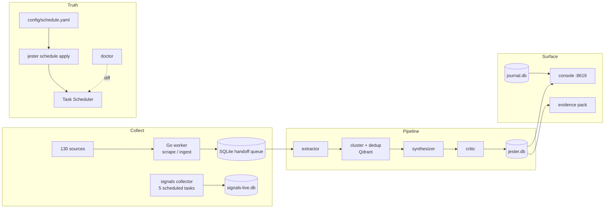
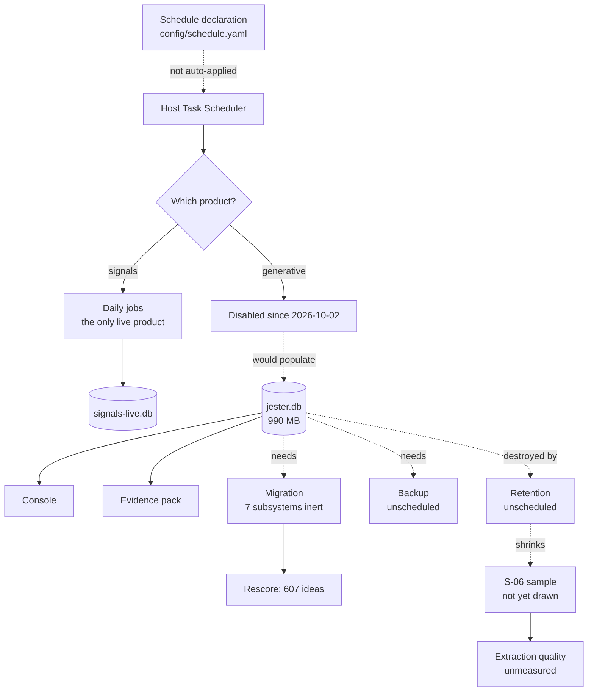
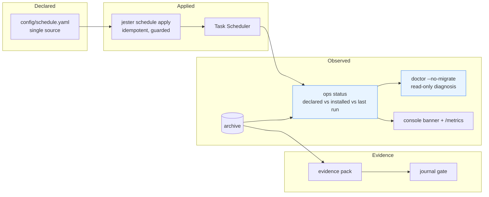
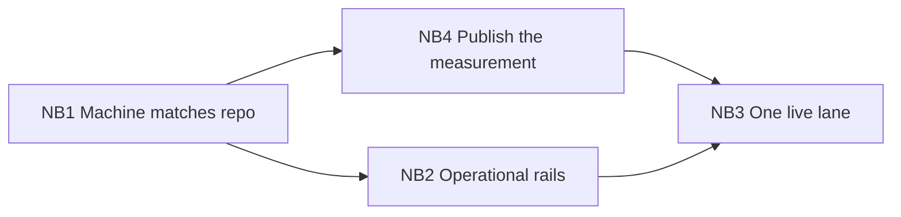

# Jester — Strategic Review and Next Development Cycle (v2)

**Date:** 2026-11-01
**HEAD reviewed:** `36d357b` (`main` = `origin/main`; CI run 41199594390 = success)
**Previous review:** [`2026-10-31-next-development-strategy.md`](2026-10-31-next-development-strategy.md) at `14bb5ba`
**Nature of this document:** analysis and planning. No application code, configuration, commit or production database was modified in producing it.

---

## 0. How to read this document

Every claim carries one of these labels:

| Label | Meaning |
|---|---|
| **[Observed]** | Read directly from code, the filesystem, the host scheduler, or the read-only archive in this session. |
| **[Measured]** | Produced by a command run in this session; the command and its output are in Appendix A. |
| **[Documented]** | Stated by a document or comment; I did not independently confirm it. |
| **[Hypothesis]** | My inference from observations; not established by a test. |
| **[Recommendation]** | A proposal. It has not been implemented. |

Two reporting rules from earlier sessions remain in force and are honoured here:

- **Orchestrator vs independent.** Every test and gate result in this report was run by me (the orchestrating agent) in this session. There was **no independent human or second-agent review** of these results. Where I say "verified", it means "I ran it and read the output", not "someone else confirmed it".
- **The live archive was not touched.** `data/jester.db` was opened read-only (`file:...?mode=ro`). It remains at mtime `2026-10-02 17:07:59`, size `989,761,536` bytes, before and after this session. `data/signals-live.db`, `data/journal.db` and `data/chat.db` were also opened read-only.

---

## 1. Executive summary

### 1.1 Verdict

The engineering is no longer the bottleneck. At `36d357b` the repository has a green Linux and Windows CI, a green full suite, a working smoke path, a measured WAL decision, read-side security, provenance tables, an evidence-pack command, a declarative scheduler and an extraction-quality harness. That is a real, visible step up from the state reviewed on 2026-10-31 [Measured: Appendix A].

What has **not** moved is the distance between *what the repository says* and *what the operator's machine actually is*. On the live box:

- seven shipped subsystems have no tables and therefore no effect: `llm_calls`, `extraction_specs`, `edit_log`, `proposals`, `maintenance_events`, the `rescore_attempts` column, and `quota_stopped` run rows [Observed: §4.5];
- the score backlog is still 607 of 2,627 ideas [Observed];
- the declared schedule and the installed schedule disagree on a **live, enabled** task — the signals sweep [Observed: §4.2];
- the documented 30-day retention policy has never run: 113,672 of 115,199 nuggets are past the cutoff [Observed: §4.3];
- the newest backup predates the archive's final writes [Observed: §4.4];
- the live CI lane has never executed [Observed: §4.6];
- `main` has no branch protection [Observed: §4.6].

The system is, in other words, **green in CI and stale on the machine**. That gap is now the highest-value thing to close — more valuable than any new feature, and cheaper than almost any feature.

### 1.2 The answer to "what should I work on next?"

> **Make the declarations true on the live machine — in an order that protects the evidence — and fix the two small pieces of code that hide the truth while you do it.**

Concretely, that is Batch NB1 (§10.1): back up and verify, migrate the archive, drain the score backlog in bounded quota windows, reconcile `config/schedule.yaml` with the code's own intent, make `jester schedule status` print the `enabled` state it already computes, and only then schedule retention and backups.

One ordering hazard makes this urgent rather than routine: **retention destroys the extraction-evaluation substrate.** `retention_sweep` NULLs `raw_text` on nuggets older than 30 days (`python/jester/store.py:1809`), and `sample_from_db` draws only from nuggets with non-empty `raw_text` (`python/jester/extraction_eval.py:89`). Run retention before the S-06 sample is drawn and the 150-comment sample becomes a sample of the ~1,527 newest nuggets only, not of the archive. The two batches have a hard ordering dependency (§10, §14.2 Q1).

### 1.3 Top five moves

1. **NB1 — Make the machine match the repo** (P0): backup, migrate, drain scores, reconcile schedule, fix status output. Cheap, reversible, unlocks seven inert subsystems.
2. **Draw the S-06 sample before retention** (P0, owner ~20 min to draw, ~3 h to label): the measurement that justifies the whole extraction claim is currently un-sampled [Observed: `eval/extraction/` contains only `README.md`].
3. **Reconcile the sweep cadence** (P0, config-only): the YAML says daily, the code argues weekly, the host is weekly. Today `jester schedule apply` would quietly turn a ~300-request weekly sweep into daily work.
4. **Put the operational rails on** (P1): branch protection with required checks, coverage floor, dependabot triage, and one real `live.yml` dispatch.
5. **Publish one dated status index** (P1): five generations of register (roadmap §1.5/§4, strategy §9, §15…) now overlap; a single `docs/STATUS.md` pointing at the authoritative row per item ends the drift.

---

## 2. Verified current-state assessment

### 2.1 The items this review was asked to check

The brief names Batch N1–N7, commits `ad52b87`, `4d844b3`, `a71ea1f`, issues **EX-G3**, **P-H1**, **P-H3**, and the **T-A4 attempt-counter** work. Each was checked against code and the roadmap, not against a claim in a report.

| Item | Status at `36d357b` | Evidence |
|---|---|---|
| N1–N7 batches | **Resolved / superseded** | Roadmap §5 lists all seven complete; `git log` shows the batch; a later cycle (S-01…S-20) touched the same files. |
| `ad52b87` | **Exists, landed before HEAD** | "journal + console: measure, output hashes, metrics, and a stale-schema gate" (2026-10-30). |
| `4d844b3` | **Exists, docs-only** | "docs: record the post-merge batch commit and its promotion". No code claim to verify. |
| `a71ea1f` | **Exists, docs-only, and corrects an overclaim** | "docs: do not claim an independent critic or that EX-G3 is closed". Good precedent: the repo policed its own wording. |
| **EX-G3** (607-idea backlog) | **Mechanism resolved; live backlog unchanged at 607/2,627** | `rescore_attempts` column (`store.py:120,312`), least-tried rotation, `SCORE_STALL_ATTEMPTS = 5` (`ops.py:21`); but the live archive predates the column [Observed]. |
| **P-H1** (`before_plan` display-only) | **Resolved** | `journal/checks.py:202-210,249,323`; `test_a_before_plan_run_cannot_back_a_number` (`test_journal_checks.py:294`) passes in this session's suite. |
| **P-H3** (export does not re-hash figures) | **Resolved** | `journal/publish.py:444` runs `artifact_problem` over every figure; `test_export_refuses_a_figure_edited_after_it_was_made` (`test_journal_publish.py:248`) passes. |
| **T-A4 attempt counter** | **Resolved in code** | `store.py:120,312,1322`; counter reset on success and on `mark_needs_score`; stalled count surfaced in the run line, maintenance and `/metrics`. Not exercised on the live archive because it has not migrated. |

**Discrepancy explained:** the brief's premise that these are open is correct for the *data* — the live archive is still un-migrated and still holds 607 unscored ideas. It is not correct for the *code*: every mechanism named has shipped and is covered by tests that pass at HEAD. The distinction matters because the fix for the remaining problem is an operator action (NB1), not development work.

### 2.2 Classification of every item in the current register

Using the seven categories the brief defines. Items are the S-01…S-24 register from the previous review plus the operational findings of this one.

| Item | Category | Basis |
|---|---|---|
| S-01 pause declared in README + Doctor notes | **Implemented and verified** | README "Operating state"; Doctor prints three disabled tasks [Measured]. |
| S-02 `quota_stopped` status, flag, metric | **Implemented and verified (in code/tests)** | `cli.py:853-908`; `ops.py` flag; `/metrics` counter; covered by `test_b1_reliability.py`. Never produced on the live archive because it is paused. |
| S-03 single-flight + atomic `start_run` + busy retry | **Implemented and verified** | `store.py:1453` (`BEGIN IMMEDIATE`), `ConcurrentRunError` at `store.py:53`; tests pass. |
| S-04 rescore budget independent of synthesis quota | **Implemented and verified (in code)** | `cli.py:828-842`; rescore runs after a quota stop; tests pass. Live backlog unchanged — see S-05. |
| S-05 live-DB migration | **Not done — owner-gated** | Seven tables/columns absent from `data/jester.db` [Observed: §4.5]. |
| S-06 extraction-quality harness | **Partially implemented** | Code, tests and CLI exist; `eval/extraction/` holds only `README.md` — no sample, no labels. `eval extract` correctly exits 0 with instructions [Measured]. |
| S-07 scope sign-off | **Not done — owner-gated** | `config/signal_rules.yaml:49-51` still `status: provisional`, empty `decided_by/decided_on`. |
| S-08 `llm_calls` provenance | **Implemented and verified (in tests); inert on live archive** | Table absent from `data/jester.db` [Observed]. |
| S-09 `jester evidence --run ID` | **Implemented and verified** | Code + tests; read-only open (`migrate=False`). Producing a pack for an old live run would print "llm_calls table absent" — by design. |
| S-10 read auth, headers, same-origin POST | **Implemented and verified** | `console/server.py:76-79,103,371,547`; console tests pass. |
| S-11 WAL measured, rollback retained | **Implemented and verified** | `docs/reports/2026-10-31-wal-benchmark.md`; decision recorded; recovery test passes. |
| S-12 live CI lane | **Authored, never run** | `gh run list -w live.yml` returns `[]` [Observed]. 13 `live_*` tests deselected in every run to date. |
| S-13 dead `models:` block | **Implemented and verified** | `test_shipped_thresholds_have_no_unread_keys` passes. |
| S-16 Windows CI | **Implemented and verified** | Job exists; HEAD CI green; covers 15 of 133 test files by design. |
| S-17 counts + smoke interpreter | **Implemented and verified** | `scripts/counts.py --no-archive` prints 1,926 / 299, matching README [Measured]; `bash scripts/smoke.sh` passes with `PYTHON` set [Measured]. |
| S-19 tag / changelog | **Not done** | 0 tags, no `CHANGELOG`; 7 open Dependabot PRs [Observed]. |
| S-20 declarative schedule + apply | **Implemented; verification found drift and one hidden state** | `schedule apply --dry-run` reports 3 tasks would change; Doctor notes 4 drifts [Measured]. See ND-02/ND-03. |
| S-21 journal page in console | **Not done** | — |
| S-22 JS tests / browser smoke | **Not done** | `frontend` lint+build only. |
| S-23 god modules | **Deferred intentionally** | `cli.py` 4,470 lines, `console/api.py` 2,465, `store.py` 1,819 [Observed]. |
| S-24 React scaffold decision | **Deferred intentionally (ADR exists)** | `docs/adr/0001-frontend-strategy.md`. |
| **New:** `schedule status` hides `enabled`/`running` | **Broken (reporting)** | `cli.py:1631-1663` prints only installed/cadence/next-run; `status()` computes `enabled` (`schedule.py:586`) and it is dropped [Observed]. |
| **New:** YAML sweep cadence contradicts code intent | **Broken (configuration truth)** | YAML `config/schedule.yaml:54-56` says daily 08:00; `schedule.py:776-780` argues weekly; host is weekly SUN [Observed]. |
| **New:** retention documented, never scheduled or run | **Gap (operational)** | No retention entry in `config/schedule.yaml` or Task Scheduler; `retention_sweep` called only from `cmd_retention` (`cli.py:962`) [Observed]. |
| **New:** no scheduled backup | **Gap (operational)** | Newest `data/backups/jester-20261002T134028Z.db.gz` (225 MB) predates the DB's last write by ~3.5 h; `data/jester-corrupt-20260828T105353Z.db` records an earlier integrity event [Observed]. |
| **New:** `jester doctor` mutates the archive | **Design defect** | `cli.py:2157` calls `open_db(args.db)` with `migrate=True`; `store.py:580-588` documents that a normal open reshapes the schema [Observed]. |
| Brief items N1–N7, `ad52b87`, `4d844b3`, `a71ea1f`, EX-G3, P-H1, P-H3, T-A4 | **No longer relevant as written** | Superseded; see §2.1. |

### 2.3 What the classification implies

- Nothing in the code is regressed relative to the previous review; the suite passes, CI is green, and the specific mechanisms the brief lists are present.
- The failures are of two kinds: **un-run owner actions** (S-05, S-06, S-07) and **un-scheduled operations** (retention, backup, live lane). Neither is fixed by more code.
- Two small reporting defects (ND-02, ND-03) make the machine look healthier or more consistent than it is. They are cheap to fix and should ride along with NB1.

Headline gate results (full table and commands in §4.1 and Appendix A): Python 1,922 passed / 1 environmental failure; Go build and serial tests green; frontend lint 0/0 and build green; `eval` 20/20; `signals check` 21/21; smoke PASS; counts match the README.

---

## 3. Architecture and engineering assessment

### 3.1 Architectural boundaries and current shape



Three products share one repository and one operator:

1. **Generative idea pipeline** — paused since 2026-10-02; 2,627 ideas, 607 unscored.
2. **Problem-signal collector** — live daily; 174 recorded runs, last scheduled run 2026-10-31T08:31Z.
3. **Proof-gated journal** — 2 journals, **0 publications** [Observed: `data/journal.db`].

The sharing is defensible: they share sources, store, auth and ops tooling. What is missing is a **single operational truth surface** — one place that says, per product, what is declared, what is installed, what last ran, and what is currently inert. Today that answer requires reading a roadmap, two strategy reports, Task Scheduler, and four SQLite files.

### 3.2 Dependencies and bottlenecks



The bottlenecks, in dependency order:

1. **Migration** gates five subsystems and the 607-idea backlog.
2. **Backup** must precede migration, and nothing schedules it.
3. **Sample drawing** must precede retention; retention is unscheduled and irreversible for the substrate.
4. **Schedule application** is the only path from declaration to runtime, and it is not run automatically — while one declaration is wrong.
5. **Live integration** gates any claim that the stack works, and it has never run.

### 3.3 What is well built

- **The honesty machinery is real.** `quota_stopped`, floor flags, `NOT archived`/`NOT scored` run lines, provenance hashes, the evidence pack's citation-integrity check, and the `before_plan` gate all encode "do not let a plausible output pass as a verified one". This is the project's distinguishing engineering asset.
- **Failure modes are refused, not imputed.** `robots.txt` failing closed (`specs.py:_robots_disallows`), `allocate` returning None rather than raising a cap, `gate_failures` treating an absent metric as a failure, `unchecked` being counted rather than guessed.
- **The migration guard is explicit.** `SCHEMA_VERSION` plus `_ADD_COLUMNS`; `migrate=False` exists and the console uses it.
- **Tests target the quiet failures** (duplicate import, dropped fetch, fixture-as-live, `FINAL` missing, fixture category disappearing), which is the right bias.

### 3.4 Structural debt, and where abstraction would actually pay

1. **Implicit migration is a trap for diagnostics.** `open_db` migrates by default (`store.py:580`). `cmd_doctor` therefore *changes the archive it is diagnosing* (`cli.py:2157`). This session deliberately ran Doctor against a throwaway DB for that reason. A diagnostic that writes is not a diagnostic; it also means "has the live archive been migrated?" can no longer be answered by running diagnosis.
2. **Declarations that are not the runtime.** `config/schedule.yaml` is a declaration; the host is the runtime; nothing applies it automatically, and one entry (the sweep) contradicts the code's own written rationale. Configuration that is never applied is documentation with a misleading name.
3. **Seven inert subsystems on the live archive.** `llm_calls`, `extraction_specs`, `edit_log`, `proposals`, `maintenance_events`, `rescore_attempts`, `quota_stopped`. Each has tests, a doc, and zero production effect. That is not wrong — it is *pending* — but the pending queue is invisible unless someone reads this report.
4. **God modules.** `cli.py` 4,470 lines, `console/api.py` 2,465. Deferred with cause, but the longer the pause, the more the new subsystems (specs, edits, maintenance, chat) get bolted onto `cli.py` rather than beside it.
5. **Register sprawl.** Roadmap §1.5/§4, strategy §9, strategy §15, CHANGELOG-absent, and now this report. Five places to ask "is S-06 done?" with four different answers.

Abstraction would pay in exactly one place now: **one `ops-status` surface** that reads the declaration, asks the host, reads the archive, and prints one table. That is NB1 plus ND-10, not a framework.

### 3.5 Proposed architectural improvements



Three changes, each small:

1. **Read-only diagnostics.** `doctor --no-migrate` becomes the default for inspection; migration is its own explicit step.
2. **A single status surface.** Declared (YAML), installed (host), last run (archive), and inert (schema) in one printed table, backed by JSON for tests.
3. **Apply only what is declared.** A cadence change to an enabled task requires `--force`; the sweep's declaration is corrected to its intended weekly cadence.

### 3.6 Performance and capacity (measured this session)

| Measure | Value | Context |
|---|---|---|
| Python suite wall time | **434.65 s** for 1,923 tests | Serial, one process, Windows, warm caches |
| Go suite wall time | ~3 s per package, serial `-p 1` | No memory refusals this session |
| Frontend build | 266 ms, 18 modules | 220.33 kB JS / 68.92 kB gzip |
| Archive size | 989,761,536 B (~944 MiB) | Single SQLite file; newest verified backup 225 MB gz |
| Nuggets / ideas | 115,199 / 2,627 | 113,672 nuggets past the 30-day cutoff |
| Signals runs recorded | 174 (125 scheduled) | Last scheduled run 2026-10-31T08:31:06Z |
| WAL benchmark (previous session, not re-run) | 3.1–3.6× commits, 40–70× reads on local disk | Rollback remains default; decision recorded |

No new benchmark was invented or extrapolated in this report. The WAL numbers are cited from `docs/reports/2026-10-31-wal-benchmark.md` and were **not** re-measured today.

---

## 4. Reliability and verification assessment

### 4.1 Gates at HEAD, run this session

| Gate | Result | Note |
|---|---|---|
| `python -m pytest python/tests -q` | **1,922 passed, 3 skipped, 13 deselected, 1 failed in 434.65 s** | The failure is environmental; see §4.1.1. |
| The one failed test, rerun with a temp root outside the repo | **1 passed** | Confirms environmental cause. |
| `go build ./...` | exit 0 | Go 1.26.7. |
| `go test -count=1 -p 1 ./...` | all packages `ok` | Serial, per the standing rule on memory pressure. |
| `npm run lint` (frontend) | 0 warnings, 0 errors | oxlint. |
| `npm run build` (frontend) | success, 18 modules, 220.33 kB JS | tsc -b + vite. |
| `python -m jester.cli eval` | `eval OK: 20 cases passed (gate=7.0)` | Scoring arithmetic only. |
| `python -m jester.cli eval extract` | exit 0, "no labels yet" | Substrate absent; see §5.2. |
| `python -m jester.cli signals check` | **21/21 cases passed** | Fixture gate. |
| `bash scripts/smoke.sh` | **SMOKE PASS** | Three gates: run summary with duration, non-trivial nugget, scored idea with intact citations. |
| `python scripts/counts.py --no-archive` | 1,926 tests / 299 Go test functions | Matches README. |
| `python -m jester.cli schedule apply --dry-run` | exit 0; **3 tasks would change** | See §4.2. |
| `python -m jester.cli doctor --db <temp>` | exit 1; 4 drift notes + Qdrant refused | Qdrant down is environmental; drift notes are real. |
| GitHub CI at `36d357b` | **success** (run 41199594390) | Confirmed via `gh`. |

#### 4.1.1 The single failure, and why it is not a code defect

`test_journal_lab.py::test_code_state_dirty_and_not_a_repo` asserts that a fresh directory is "not a git repository". My first rerun placed pytest's temp root inside the checkout (`.qoder-logs/tmp`), and `git -C <dir> rev-parse HEAD` correctly walks up to the Jester repository (`journal/lab.py:128-130`). The test then finds a commit and no `note` key.

Rerunning the same test with `TMP` outside the repository passes. The test is correct; my temp-root choice was not. This is worth recording because it is the *same class* of environment sensitivity that the Windows CI job exists to catch — and the operator will hit it any time a temp dir lives under the repo.

Separately, the first attempt at the full suite aborted with 1,926 `PermissionError` errors on `C:\Users\...\Temp\pytest-of-mano9` — an ACL problem on the machine's temp root, not a test failure. The suite was rerun with a writable temp root.

### 4.2 Schedule: declared, installed, and the difference

Installed at review time (Task Scheduler, read directly) [Observed]:

| Task | Installed | Declared (`config/schedule.yaml`) | Verdict |
|---|---|---|---|
| `JesterNightly` | Disabled, every 30 min | `enabled: false`, every 30 | Matches (pause applied) |
| `JesterNightlyScrape` | Disabled, hourly, with `only`/`max_posts` | `enabled: false`, hourly, no options | Launcher options drift; no live effect |
| `JesterNightlyTreat` | Disabled, every **15** min | `enabled: false`, every **30** | Cadence drift; no live effect |
| `JesterNightlySignals` | **Enabled**, 09:00 daily | Enabled, 09:00 | Matches |
| `JesterNightlySignalsHiring` | **Enabled**, 09:30 | Enabled, 09:30 | Matches |
| `JesterNightlyLeadsReddit` | **Enabled**, 09:45 | Enabled, 09:45 | Matches |
| `JesterNightlySignalsBrief` | **Enabled**, 10:00 | Enabled, 10:00 | Matches |
| `JesterNightlySignalsSweep` | **Enabled, weekly SUN 08:00** | **Enabled, daily 08:00** | **Live contradiction** |

The sweep is not a cosmetic difference. Its command reads Himalayas to the end of results for ten terms at `--limit 3000` (`schedule.py:472-481`), which the code comment justifies as deliberately not-daily: *"~300 requests: well inside the 600/day budget, but not something to do daily to a board whose data refreshes once a day"* (`schedule.py:776-780`). The declaration says daily anyway. **Running `jester schedule apply` today would convert a deliberate weekly sweep into a daily one** — on a live, enabled task. That is the sharpest operational trap found in this review.

**Second defect: the status line hides the state it knows.** `status()` returns `enabled` and `running` (`schedule.py:586`), with a comment explaining that "registered is not the same as live". But `cmd_schedule` never prints either field (`cli.py:1631-1663`). Observed output for the Disabled `JesterNightly`:

```
scrape job INSTALLED via schtasks — every 30 minutes, next run N/A
```

This is the exact failure mode the `status()` docstring claims to have fixed, still present one layer up.

### 4.3 Retention is policy, not practice

- `docs/data-retention.md` documents a 30-day TTL for nugget `raw_text`, completed ingest batches, listing free text, and export directories.
- `retention_sweep` (`store.py:1802-1810`) implements it and is called only by `cmd_retention` (`cli.py:962`) — a manual command and a console button.
- **No retention task exists** in `config/schedule.yaml` or in Task Scheduler [Observed].
- Today **113,672 of 115,199 nuggets** are older than the 30-day cutoff (2026-10-02), and all of them still carry `raw_text` [Observed].

So the archive is ~40 days past its own stated policy for 98.7% of its rows, and the data-minimisation claim in the docs is currently untrue of the machine. This is a credibility problem before it is a storage problem (the DB is 990 MB).

**The ordering hazard.** `retention_sweep` NULLs `raw_text`; `sample_from_db` selects only rows `WHERE raw_text IS NOT NULL AND raw_text != ''` (`extraction_eval.py:89`). If retention runs first, the S-06 sample can only be drawn from the 1,527 newest nuggets. The extraction-quality measurement would then describe the recent tail, not the archive — quietly and permanently. **Draw the sample before scheduling retention.** This is the single most important sequencing constraint in this plan.

### 4.4 Backup: exists, but not on a schedule and not newest

- `data/backups/` holds four snapshots; the newest is `jester-20261002T134028Z.db.gz` (225 MB, 2026-10-02 13:40 UTC).
- The live DB's last write is 2026-10-02 17:07 local — **~3.5 h after the newest backup**. The snapshot is therefore older than the archive it would restore.
- `jester backup --verify` exists and is tested, but nothing schedules it.
- A file named `data/jester-corrupt-20260828T105353Z.db` sits in `data/`, recording a past integrity event. For a single 990 MB SQLite file that is the load-bearing artefact of three products, "no scheduled, verified backup" is the largest single point of loss in the system.

### 4.5 Migration: seven subsystems inert

`data/jester.db` lacks these tables/columns: `llm_calls`, `extraction_specs`, `edit_log`, `proposals`, `maintenance_events`, `signal_rules` (rules live in config), and `ideas.rescore_attempts` [Observed]. Consequences on the live archive today:

| Subsystem | Code status | Live effect |
|---|---|---|
| S-08 provenance | shipped, tested | none — no calls recorded for any historical run |
| S-09 evidence pack | shipped, tested | works, but `calls.json` will be empty with a "table absent" note |
| S-06 extraction harness | code shipped | could draw a sample, but no labels exist |
| Edits/proposals (chat writes) | shipped, tested | none |
| Maintenance events | shipped, tested | none |
| Rescore rotation/attempt cap | shipped, tested | `rescore` cannot select/rotate; backlog frozen at 607 |
| `quota_stopped` history | shipped, tested | no run has ever recorded it (paused before it shipped) |

`jester migrate` is a deliberate, one-line command; `jester backup --verify` precedes it safely. The work is operator time and a backup window, not engineering.

### 4.6 CI gates that do not gate

- **No branch protection on `main`** (GitHub API: `Branch not protected`, 404) [Observed]. Required checks are advisory.
- **Coverage is collected but never gated** — no `fail-under` anywhere in `ci.yml`, `pytest.ini` or `pyproject.toml` [Observed].
- **`pip-audit` is `continue-on-error: true`** by design (F-08 triage pending).
- **`live.yml` has never run** (0 runs) [Observed]; 13 `live_*` tests are deselected in every run to date.
- **Windows CI covers 15 of 133 test files**, deliberately, and both of its defects found on the first run were genuine Windows-only issues — evidence the subset is well chosen, not evidence of coverage.

### 4.7 Reliability assessment

The failure *handling* is strong: single-flight, atomic `start_run`, quota settlement, stand-down exit 0, `NOT archived`/`NOT scored` lines, evidence-pack integrity. The failure *visibility* is weaker: a disabled task prints as INSTALLED; a diagnostic silently migrates; a declared cadence that is not applied looks like configuration; a retention policy with no scheduler looks like a policy; a backup without a schedule looks like a backup. Every one of these is a *reporting* gap, and reporting gaps are the cheapest class of defect to eliminate.

---

## 5. Evaluation and measurement assessment

### 5.1 What is measured, and how well

| Claim | Instrument | State |
|---|---|---|
| Scoring arithmetic | `eval` on committed good/bad pairs | **Green**: 20 cases, gate 7.0 [Measured] |
| Signal classification | 21 fixture cases | **Green**: 21/21 [Measured] |
| Extraction quality | `extraction_eval.py` (κ, P/R/F1, fabrication, unchecked, nuggets/comment) | **Harness green; substrate absent** [Observed] |
| Pipeline health end-to-end | `scripts/smoke.sh` | **Green** [Measured] |
| Run truthfulness | `quota_stopped`, floor flags | **Green in tests; never exercised live** |
| Critic calibration | none | **Absent** |
| Signals recall | none | **Absent** (fixtures are precision-shaped) |
| Citation integrity | evidence pack `integrity.json` | **Green in tests; not run against a live run** (no calls table) |

### 5.2 Why the extraction number is the one that matters now

Every downstream aggregate — "2,627 ideas", "607 unscored", "115,199 nuggets" — rests on the assumption that extraction does not fabricate. That assumption is currently **unmeasured** on this archive. The harness is good: deterministic seed (`20261031`), stratification by platform × category × length, κ over 50 double-labelled rows, fabrication and unchecked rates reported with denominators, and floors (F1 ≥ 0.70, fabrication ≤ 5%, nuggets/comment ≤ 1.2) that treat an absent metric as failure.

What it lacks is the sample and the labels — an owner gate of roughly three hours, zero model calls, zero quota. It is the highest-information, lowest-cost measurement available to this project, and it is the only one that can turn "the archive is interesting" into "the archive is trustworthy at this measured rate".

### 5.3 The critique the brief invites

The project's measurement culture is stronger than its measurement *coverage*. It has built excellent instruments for the questions it anticipated (scoring arithmetic, signal fixtures, smoke) and has not yet answered the question its own claim depends on (does extraction invent insights?). A reviewer should say this plainly: the harness without labels is a promise, not a measurement, and the report should never cite extraction quality until the labels exist.

---

## 6. Product and usability assessment

| Surface | Evidence of use | Assessment |
|---|---|---|
| Console (runs, ideas, queue, metrics) | the only recurring human entry point | Well instrumented; `/metrics` now counts quota stops |
| `jester evidence --run` | shipped this cycle | The strongest product idea in the repo: a folder a stranger can follow |
| Chat (13 tools, proposals only) | **0 sessions** in `data/chat.db` [Observed] | Built, tested, unused. Structurally safe (journal/signals excluded; writes only mint proposals) but unproven in use |
| Journal | **2 journals, 0 publications** [Observed] | The proof gate works; nothing has passed it |
| Signals brief/leads pages | daily scheduled jobs, 174 runs | The most *operated* product, and the least documented as a product |
| React frontend | built, linted, 220 kB bundle | Reachable? The ADR leaves the decision open; the SPA duplicates part of the console |

The asymmetry is the product finding: the project's best user-facing artefact (the evidence pack) is a CLI command, while two built surfaces (chat, journal) have never been used and a third (React) has no decided role. Onboarding is documented (`docs/quickstart.md`) and the smoke command is the one-command path, but the first useful output still requires choosing among surfaces.

**The question for the owner is not "what else can we build" but "which of these five surfaces is the product?"** Until that is answered, every new surface adds maintenance without adding adoption.

Accessibility and responsiveness were **not** assessed in this review: there is no browser-based test, no JS test runner, and the frontend was only linted and built. That is a limitation, stated rather than papered over.

---

## 7. Security and operational assessment

### 7.1 What shipped and holds

Verified in code and by the suite: token on GETs when set or `--read-auth`, `nosniff`/`X-Frame-Options: DENY`/`Referrer-Policy`/CSP on every response, same-origin POST check, bounded body drain on a refused POST, loopback binds in compose, `JESTER_CONSOLE_TOKEN` in the untracked `.env`. The specifier's fetcher checks `robots.txt` and fails **closed** when it cannot be fetched.

### 7.2 Residual risks, in order

1. **No branch protection** — a red run does not block a merge (§4.6).
2. **Model-provider egress is undocumented** — what leaves the machine (prompts containing scraped comments) and to whom is not stated in one place. For an archive with a data-minimisation policy, that is a documentation gap with privacy consequences.
3. **Chat remains the only write path into the archive**, and it is proposal-gated; that is good design, but it has never been exercised against a live model, so its refusal paths are unproven in practice.
4. **`pip-audit` is advisory** and seven dependency PRs are open, including `pytest` — which is still declared as a **runtime** dependency (`python/pyproject.toml:11`) despite the comment two paragraphs below saying it should not be. That is a known F-08 follow-up, not a new discovery, but it is now 7 PRs deep.

### 7.3 Operational maturity summary

| Capability | State |
|---|---|
| Repeatable build | Yes (lock file on Linux; requirements on Windows) |
| Green CI | Yes at HEAD; not required for merge |
| Live integration test | Authored, never executed |
| Backup | Manual, unscheduled, older than last write |
| Retention | Documented, unscheduled, unexecuted |
| Release anchor | None (0 tags, no CHANGELOG) |
| Incident record | `maintenance_events` + run flags exist; no incident process |
| Single status surface | No (five overlapping registers) |

An experienced reviewer would describe this as **"a well-tested system that is not yet operated"**. The code is ahead of the process by roughly one cycle.

---

## 8. Newly discovered issues and opportunities

These were not in any prior report. Each is stated with its evidence; the register in §9 carries the solution and verification.

### 8.1 New issues

| # | Issue | Evidence | Why it matters |
|---|---|---|---|
| 1 | **Retention destroys the S-06 substrate** | `store.py:1809` NULLs `raw_text`; `extraction_eval.py:89` samples only non-empty rows; 113,672 nuggets past TTL [Observed] | Scheduling retention before drawing the sample silently redefines the measurement population |
| 2 | **The declared schedule contradicts the code for a live task** | `config/schedule.yaml:54-56` daily vs `schedule.py:776-780` weekly vs host weekly [Observed] | `apply` would multiply a live job's request volume by 7 |
| 3 | **`schedule status` drops `enabled`/`running`** | `cli.py:1631-1663` vs `schedule.py:586` [Observed] | A paused task reads as a working schedule — the exact defect the code comment says it fixed |
| 4 | **`doctor` migrates the archive it diagnoses** | `cli.py:2157` + `store.py:580-588` [Observed] | Diagnosis changes state; "is it migrated?" becomes unanswerable by diagnosis |
| 5 | **Retention has no scheduled caller** | Only `cmd_retention` calls `retention_sweep`; no task entry [Observed] | A documented policy that is 98.7% unexecuted |
| 6 | **No scheduled backup; newest predates last write** | `data/backups/`; `data/jester-corrupt-20260828T105353Z.db` [Observed] | Largest single point of loss for a 990 MB single-file archive |
| 7 | **Seven subsystems inert on the live archive** | tables/columns absent [Observed] | Tests and docs describe behaviour the machine does not have |
| 8 | **`live.yml` has never run** | `gh run list -w live.yml` → `[]` [Observed] | The only integration lane is unproven |
| 9 | **`main` unprotected; coverage un-gated** | 404 protection; no `fail-under` [Observed] | Green CI is advisory, not enforced |
| 10 | **`pytest` is a runtime dependency** | `python/pyproject.toml:11` [Observed] | Every install ships a test runner; 7 Dependabot PRs wait behind it |

### 8.2 Opportunities

1. **The evidence pack could be the product interface** rather than a follow-up command — every run emits a folder, the console links to it, the journal consumes it. Low effort, high differentiation.
2. **One `ops status` command** that prints declared / installed / last-run / inert in a single table would have prevented four of the ten issues above.
3. **A published extraction report** (κ, fabrication, unchecked) is the cheapest credibility the project can buy.
4. **The signals collector is the only product with operating history** (174 runs); documenting it as a product may be worth more than any code change to the paused pipeline.

---

## 9. Prioritized recommendation register

Selective by design: fourteen items, each with an identified problem and an objective verification. Priority: **P0** = correctness/security/integrity now; **P1** = next cycle; **P2** = can follow; **P3** = optional.

**Current status of every ND item lives in [docs/STATUS.md](../STATUS.md)**, which is the index across this register, the S-register in the 2026-10-31 report, and the F-register in the master roadmap. This table records the finding as of 2026-11-01.

| ID | Problem | Evidence | Proposed solution | Expected impact | Effort | Risk | Dependencies | Priority | Verification |
|---|---|---|---|---|---|---|---|---|---|
| **ND-01** | Seven shipped subsystems are inert on the live archive; 607 ideas remain unscored | Tables absent [Observed]; `needs_score=607` [Observed] | Backup + `--verify`, `jester migrate`, drain `rescore --pending` in bounded windows, then produce one evidence pack | Unlocks provenance, edits, specs, maintenance, rescore; makes S-02/S-04/S-08 real | S–M (operator) | Low; migration is additive and guarded | Backup must be newer than last write | **P0** | `llm_calls`/`extraction_specs` exist; `needs_score` falls monotonically; a new run's evidence pack lists calls |
| **ND-02** | `schedule status` prints a disabled task as INSTALLED | `cli.py:1631-1663`; observed output [Observed] | Print `enabled`/`running`; make a disabled task visibly "PAUSED" | Ends the exact misreading the `status()` comment claims to fix | XS | None | — | **P0** | Test: disabled fixture prints PAUSED; enabled prints RUNNING/IDLE |
| **ND-03** | YAML declares the live sweep daily; code rationale and host say weekly | `config/schedule.yaml:54-56`; `schedule.py:776-780`; host weekly SUN [Observed] | Decide weekly (matches code rationale), fix YAML; make `apply` refuse a cadence change to an enabled task without `--force` | Prevents a silent 7× increase in request volume on a live job | XS | Low | Owner decides intent | **P0** | `apply --dry-run` → unchanged; Doctor drift note gone; test for the `--force` refusal |
| **ND-04** | Extraction-quality claim has no sample or labels | `eval/extraction/` holds only README [Observed] | Draw the 150-comment sample **before retention**, label it (50 double), publish κ/P/R/F1/fabrication | Converts the central claim from promise to measurement | M (3 h owner) | Low; read-only draw | Must precede ND-05 | **P0** | `eval extract --labels …` prints the full report inside floors |
| **ND-05** | Retention policy never scheduled or run; 98.7% of nuggets past TTL | No task; `retention_sweep` manual only [Observed] | Add a retention entry to `config/schedule.yaml` **after** ND-04; apply; record the first sweep's counts | Makes the documented privacy policy true | S | **High if ordered wrong** — destroys the S-06 substrate | ND-04 | **P1** | Doctor shows the task; first run reports N nuggets wiped; count matches the pre-run age query |
| **ND-06** | No scheduled, verified backup; newest predates last write | `data/backups/` newest 2026-10-02T13:40Z [Observed] | `jester backup` + `--verify` on a schedule (keep 14); verify the newest snapshot | Removes the largest single point of loss | S | Low | Disk space for one 225 MB snapshot | **P1** | Scheduled task exists; `--verify` prints OK; restore drill on a copy |
| **ND-07** | `jester doctor` migrates the archive it diagnoses | `cli.py:2157` + `store.py:580-588` [Observed] | Add `--no-migrate` (read-only) and make the CLI default explicit; print which mode was used | A diagnostic that only reads; "has this been migrated?" becomes answerable | S | Medium: some checks need new tables, so they must degrade to a note | None | **P1** | Live DB mtime unchanged after `doctor --no-migrate`; missing-table checks print notes, not crashes |
| **ND-08** | `live.yml` had never run; its 11 live tests were unexecuted (this row said 13; the lane collects 11) | `gh run list -w live.yml` → `[]` [Observed] | One dispatch, fix what breaks, then a weekly cron — **done 2026-11-01**: the cron fired, broke one test, C.7 fixed it, dispatch `41302659108` green | Integration drift becomes visible before the operator hits it | M | Medium: may surface real stack drift | Qdrant/Ollama available in CI | **P1** | One green run linked from README; a deliberate drift fails it |
| **ND-09** | `main` is unprotected; coverage and audit gates are advisory | 404 on protection; no `fail-under`; `continue-on-error` [Observed] | Protect `main` with required checks; record a coverage baseline then add a floor; triage the 7 Dependabot PRs (start with `pytest` → dev-only) | A red run blocks a merge; dependency drift stops accumulating | S | Low | ND-08 for a meaningful required set | **P1** | Protection returns JSON; a red PR cannot merge; open PR count falls |
| **ND-10** | Five overlapping registers; "is it done?" has four answers | roadmap §1.5/§4, strategy §9/§15, this §2.2 | Create `docs/STATUS.md` as the single index; each register links to it; archive superseded sections | Reviewers and future sessions stop re-deriving state | S | Low | — | **P1** | One row per item with evidence link; no two documents disagree on a status |
| **ND-11** | No release anchor; archive numbers drift under dated docs | 0 tags, no CHANGELOG; README 115,185 vs live 115,199 [Observed] | Tag `v0.1.0` at HEAD; CHANGELOG with the three products' state; make archive counts generated or explicitly dated | A resume point and an auditable history | S | Low | ND-01 preferred first | **P2** | Tag exists; CHANGELOG matches code; counts carry a date |
| **ND-12** | Chat (0 sessions) and journal (0 publications) are built but unproven | read-only counts [Observed] | Either exercise each once end-to-end on fixtures, or demote them from the README front page | Removes "tested but never run" rot; honest product positioning | S–M | Low | — | **P2** | A chat session row and a journal gate result in a temp DB, or the README no longer advertises them |
| **ND-13** | Model-provider egress undocumented | prompts carry scraped comments; no single doc [Observed] | One page: what is sent, to which provider, under which env var, retention at the provider | Completes the privacy story the retention policy starts | XS | Low | — | **P2** | Doc reviewed against `llm.py` settings |
| **ND-14** | God modules; new subsystems accrete onto `cli.py` | 4,470 / 2,465 / 1,819 lines [Observed] | Split `cli.py` command groups and `console/api.py` routes when the next feature touches them | Bounded, chosen by real work rather than a rewrite | L | Medium | After ND-01/ND-04 | **P3** | Each split is a pure move with tests unchanged |

---

## 10. Proposed next implementation batches

Each batch is independently verifiable and test-first for its code parts. Owner-only parts are marked.



### 10.1 NB1 — "The machine matches the repo" (P0)

**Objective.** Every declaration in the repository is true of the operator's machine, and every owner-gated subsystem is live or explicitly recorded as pending.

**Problems addressed.** ND-01, ND-02, ND-03, ND-05 (scheduling only — the sweep itself waits for NB4), ND-06.

**Deliverables.**

1. `jester schedule status` prints `enabled`/`running` and renders a disabled task as PAUSED. (Code; test-first.)
2. `config/schedule.yaml` sweep cadence reconciled with the code's weekly rationale; `schedule apply` refuses an *enabled-task* cadence change without `--force`. (Code + config; test-first.)
3. A backup taken and verified, newer than the archive's last write. (Owner, command.)
4. `jester migrate` run on the live archive, after the backup. (Owner.)
5. `jester rescore --pending` drained in bounded windows; `needs_score` falls per run. (Owner, quota windows.)
6. Retention and backup entries added to `config/schedule.yaml` and applied — retention is ordered after NB4's sample. (Owner + config.)
7. `jester doctor` against the live archive, with all drift notes resolved or explained.

**Components/files.** `python/jester/cli.py` (status print), `python/jester/schedule.py` (`apply_desired` guard), `config/schedule.yaml`, `python/tests/test_schedule*.py`, `python/tests/test_doctor.py`.

**Dependencies.** A verified backup before migration; S-06 sample drawn before retention.

**Test-first strategy.**
- Red: a test that a disabled fixture status is rendered PAUSED (fails on current code).
- Red: a test that `apply --dry-run` on a spec whose only difference is cadence of an enabled task refuses without `--force`.
- Red: a test that the checked-in `schedule.yaml` sweep cadence equals the rationale the code documents (a contract test, so the two cannot diverge again).

**Acceptance criteria.**
- `schedule status` on the disabled `JesterNightly` says PAUSED.
- `schedule apply --dry-run` on the reconciled YAML reports 0 changes (or only the paused tasks' launcher options).
- `jester doctor` shows no cadence drift; the three paused tasks remain notes.
- After migration, `llm_calls` and `extraction_specs` exist; `needs_score` is strictly lower each rescore run.
- Backup newer than DB mtime, `--verify` OK.

**Regression risks.** Migration is additive but touches a 990 MB file — a failed backup is the only real hazard. The `--force` guard could block a legitimate change; keep its message explicit. Reconcile-to-weekly must not silently change any *other* task.

**Verification requirements.** Every acceptance criterion observed and pasted into the batch record; the three code tests demonstrated red-before/green-after; a read-only query before and after migration showing the table list and `needs_score`.

**Definition of done.** All acceptance criteria observed; tests fail before and pass after; the live `data/jester.db` has the new tables; the report's Appendix A is updated with the new outputs.

### 10.2 NB2 — "Operational rails" (P1)

**Objective.** A red pipeline cannot reach `main`, and dependency drift stops accumulating.

**Problems.** ND-09, ND-11.

**Deliverables.** Branch protection with required checks (CI Linux, Go, frontend; Windows once stable); a coverage baseline recorded, then a `fail-under` set below it; the seven Dependabot PRs triaged, `pytest` moved out of runtime dependencies; tag `v0.1.0`; `CHANGELOG.md`.

**Tests/verification.** A deliberately red PR cannot merge; `pip install .` no longer installs `pytest`; tag points at the verified commit; CHANGELOG matches `docs/STATUS.md`.

**Risks.** A too-high coverage floor blocks work; start at baseline − 2 points. Tagging before NB1 would anchor an un-migrated state — acceptable, but NB1 first is cleaner.

### 10.3 NB3 — "One live lane" (P1)

**Objective.** The live integration path has run at least once and is scheduled.

**Problems.** ND-08.

**Deliverables.** One `live.yml` dispatch; fixes for whatever it exposes; a weekly cron; README link; a deliberate-drift check.

**Verification.** One green run URL in the report; a seeded break fails it.

**Risks.** Stack drift may cost more than expected; time-box to one working day and record findings even if red.

### 10.4 NB4 — "Publish the measurement" (P0 owner, then P1)

**Objective.** Extraction quality is measured on the archive, published, and gated.

**Problems.** ND-04 (and the credibility half of ND-05).

**Deliverables.** `eval/extraction/sample.jsonl` (deterministic, drawn before retention); `labels.jsonl` (150 rows, 50 doubled); a published report with κ, precision, recall, F1, fabrication, unchecked rate, nuggets/comment and the sample design; `eval extract` wired into CI once labels are committed.

**Verification.** The command prints the report and exits 0 inside floors; a hand-computed fixture test pins the arithmetic; CI runs it.

**Risks.** F1 may land below 0.70. That is a result, not a failure of the batch — publish it, and treat it as the next cycle's input.

### 10.5 What must **not** be undertaken yet

- **Resuming the daily generative loop.** Not until NB1 is done and one unattended day ends honestly.
- **Scheduling retention before NB4's sample.** It irreversibly shrinks the evaluation substrate.
- **`jester schedule apply` as-is.** It would convert the weekly sweep to daily.
- **The React port or deletion.** A decision needs a product answer (§6), not a refactor.
- **Splitting the god modules.** They will be split by real work (ND-14), not by a rewrite.
- **Flipping WAL to default.** The measured conditions for flipping have not changed.
- **New scrapers, model changes, or new LLM features.** None address an identified problem.
- **Bulk dependency upgrades.** Triage seven, not seventy.

---

## 11. Two-week priority plan

| Day | Work |
|---|---|
| 1 | NB1 code: `schedule status` PAUSED/RUNNING (test-first); `apply --force` guard; YAML sweep reconciliation; contract test |
| 1 | Owner: verified backup newer than last write |
| 2 | Owner: `jester migrate`; `doctor` against the live archive; record drift notes |
| 3 | Owner: draw `sample.jsonl` (before any retention) |
| 3–5 | Owner: bounded `rescore --pending` windows; watch `needs_score` fall; one evidence pack for a new run |
| 6–8 | Owner: label ~150 comments (50 doubled); publish the extraction report |
| 9 | NB2: branch protection, required checks, coverage baseline, Dependabot triage, `pytest` → dev-only |
| 10 | NB3: one `live.yml` dispatch; record and fix |
| 11 | ND-10: `docs/STATUS.md`; link the five registers |
| 12 | NB1 close-out: retention + backup entries scheduled and applied; `doctor` clean |
| 13–14 | Buffer, verification pass, write the next report from evidence |

If only **two weeks** exist, this is the plan: it delivers a truthful machine, a measured claim, and enforced rails, in that order.

---

## 12. Long-term development direction

### 12.1 The three products, ranked by evidence of value

1. **Signals collector** — the only product that runs daily, produces an artefact a buyer can read, and has an operating history (174 runs). It is under-documented *as a product* relative to its actual use.
2. **Evidence pack** — the only artefact that makes the idea pipeline auditable. It is the differentiator; it should be the default output of a run, not a follow-up command.
3. **Journal** — the proof gate is the most intellectually honest thing in the repo, and it has published nothing. It is either the product or a research prototype; that decision is overdue.

### 12.2 What to stop pretending

- That a declared schedule is an applied schedule.
- That a retention policy without a scheduler is a policy.
- That a backup without a schedule is a backup.
- That a built surface is a used surface.
- That a harness without labels is a measurement.

### 12.3 The ten questions, answered

1. **Is Jester evolving in the right direction?**
   Yes in substance, wrong in order. The three-product direction is coherent, but the work of the last two cycles has all been *building instruments*; almost none has been *taking measurements*. Reverse that for two weeks.

2. **Are there architectural decisions that should be reconsidered?**
   (a) Migration-on-open as the default — it makes diagnostics mutating (ND-07). (b) The scheduler's declaration-vs-runtime duality with no enforcement (ND-03). (c) One repository for three products with one CI — keep it, but give each product a status row (ND-10).

3. **Is the project becoming unnecessarily complex?**
   Five surfaces (console, evidence pack, chat, journal, React) for one operator. Two or three are load-bearing. The unused ones are not free: each needs tests, docs and review.

4. **What is currently its biggest technical weakness?**
   Not the god files. It is the **gap between declared and actual state** — a system that is green in CI, green in tests, and stale, drifted and un-backuped on the only machine it runs on. Every finding in §4 is a facet of it.

5. **What is the biggest gap between its current state and a production-quality system?**
   No scheduled, verified backup of the single 990 MB SQLite file that holds all three products. A corruption event has already happened once (`data/jester-corrupt-20260828T105353Z.db`).

6. **Which improvements would provide the greatest return on engineering effort?**
   NB1. Operator-hours are small, it unlocks seven inert subsystems and 607 ideas, and it makes every future status claim checkable. No feature competes.

7. **What would an experienced engineering team criticise?**
   Registers that drift; gates that do not gate; a diagnostic that writes; a retention policy that has never run; a harness with no data; 1,923 tests and two built surfaces nobody has used; a paused product whose pause lives in three places.

8. **What would make Jester genuinely stand out?**
   The provenance spine — prompt/response hashes, citation integrity, evidence packs, `before_plan` refusals — combined with a *published* extraction-quality measurement. Very few systems at any scale can say "here is what was asked, what came back, what it cited, and how often it invented something, at this measured rate". That combination is the moat.

9. **If I had only two weeks, what would I prioritise?**
   §11: NB1 (days 1–5), the sample before retention (day 3), labels (days 6–8), then rails (day 9) and one live run (day 10).

10. **What would I avoid working on for the next month?**
    New features; the generative resume; the React decision; god-module splits; WAL defaults; bulk dependency churn; any rewrite. Fix state, measure the claim, then build.

### 12.4 Three to six months, if the owner chooses to continue

- **Operate first.** One unattended generative day that ends `quota_stopped` honestly, with scores draining and a backup verified, before any new feature.
- **Publish the extraction report** with κ and fabrication; make it a gate, not a document.
- **Let the evidence pack become the interface**: every run emits a folder; the console links to it; the journal consumes it.
- **Decide the surface question**: console + evidence pack (keep), React SPA (delete or port with a date), chat (prove or demote), journal (publish one article or archive the product).
- **Only then** consider model changes, new scrapers, or the WAL default.

---

## 13. Research references, and what each changes here

The brief asks for primary sources and established practice, with the problem each addresses. These are the ones that shaped the recommendations above; each is tied to a specific item, not cited decoratively.

| Source | Problem it addresses | Technique it gives | Why appropriate here | Complexity | Benefit | Trade-off |
|---|---|---|---|---|---|---|
| Breck et al., *The ML Test Score* (IEEE Big Data, 2017) | "How do we know this ML system is production-ready?" | A 28-test rubric across data, model, infrastructure, monitoring | Jester's §4 findings map cleanly onto its infrastructure/monitoring rows; it turns "mature?" into a checklist | Low to apply | An external yardstick for ND-01/ND-06/ND-09 | Rigid; some tests assume serving infrastructure Jester does not have |
| Sculley et al., *Hidden Technical Debt in ML Systems* (NeurIPS, 2015) | Configuration and glue-code debt accumulating silently | Name the anti-patterns: configuration debt, pipeline jungles, undeclared consumers | The declared-vs-installed schedule and seven inert subsystems are textbook configuration debt | Low | Language that makes ND-03/ND-05 reviewable | Descriptive, not prescriptive |
| Google *SRE Workbook* — toil, monitoring, postmortems | Operations that are manual, unmeasured, or forgotten | Toil budget; symptom-based alerting; blameless postmortem | Retention/backup are pure toil now; a postmortem for the 2026-08-28 corruption is missing | Low | Turns ND-05/ND-06 into standing ops, not heroics | Assumes a team; a solo operator must trim |
| Humble & Farley, *Continuous Delivery*; Forsgren, Humble & Kim, *Accelerate* | Gates that do not gate; unverifiable delivery | Deployment pipeline with required stages; the four DORA metrics | Branch protection + required checks (ND-09) is the pipeline principle applied to a one-person repo | Low | Merge cannot bypass a red run | Slower merges by minutes |
| Cohen (1960), κ; Landis & Koch (1977), interpretation bands | Agreement that ignores chance | Chance-corrected agreement with published interpretation | The extraction report's κ is only meaningful with a stated band and denominator (ND-04) | Low | Defensible inter-rater number | κ needs 50 double-labelled rows |
| Zheng et al., *Judging LLM-as-a-Judge* (2023); Sharma et al., judge-bias work (2024) | Scorer rewards verbosity/position; unchecked competition imputed | Blinded pairwise comparison; position-swap controls; report unchecked | S-14 remains open; the critic's 1–10 score is unanchored | Medium | Calibrated scorer before any score trend is believed | Human rating time |
| Mitchell et al., *Model Cards* (2019); Gebru et al., *Datasheets for Datasets* (2018) | Systems whose claims cannot be audited | A standard, short disclosure sheet per model/dataset | The evidence pack is already a system card; ND-13 completes it with egress | Low | One-page, reviewable claims | Another document to keep current |
| RFC 9309 (robots.txt) | Crawling without consent | Machine-readable exclusion; fail closed when unreadable | Already implemented in the specifier; the report should say so in §7 | None | Defensible collection posture | Some sources unreadable |
| OWASP ASVS 4.0.3; OWASP Top 10 for LLM Applications | Auth, session, and tool-abuse risks | Verification requirements for auth/session; LLM-specific threat classes | Console auth is implemented (S-10); ASVS gives the next slice; chat's tool surface stays proposal-only | Low | Externally checkable security posture | Full ASVS is overkill; take V2/V3 |
| W3C Fetch Metadata Request Headers | Cross-site request forgery on cookie/token-authenticated POSTs | `Sec-Fetch-Site` checks alongside origin checks | The same-origin POST check can be strengthened cheaply | Low | Defense in depth | Some older clients omit the header |
| Diátaxis (Procida); Nygard, ADRs (2011) | Documentation that drifts and decisions that vanish | Four doc types (tutorial/how-to/reference/explanation); one decision per ADR | ND-10 `docs/STATUS.md` plus the existing ADR directory | Low | Readers find the current answer once | Requires discipline to keep one index |
| SQLite documentation — WAL and backup API | Concurrency vs durability trade-offs; safe copies | WAL semantics; online backup | The WAL decision is already measured and recorded; the backup API underpins ND-06 | None (done) | Evidence-based defaults | WAL stays opt-in on network volumes |

---

## 14. Explicit assumptions and unresolved questions

### 14.1 Assumptions (revisable)

- The generative pause is a deliberate cost decision, not an abandonment; the owner intends to resume.
- The live machine is the operator's primary machine (the one Task Scheduler describes), not a staging box.
- The seven absent tables are pending migration, not a deliberate fork of the schema.
- The weekly sweep on the host is the intended cadence (it matches the code's rationale), and the YAML is the mistaken side.
- Quota windows are available to drain 607 scores at the configured `rescore_per_run`.

### 14.2 Questions for the owner

1. **Which comes first: retention or the sample?** This report insists sample-first because retention is irreversible for the substrate. Confirm.
2. **Is the sweep weekly or daily?** The code argues weekly, the declaration says daily. Pick one; NB1 makes them agree.
3. **Is the generative loop resuming in this cycle?** If yes, NB1 is a prerequisite, not an alternative.
4. **Which surface is the product?** Console + evidence pack, journal, chat, or the React SPA. ND-12 depends on the answer.
5. **Is there an off-machine backup target?** Local `data/backups/` protects against corruption, not against disk loss.
6. **What is the scope sign-off decision** (S-07), and when? The signal claim cannot be stated until it is recorded.

### 14.3 What I did not do, and why

- Did not modify application code, configuration, commits or the live archive (constraint of the brief).
- Did not run `jester migrate`, `retention`, `backup`, `rescore` or `schedule apply` against production; `apply` was run only with `--dry-run`.
- Did not run `jester doctor` against the live archive, because it migrates by default (ND-07); Doctor was run against a throwaway DB in `C:/Users/mano9/qoder-tmp/doctor-check.db`.
- Did not draw the S-06 sample (reads the live archive; owner action) or label anything.
- Did not dispatch `live.yml` (would run external services and spend CI minutes).
- Did not re-measure WAL, throughput or latency; the performance figures in §3.6 are either from this session's gates or explicitly cited from the prior benchmark.
- Did not assess browser accessibility or responsiveness; the frontend was linted and built only.
- Did not verify findings independently with a second reviewer; all results are orchestrator-run.

### 14.4 Relationship to existing documents

This report **does not overwrite** any prior document. It supersedes the *status* half of `docs/reports/2026-10-31-next-development-strategy.md` (its §15) while leaving its S-register as the historical record. The register here uses a new `ND-` prefix precisely so the two can coexist without renumbering. `docs/plans/2026-10-29-project-assessment-and-master-roadmap.md` remains the source for N1–N7 and the P-H/EX issue history.

---

## Appendix A — Commands run and outputs (2026-11-01, HEAD `36d357b`)

All commands were run by the orchestrating agent. No human or second agent re-ran them.

| # | Command | Output (verbatim tail) |
|---|---|---|
| 1 | `python -m pytest python/tests -q` (repo-local temp) | `1 failed, 1922 passed, 3 skipped, 13 deselected, 41 warnings in 434.65s (0:07:14)` — failure: `test_journal_lab.py::test_code_state_dirty_and_not_a_repo` |
| 2 | `python -m pytest python/tests/test_journal_lab.py::test_code_state_dirty_and_not_a_repo -q` (temp outside repo) | `1 passed in 1.04s` |
| 3 | `go build ./...` | exit 0 |
| 4 | `go test -count=1 -p 1 ./...` | all packages `ok` (worker, cloakbrowser, config, discourse, github, hackernews, htmltext, lemmy, mediahash, podcast, prefilter, realestate, reddit, siteprobe, siteprofile, stackexchange, steam, store, youtube) |
| 5 | `npm run lint` | `Found 0 warnings and 0 errors.` (oxlint, 3 files, 116 rules) |
| 6 | `npm run build` | `✓ 18 modules transformed`; `dist/assets/index-Cyb5yiHW.js 220.33 kB │ gzip: 68.92 kB` |
| 7 | `python -m jester.cli eval` | `eval OK: 20 cases passed (gate=7.0)` |
| 8 | `python -m jester.cli eval extract --labels eval/extraction/labels.jsonl` | `no labels yet at eval\extraction\labels.jsonl` + schema help; exit 0 |
| 9 | `python -m jester.cli signals check` | `21/21 case(s) passed · categories: ambiguous, edits, failures, irrelevant, relevant` |
| 10 | `bash scripts/smoke.sh` | `SMOKE PASS: run summary with duration; >=1 non-trivial nugget; scored idea(s) cite nuggets that exist` |
| 11 | `python scripts/counts.py --no-archive` | `python tests: 1926` / `go test functions: 299` |
| 12 | `python -m jester.cli schedule apply --dry-run` | 3 `would reinstall`; `dry run: 3 task(s) would change` |
| 13 | `python -m jester.cli schedule status` | `scrape job INSTALLED via schtasks — every 30 minutes, next run N/A` (task is Disabled) |
| 14 | `schtasks /query /tn <task> /fo LIST /v` | Nightly/Scrape/Treat `Disabled`; Signals 09:00, Hiring 09:30, Brief 10:00, Leads 09:45 enabled; Sweep `weekly SUN` 08:00 enabled |
| 15 | `python -m jester.cli doctor --db C:/Users/mano9/qoder-tmp/doctor-check.db` | 4 schedule-drift notes + `doctor FAIL: qdrant parity check failed ... refused` (Qdrant not running) |
| 16 | read-only `sqlite3` on `data/jester.db` | 350 runs (292 completed, 53 aborted, 5 error); 0 `quota_stopped`; 2,627 ideas / 607 `needs_score`; 115,199 nuggets / 0 null `raw_text`; 113,672 created before 2026-10-02; tables `llm_calls`, `extraction_specs`, `edit_log`, `proposals`, `maintenance_events` absent |
| 17 | read-only `sqlite3` on `data/signals-live.db` | 174 runs (125 scheduled); last scheduled 2026-10-31T08:31:06Z |
| 18 | read-only `sqlite3` on `data/journal.db` | 2 journals, 0 publications |
| 19 | read-only `sqlite3` on `data/chat.db` | 0 sessions |
| 20 | `gh run list` | HEAD `36d357b` CI **success** (41199594390); `live.yml` → `[]`; `gh api branches/main/protection` → 404 `Branch not protected` |
| 21 | `gh pr list --state open` | 7 open Dependabot PRs (#68, #69, #71, #73, #75, #76, #77) |

Environmental notes: the first full-suite attempt aborted with 1,926 `PermissionError`s on the machine's system temp root (ACL), not a test failure; it was rerun with a writable temp root. All later Python commands that create temp files used `C:/Users/mano9/qoder-tmp`.

`data/jester.db` before and after: mtime `2026-10-02 17:07:59 +0100`, size `989,761,536` bytes.

---

## Appendix B — File and line index used in this report

Line numbers are against the tree pushed as `a8be9c0`, not the `36d357b` the
analysis was written against: the cycle moved several of them, and two claims
below are marked where the behaviour the report found has since been changed.

| Claim | Location |
|---|---|
| `open_db` migrates by default | [python/jester/store.py:580](file:///D:/project%20in%20this%20pc/Jester/Jester/python/jester/store.py#L580) |
| Doctor opens with default migration | [python/jester/cli.py:2203](file:///D:/project%20in%20this%20pc/Jester/Jester/python/jester/cli.py#L2203) |
| Schedule status print carries `enabled`/`running` (**dropped them before NB1**) | [python/jester/cli.py:1654](file:///D:/project%20in%20this%20pc/Jester/Jester/python/jester/cli.py#L1654) |
| `status()` computes `enabled`/`running` | [python/jester/schedule.py:604](file:///D:/project%20in%20this%20pc/Jester/Jester/python/jester/schedule.py#L604) |
| Weekly sweep rationale (`SWEEP_CADENCE`) | [python/jester/schedule.py:413](file:///D:/project%20in%20this%20pc/Jester/Jester/python/jester/schedule.py#L413) |
| Sweep command definition | [python/jester/schedule.py:485](file:///D:/project%20in%20this%20pc/Jester/Jester/python/jester/schedule.py#L485) |
| Sweep declared weekly (**daily before NB1**) | [config/schedule.yaml:54](file:///D:/project%20in%20this%20pc/Jester/Jester/config/schedule.yaml#L54) |
| `apply_desired` create/state logic | [python/jester/schedule.py:1232](file:///D:/project%20in%20this%20pc/Jester/Jester/python/jester/schedule.py#L1232) |
| `cadence_matches` | [python/jester/schedule.py:1154](file:///D:/project%20in%20this%20pc/Jester/Jester/python/jester/schedule.py#L1154) |
| Retention NULLs `raw_text` | [python/jester/store.py:1819](file:///D:/project%20in%20this%20pc/Jester/Jester/python/jester/store.py#L1819) |
| Retention command | [python/jester/cli.py:967](file:///D:/project%20in%20this%20pc/Jester/Jester/python/jester/cli.py#L967) |
| Sample filters on non-empty `raw_text` | [python/jester/extraction_eval.py:89](file:///D:/project%20in%20this%20pc/Jester/Jester/python/jester/extraction_eval.py#L89) |
| `rescore_attempts` column | [python/jester/store.py:120](file:///D:/project%20in%20this%20pc/Jester/Jester/python/jester/store.py#L120) |
| `SCORE_STALL_ATTEMPTS` | [python/jester/ops.py:21](file:///D:/project%20in%20this%20pc/Jester/Jester/python/jester/ops.py#L21) |
| `quota_stopped` status assignment | [python/jester/cli.py:908](file:///D:/project%20in%20this%20pc/Jester/Jester/python/jester/cli.py#L908) |
| `before_plan` refusal | [python/jester/journal/checks.py:202](file:///D:/project%20in%20this%20pc/Jester/Jester/python/jester/journal/checks.py#L202) |
| Figure re-hash on export | [python/jester/journal/publish.py:444](file:///D:/project%20in%20this%20pc/Jester/Jester/python/jester/journal/publish.py#L444) |
| Console opens without migration | [python/jester/console/api.py:153](file:///D:/project%20in%20this%20pc/Jester/Jester/python/jester/console/api.py#L153) |
| Security headers and auth | [python/jester/console/server.py:76](file:///D:/project%20in%20this%20pc/Jester/Jester/python/jester/console/server.py#L76) |
| `pytest` still a runtime dependency | [python/pyproject.toml:11](file:///D:/project%20in%20this%20pc/Jester/Jester/python/pyproject.toml#L11) |
| CI jobs and advisory audit | [.github/workflows/ci.yml:137](file:///D:/project%20in%20this%20pc/Jester/Jester/.github/workflows/ci.yml#L137) |
| Backup artefacts | `data/backups/` (newest `jester-20261002T134028Z.db.gz`) |
| Corruption record | `data/jester-corrupt-20260828T105353Z.db` |

---

## Appendix C — Implementation and end-to-end verification (2026-11-01, the tree pushed as `a8be9c0`, plus the live-lane fix in C.7)

**Provenance.** Every command in C.2 was run by the orchestrating agent on this machine (Windows 11, git bash) during implementation, and the outputs below are the verbatim tails. A separate read-only review agent inspected the diff (C.3); it did not run the suite. No human re-ran these commands. `data/jester.db` was never opened for writing: live-archive work used the verified snapshot `C:/Users/mano9/qoder-tmp/jester-backup/jester-20261101T071324Z.db` and the committed copy in `data/backups/`.

### C.1 What this cycle changed

| Batch | Item | Where |
|---|---|---|
| NB1 | `schedule status` says PAUSED / `state : DISABLED`; enabled tasks print RUNNING/idle | [python/jester/cli.py:1631](../../python/jester/cli.py#L1631), [test_schedule_apply.py](../../python/tests/test_schedule_apply.py) |
| NB1 | `apply` refuses a cadence change on a currently-enabled task without `--force`; the refusal is reported by `--dry-run` too | [python/jester/schedule.py:1261](../../python/jester/schedule.py#L1261) |
| NB1 | Sweep declared weekly, matching `SWEEP_CADENCE`; contract test ties YAML to code | [config/schedule.yaml](../../config/schedule.yaml), [python/jester/schedule.py:776](../../python/jester/schedule.py#L776) |
| NB1 | Backup (daily 02:30, enabled) and retention (weekly SUN 03:30, disabled) declared | [config/schedule.yaml](../../config/schedule.yaml), [docs/data-retention.md](../data-retention.md) |
| ND-07 | `doctor --no-migrate`: read-only diagnosis, absent tables named, missing archive refused | [python/jester/cli.py:2196](../../python/jester/cli.py#L2196), [test_doctor.py](../../python/tests/test_doctor.py) |
| NB2 | Coverage floor `--cov-fail-under=86` (baseline 88%); `pytest` moved to `.[dev]` | [.github/workflows/ci.yml](../../.github/workflows/ci.yml), [python/pyproject.toml](../../python/pyproject.toml) |
| NB2 | `CHANGELOG.md`, `docs/STATUS.md`, `docs/model-providers.md` (ND-10, ND-13) | repository root, `docs/` |
| NB4 | `eval sample` draws the deterministic sample; `eval extract` gates CI; sample committed | [python/jester/cli_review.py:86](../../python/jester/cli_review.py#L86), [eval/extraction/](../../eval/extraction/) |

### C.2 Gates, run on this tree

| # | Command | Output (verbatim tail) |
|---|---|---|
| 1 | `python -m pytest python/tests -q` (full suite, post-review-fix tree) | `1948 passed, 3 skipped, 13 deselected, 41 warnings in 413.19s (0:06:53)`; exit 0 |
| 2 | `go build -p 1 ./...` | exit 0, no output |
| 3 | `GOMAXPROCS=1 go test -count=1 -p 1 ./...` | exit 0; 19 packages `ok`; no failures |
| 4 | `npm run lint` (frontend) | `Found 0 warnings and 0 errors.` (oxlint, 3 files, 116 rules) |
| 5 | `npm run build` (frontend) | `✓ 18 modules transformed`; `dist/assets/index-Cyb5yiHW.js 220.33 kB │ gzip: 68.92 kB`; exit 0 |
| 6 | `python -m jester.cli signals check` | `21/21 case(s) passed · categories: ambiguous, edits, failures, irrelevant, relevant`; exit 0 |
| 7 | `python -m jester.cli eval` | `eval OK: 20 cases passed (gate=7.0)`; exit 0 |
| 8 | `python -m jester.cli eval extract` | `no labels yet at ...labels.jsonl` + schema help; exit 0 |
| 9 | `python -m jester.cli eval sample --db <verified snapshot>` | `drew 150 comment(s) from 115199`; 89 strata in pool and allocated; seed 20261031; `sha256 adbb909d4742d88c…` — two runs identical (the draw changed after this row was first written; see C.6) |
| 10 | `python -m jester.cli eval sample --db <missing path>` | `eval sample: … does not exist; nothing to draw from`; exit 1; no file or directory created |
| 11 | `python -m jester.cli eval sample --db <empty archive>` | `eval sample: no text-bearing nuggets …; nothing to draw`; exit 1 |
| 12 | `python -m jester.cli schedule status` | `scrape job PAUSED via schtasks — every 30 minutes, next run N/A` / `state : DISABLED` |
| 13 | `python -m jester.cli schedule apply --dry-run` | Sweep `unchanged`; `JesterNightlyScrape` and `JesterNightlyTreat` `would reinstall`; Backup and Retention `would install`; `dry run: 4 task(s) would change`; exit 0, nothing written |
| 14 | `python -m jester.cli doctor --db <snapshot copy> --no-migrate` | `opened read-only; no migration`; absent `llm_calls`, `edit_log`, `edit_proposals`, `signal_rule_proposals`; pause notes for the three disabled tasks; `FAIL: no run in 712h`; `FAIL: qdrant parity … refused`; **sha256 `e5185d4be1bd1fbb` before and after**; exit 1 |
| 15 | `bash scripts/smoke.sh` | `SMOKE PASS: run summary with duration; >=1 non-trivial nugget; scored idea(s) cite nuggets that exist`; exit 0 |

The two Doctor failures are the findings the command exists to report: the generative loop is paused (so the last run is old), and Qdrant is not running on this machine. Neither is a regression.

The suite in row 1 was run after the review fixes, and the only later change to code was one docstring sentence in `open_db` (plus documentation). A third attempt on the exact final tree was started and stopped: the host was paging (ComfyUI ~16.8 GB and WSL ~11 GB committed against 33 GB of RAM) and had reached 14% after four minutes. Row 1 is therefore the evidence for the final code; the stopped attempt is not cited as a result.

Coverage was measured once this cycle, with the full suite at HEAD: `TOTAL 15917 1935 88%`. The floor is `--cov-fail-under=86`, two points below it. The total is not re-measured locally for the final tree; CI's coverage step on push is the gate that enforces it.

**Environment-attributed.** `go build ./...` with default parallelism first died in the compiler with `runtime: VirtualAlloc of 2793472 bytes failed with errno=1455 / fatal error: out of memory` while compiling `jester/cmd/forumprobe`. Free commit charge on the machine was ~1.2 GB of 56.6 GB, held mostly by unrelated applications (ComfyUI ~16.8 GB, WSL ~11 GB). The serial build (`-p 1`) and the serial test run both passed. This is the same page-file pressure recorded in Appendix A of the 2026-10-31 report, not a code failure.

### C.3 Independent review, and what changed because of it

A read-only reviewer read `git diff` and the new files against the invariants (no write from a read-only open; no cadence change without `--force`; no side effects from `--dry-run`; deterministic draw). Findings and resolutions:

| # | Severity | Finding | Resolution |
|---|---|---|---|
| 1 | HIGH | `migrate=False` still ran `PRAGMA journal_mode`, which **writes** when it changes the mode: a WAL archive was converted to DELETE and its header rewritten. Reproduced on a scratch DB (mode `wal`→`delete`, hash changed). | Journal mode is now set only on migrating opens. Regression test `test_migrate_false_does_not_convert_a_wal_archive`; Doctor re-verified byte-identical. |
| 2 | HIGH | `eval sample` on a missing archive let `open_db` create the file (and parent), then died in the first SELECT. | Existence guard with a clear message, exit 1; test and the end-to-end check in C.2 #10. |
| 3 | MEDIUM | An empty pool returned `{"ok": False}` but the CLI exited 0. | Exit 1 with `nothing to draw`; test and C.2 #11. |
| 4 | MEDIUM | The `--force` guard also refuses a task that is enabled now and declared disabled with a new cadence, which is the safe direction. | **Left deliberately.** The rule is "refuse a cadence change to an enabled task"; pausing and rescheduling in one edit still changes a live registration, so it takes an explicit `--force`. Two applies are possible without it. |
| 5 | MEDIUM | The design file recorded an absolute local path, and the docs implied the seed alone reproduced the draw. | The design records the archive's basename; docs now require the same archive contents (pool 115,199, 89 strata) and say a new comment can change the ids. |
| 6 | LOW | The archive draw buckets on `length(raw_text)` but a pure draw bucketed on the stripped text, so padding could move a row across a 280/1000 boundary. | `_chars()` measures the raw length on both paths; test `test_padding_does_not_move_a_comment_between_strata`. |
| 7 | LOW | The retention doc said `schedule apply` "installs what the file says" without the new refusal. | Documented, including the non-zero exit and `--force`. |

The reviewer also noted that `pylock.toml` still pins `pytest`/`pytest-cov` although `pyproject.toml` now puts them in `.[dev]`; `python/requirements.txt` carries an explicit note that those rows stay until the lock is regenerated, so CI's `--cov` step keeps its input.

### C.4 What was deliberately not done

Resuming the generative loop; scheduling retention (still `enabled: false`) before the sample is labelled; `schedule apply` on the host; any write to `data/jester.db` (migrate, rescore, retention); the React port or deletion; splitting god modules; flipping WAL to the default; new scrapers or model changes; bulk dependency upgrades; branch protection, Dependabot triage, and the `v0.1.0` tag — those need the owner's account or judgement. The `live.yml` dispatch listed here was done afterwards; C.7 records it.

### C.5 Owner-gated steps, in order

1. Review, commit and push this working tree — **done**: `a8be9c0` on `main`, CI `41300116727` green in all six checks, gate OK (C.6).
2. `python -m jester.cli schedule apply` on the host — four changes, none of them the live sweep.
3. Label `eval/extraction/sample.jsonl` (150 rows, 50 doubled) and run `eval extract` to publish κ/P/R/F1/fabrication; only then flip retention to `enabled: true`.
4. Back up, then `jester migrate` and drain `jester rescore --pending` on the live archive (ND-01).
5. Branch protection + required checks, Dependabot triage (ND-09); tag `v0.1.0` after the push is green (ND-11). ND-08 is **done**: the weekly cron is live, and the dispatched lane `41302659108` is green (C.7). ND-09 and ND-11 were then done too — see C.8.

### C.6 The SonarCloud security rating (added after C.1–C.5)

**Symptom.** The `SonarCloud Code Analysis` check failed on `main` at `36d357b`
after 1m30s. `api/qualitygates/project_status` reported `new_security_rating`
= **3 (C)** against a threshold of 1 (A); `new_coverage` (94.2 ≥ 80) and
`new_duplicated_lines_density` (0.0 ≤ 3) passed. The condition is "at least
one medium-impact issue on new code", and
`api/issues/search?…&inNewCodePeriod=true` returned exactly three issues with
an impact of MEDIUM or above — all three MEDIUM:

| Rule | Site | What the analyser saw | What was done |
|---|---|---|---|
| `pythonsecurity:S8706` | `python/jester/wal_bench.py:62` and `:168` | Taint from `argparse` (`sys.argv`) reaching `sqlite3.connect`; the engine models that argument as a connection string. | `uri=False` is now passed explicitly at both calls (it was already the default), and the rule is ignored **for this one file** in `sonar-project.properties` (`e10`) with the reason beside it. |
| `python:S2245` | `python/jester/extraction_eval.py` (`random.Random(seed)` in the draw) | A PRNG in a context the rule treats as security-sensitive. | The draw ranks each row by `sha256(seed, unique_key)` and takes the lowest ranks; `random` is no longer imported. Same seed and pool, same ids. |

**Why S8706 does not apply here.** In CPython the first argument of
`sqlite3.connect` is a file name; the `file:…?mode=…` URI form exists only
when `uri=True` is passed, which neither call does. The value comes from
`--db`, a developer pointing a local benchmark at a throwaway file, and
`wal_bench` refuses the live archive by resolved path before it connects.
There is no HTTP surface: the module is run by hand. A path check added only
to satisfy the analyser would not change what `sqlite3` does with the string,
so the suppression is written down rather than dressed up as a fix. The rule
key and the single file are both named, so a future real use of a DSN in this
module would no longer be hidden — nothing else in the repository is covered
by `e10`.

**Two HIGH findings are not part of this gate.** `pythonsecurity:S8707`
(`store.py:604`, the `open_db` path) and `go:S4790`
(`go/internal/reddit/dom.go:150`, the SHA-1 dedup fingerprint) were created
on 2026-08-25, before the 0.1.0 baseline, so they are not on new code and do
not move this rating. Both are recorded here rather than silently left
unmentioned: the fingerprint is a dedup identity, not authentication, and it
must stay byte-identical to the Python fetchers' keys; `open_db` takes the
archive path by design.

**Gates re-run for this change.**

| # | Command | Output |
|---|---|---|
| 16 | `eval sample` twice from the same verified snapshot | `drew 150 comment(s) from 115199`; 89 strata; both files `sha256 adbb909d4742d88c…`; snapshot `md5sum` unchanged before and after |
| 17 | `pytest python/tests/test_extraction_eval.py python/tests/test_wal_bench.py -q` | `24 passed in 3.09s` |
| 18 | `python -m jester.cli eval extract` (no labels) | schema help; exit 0 |
| 19 | `python -m pytest python/tests -q` (full suite, final tree) | `1950 passed, 3 skipped, 13 deselected, 41 warnings in 591.58s (0:09:51)`; exit 0 |

Row 19 supersedes row 1 as the evidence for the final tree: it is the same
suite plus the two tests added in `test_extraction_eval.py`. Local runs used
`TMP=D:\tmp\jester-pytest` for the reason in the last paragraph.

**Result on `a8be9c0`.** The gate is green. `api/qualitygates/project_status`
returns `GATE: OK`: `new_security_rating` **1 (A)**, was 3 (C); the other five
conditions unchanged (`new_coverage` 94.2 ≥ 80, duplication 0.0 ≤ 3, hotspots
reviewed 100%, reliability and maintainability 1). CI run `41300116727` is
green in all six checks, including `Sonar — CI scanner` and
`SonarCloud Code Analysis`.

Two vulnerabilities remain open and both predate the 0.1.0 baseline (created
2026-08-25): `pythonsecurity:S8707` on `store.open_db` and `go:S4790` on the
SHA-1 dedup fingerprint. The issues API with `inNewCodePeriod=true` still
lists them, because that filter attributes to changed lines; the rating counts
issues created inside the period, and reports A. Two numbers, one state — not
a hidden failure.

**Verification boundary.** The rating is computed by SonarCloud, so it could
only be confirmed by an analysis: there is no local scanner on this host (no
`SONAR_TOKEN`). Ignore entries apply to the scanner run, which is the active
analysis method — the `Sonar — CI scanner` job and the `SonarCloud Code
Analysis` check ran on the same commit, which they cannot both do with
autoscan on.

**Environment, not code.** `%TEMP%\pytest-of-mano9` became unreadable to its
own owner (ACL denial) after a stopped suite run on this host, which made
every `tmp_path` fixture error before setup. Local runs used
`TMP=D:\tmp\jester-pytest`; the directory was not deleted or repaired. CI's
temp directory is unaffected.

### C.7 The live lane's first run (added after the scheduled run, 2026-11-01)

**Symptom.** The `Live — Ollama and Qdrant` workflow fired on its own schedule
at 11:14 UTC against `acd424e` (run `41300973142`, event `schedule`). Steps 1–7
passed; step 8, `python -m pytest python/tests -q -m "live_ollama or
live_qdrant"`, ended `1 failed, 10 passed, 1955 deselected in 28.13s`. The
failure was
`test_qdrant_server.py::test_cmd_run_writes_points_to_shared_server` at
`assert rows > 0` (`assert 0 > 0`), with this stdout:

```
no pending batches; fetching via FixtureFetcher
NOT archived: 2 comment(s) whose extraction fell back to the deterministic stand-in; 1 batch(es) stay queued for a run with allowance left
kept 0 nuggets from 2 pending comments
degraded: qwen3:8b fell back to the deterministic stand-in 2 time(s): ResponseError: model 'qwen3:8b' not found (status code: 404)
```

**Root cause 1 — the model.** The test runs `cmd_run` on the repository config,
whose extractor is `qwen3:8b` ([thresholds.yaml:220](../../config/thresholds.yaml#L220)),
while the lane pulls only `qwen3:0.6b` ([live.yml:36](../../.github/workflows/live.yml#L36), [:70](../../.github/workflows/live.yml#L70)) —
deliberately, because 5 GB every night buys nothing the contract tests need.
`JESTER_LIVE_MODEL` is read by `test_live_ollama.py` alone
([:17](../../python/tests/test_live_ollama.py#L17)); `cmd_run` never sees it.
Extraction therefore 404'd, `_file_produced`
([cli.py:578](../../python/jester/cli.py#L578)) refused to archive stand-in rows
from a real provider, and the table stayed empty. The test depended on a model
the lane never installs; because the lane had never run, nothing said so.

**Root cause 2 — the collection, hidden behind the first.** Had a row been
archived, the next assertion would still have failed: it counted the bare
`nuggets` collection (`VectorStore.count_points_at` default,
[vector.py:179](../../python/jester/vector.py#L179)) while the pipeline writes
`nuggets__<db stem>` (`collection_for`,
[cli.py:106](../../python/jester/cli.py#L106)). Doctor documents this exact
mistake at [cli.py:2107](../../python/jester/cli.py#L2107): "probing the bare
'nuggets' name reported 0 points against a healthy 1,771-point store".

**What changed.** Only [test_qdrant_server.py](../../python/tests/test_qdrant_server.py).
The test pins the five model roles to the deterministic stand-ins — the set
`jester smoke` pins ([cli.py:1850](../../python/jester/cli.py#L1850)) — because
its subject is the Qdrant write path, not a model; and it probes
`collection_for(db_path)` and asserts Doctor reports no parity finding, which
is what its docstring always claimed.

**Evidence, local.**

| # | Command | Output |
|---|---|---|
| 20 | the test as written at `acd424e`, against a real Qdrant (throwaway container), host Ollama serving `qwen3:8b` | `1 failed ... AssertionError: assert 0 == 2` — 2 rows archived, the bare collection held 0: root cause 2 proven without the lane |
| 21 | the fixed test, same container, no model call | `1 passed in 2.69s` |
| 22 | `pytest python/tests/test_qdrant_server.py -m "live_ollama or live_qdrant"` | `7 passed in 6.11s` |
| 23 | `pytest python/tests -q` (full default suite, final tree) | `1950 passed, 3 skipped, 13 deselected, 41 warnings in 445.23s`; exit 0 |

After row 21 the server held `nuggets__j` with 2 points and no bare `nuggets`
collection — the two names the old assertion conflated.

**Verification boundary, before the dispatch.** Row 20 ran on this host, where
Ollama happens to serve `qwen3:8b`; that is why the first root cause did not
reproduce here and the second one did. A local run cannot confirm the lane.

**Result on `0697e1d`.** The fix was pushed as `0697e1d`. Push run
`41302624812` passed all seven checks — the six CI jobs plus
`SonarCloud Code Analysis` — and the dispatched lane `41302659108` passed in
all nine steps: step 8 ran `11 passed, 1955 deselected in 21.72s`, and step 9's
re-run found the same 11 and `0 skipped` (`12.95s`). The previous run had been
`1 failed, 10 passed`. The SonarCloud gate still returns `GATE: OK` with all
three new-code ratings at 1.

**Who ran what.** Rows 20–23 and the two CI queries above were run by the
orchestrating agent on this machine and from this account; no independent
reviewer has seen the diff. `data/jester.db` was never opened.

**Environment.** The reproduction used a throwaway `qdrant/qdrant:latest`
container on port 6333, removed afterwards. The same change corrects the live
test count written in [README.md](../../README.md#tests) and at the top of
[`live.yml`](../../.github/workflows/live.yml): both said thirteen, the lane
collects eleven.

### C.8 The release, the dependency triage and branch protection (added 2026-11-01)

Three owner-gated steps from §C.5 were carried out after C.7, in this order.

**Dependency triage (ND-09).** All seven open Dependabot PRs were inspected,
and rebases were requested where they shared a lockfile. Four were merged,
each only after its own head was green in all four PR-visible CI jobs:

| PR | Bump | Merge commit | Checks on the PR head |
|---|---|---|---|
| #73 | react 19.3.0 → 19.3.1 | `36de2b0` | Python, Windows, Go, Frontend, Sonar — all `success` |
| #71 | react-dom 19.3.0 → 19.3.1 | `5f37204` | same, on rebased head `0e706eb` |
| #76 | vite 8.2.2 → 8.3.5 | `54f696b` | same, on rebased head `9173c4a` |
| #77 | oxlint 1.87.0 → 1.90.0 | `7e955cd` | same, on rebased head `a735127` |

The push runs for `5f37204` and `54f696b` show `cancelled`: each was superseded
by the next push under the workflow's `concurrency` group, not by a failure.
`36de2b0` ran complete and green, including `SonarCloud Code Analysis`.

Three were left open, with reasons:

- **#68**, typescript 6.0.3 → 7.0.2 — a major compiler change (the native-port
  release), not a routine bump; it needs its own build/lint pass and possibly
  code changes.
- **#69**, pytest `>=8.0` → `>=9.1.1` — major; plugin and fixture
  compatibility across ~1,950 tests is unverified, and `python/pylock.toml`
  must be regenerated in the same change.
- **#75**, qdrant-client `>=1.19.1` → `>=1.20.0` — edits only
  [`python/requirements.txt`](../../python/requirements.txt#L8). The Linux job
  installs [`python/pylock.toml`](../../python/pylock.toml), which pins
  1.19.1, while the Windows job installs `requirements.txt`; merging the bump
  alone would leave the two platforms on different client versions. It needs
  the lock regenerated together with the bump.

**The release (ND-11).** [CHANGELOG.md](../../CHANGELOG.md) had an `Unreleased`
section for this cycle above a `0.1.0` section dated 2026-10-31. Both are now
one `## [0.1.0] — 2026-11-01` entry: the 2026-10-31 anchor (`36d357b`, five
jobs green at `41199031390`) is stated in its intro, that anchor's idea-pipeline
bullets are folded under this cycle's, and the schedule count is corrected to
ten declared tasks (eight at the anchor). Commit `d2da8de`; push run
`41305838637` is green in all six checks including `SonarCloud Code Analysis`.
Annotated tag `v0.1.0` (`45d755c`, 2026-11-01T13:25:28+01:00) was pushed and
`git rev-parse v0.1.0^{commit}` equals both local and `origin/main` `d2da8de`.

**Branch protection.** `main` now requires four check contexts — `Python —
clean clone, lock install, suite`, `Go — build and test`, `Frontend — lint and
build the scaffold`, `Sonar — CI scanner` — with `strict: false`,
`enforce_admins: false`, force pushes and deletions blocked, and no PR-review
requirement, so direct owner pushes still work. That is four checks rather
than the seven originally discussed, because only four report on every PR:
`Windows` post-dates the PRs that were open, `SonarCloud Code Analysis` posts
only where the scanner can authenticate (Dependabot PRs have no secrets, so
the scan step is skipped), and the live lane has no `pull_request` trigger.
Requiring any of those three would have blocked every dependency PR.

The first `PUT` landed with the four contexts double-encoded — `—` (the UTF-8
bytes of `—` re-read as CP-1252) instead of `—` — because `gh api --input`
decoded the UTF-8 payload file with the Windows ANSI code page. In that state
no required check could ever match, so every PR merge would have been blocked
while admin pushes still succeeded. The correction sent the same payload with
`\u2014` escapes (pure ASCII); the stored contexts were then compared, code
point by code point, against the check-run names on `d2da8de`, and all four
match exactly.

**Who ran what.** Every command in C.8 was run by the orchestrating agent on
this machine and from this account; the SonarCloud gate responses and the
check-run lists are GitHub's, not local claims. No independent reviewer has
seen this cycle's diff. `data/jester.db` was not opened or modified; the
dependency merges touch `frontend/package-lock.json` and one `package.json`.

