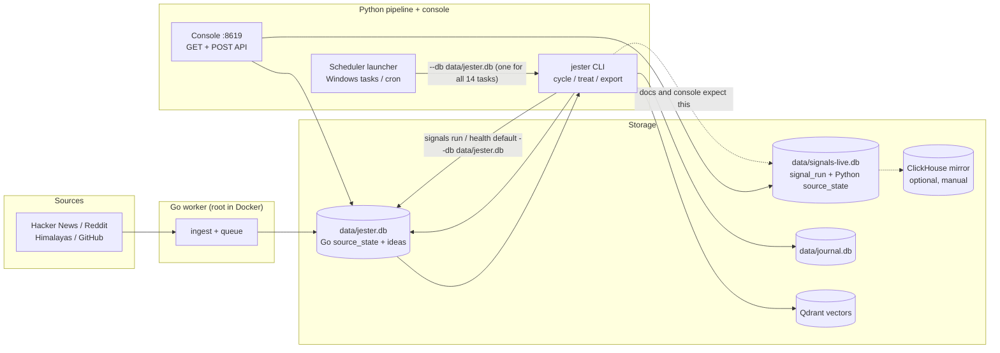
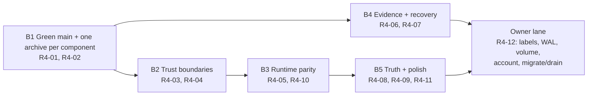

# Jester — Strategic Review and Next Development Strategy (v4)

> **Date:** 2026-11-02
> **Tree reviewed:** `origin/main` at `4c1773c9d387b277c0e16a2b46f290d7172c9395` (the post-merge main).
> **Review worktree:** `D:\project in this pc\Jester\jester-v3-hardening`, branch `fix/lock-parity`, HEAD `b01349e` (origin/main plus the one-line `qdrant-client` floor fix in PR #85).
> **Release under review:** `v0.1.0` -> `d2da8de`; the V3 hardening cycle squash-merged to main as `7005078` via PR #79.
>
> **Method and disclosure.** Code, configs, workflows and documents were read directly. Repository state was measured with `git`, `gh`, `python scripts/counts.py`, and one read-only reproduction on temporary SQLite files. **No application code, config, database or commit was changed by this review; this file is the only artifact.** The Python/Go/frontend suites were **not** run for this review. `data/jester.db`, `data/signals-live.db` and `data/journal.db` were **not** opened; every statement about their contents is marked `[Prior-cycle]` and is not a current measurement. The main checkout also holds uncommitted edits to `docs/STATUS.md` and `docs/reports/2026-11-01-next-development-strategy-v2.md`, plus an untracked `docs/reports/2026-11-01-next-development-strategy-v3.md`; those were not written to and are not assessed here.
>
> **Evidence labels used throughout:** `[Observed]` read in the file at the cited line; `[Measured]` produced by a command in this session; `[Prior-cycle]` reported by an earlier review or roadmap and not re-measured; `[Inference]` a reasoned conclusion not directly executed; `[Recommendation]` a proposed change.
>
> **Independence.** This is an orchestrator-run review. No independent human reviewer has seen it, and the last genuinely independent score (8.9/10, 2026-10-29) is not reused as a current score.

---

## 1. Executive summary

### 1.1 The verdict

The V3 cycle did what it said it would. The five P0s the previous review named are implemented and tested: the idea write is one `BEGIN IMMEDIATE` unit, quota corruption fails closed, the quota spend is one deciding statement, `source_state` streaks and `jester health` exist, the CloakBrowser credential is redacted, the console has a body cap and host allow-list, the journal binds approvals to a manifest, and the backup covers companions and restores into a verified copy. Those are real, non-cosmetic improvements.

The risk has moved again, and this time it is at the **seams between the components that were individually hardened**:

1. **The system has two archives; the scheduler can only carry one `--db`.** `jester signals` and `jester health` default to `data/jester.db`, the file the Go worker owns, while the console, the docs and the lab all use `data/signals-live.db`. The declared schedule passes one database to all 14 tasks. Apply it and the signals collector writes into the main archive, where its `source_state` table collides with the Go worker's different `source_state` schema. `[Observed]` `[Measured]` (reproduced on a temporary DB: a false `barren` verdict, then `IndexError` on `report` once a run row exists; `OperationalError: no such column: consecutive_zero` on the streak write). This is latent only because `schedule apply` is still owner-gated.
2. **Main is red, and the mechanism that reddened it recurs.** Dependabot cannot regenerate a PEP 751 lock, so every pip floor bump can break lock parity; the merge that introduced it passed because Windows is not a required check, `strict` is off, and admins are not enforced. The fix exists (PR #85, green) but is unmerged.
3. **The console is an unauthenticated control plane by default.** With no `JESTER_CONSOLE_TOKEN`, every POST is authorized; `0.0.0.0` only prints a warning; `/api/export` accepts an arbitrary `out_dir` and writes there. Loopback limits the blast radius to local processes and local users, not to zero.
4. **The evaluation gate still cannot gate.** The harness, kappa floor and agreement report are built, but there are no labels, and CI deliberately exits 0 when the label file is absent. The project still has no measured extraction-quality number.
5. **The documentation no longer describes main.** `docs/STATUS.md` still says the V3 branch is "not pushed and not merged" and that main is `5a4bd36`; quickstart tells every OS to install a Linux-only lock; Python is declared 3.10, 3.11 and 3.12 in three places; Go is declared 1.22+ while `go.mod` says 1.26.

### 1.2 The answer to the brief's closing question

**Fix the integration seams before adding anything: make one archive per component explicit and executable, then make main green and keep it green. Only then spend time on evidence and polish.**

Concretely, in this order:

1. Merge PR #85; add Windows to the required contexts; turn on `strict`; decide how a pip bump gets its lock regenerated (R4-01).
2. Give the scheduler a per-command database, make `signals`/`health` default to `data/signals-live.db`, rename the Python table to `signals_source_state`, and add a cross-language contract test (R4-02). **Do not run `jester schedule apply` until this lands.**
3. Close the console's default-open write path and constrain export output (R4-03).
4. Add the config key-set parity gate, because `config-live/` silently runs on defaults for 17 keys (R4-04).
5. Then the owner-gated evidence work: labels, WAL, second volume, task account, migration/drain (R4-06, R4-07, R4-12).

### 1.3 The six things that matter most

| # | What | Why it is first | Register |
|---|---|---|---|
| 1 | Scheduler and CLI point the signals pipeline at the main archive | Applying the declared schedule creates a schema collision and a daily false alarm; the two-archive design is real, the wiring is not | R4-02 |
| 2 | Main is red; the lock-parity failure is structural | A red main invalidates every "green" claim and blocks the next merge; #85 is green but open | R4-01 |
| 3 | Console writes are open by default; export writes anywhere | Any local process or user can mutate the archive and drop files anywhere the console user can write | R4-03 |
| 4 | `config-live/` is 19 keys against dev's 35 | Production silently runs on defaults for scheduler switches and per-platform throttles | R4-04 |
| 5 | The extraction gate has never gated | No labels means no quality number, no retention decision, and no evidence the flagship claim is true | R4-06 |
| 6 | STATUS, quickstart and version contracts are stale | The project's own rule is "if this page and another document disagree, this page wins"; the page is wrong about main | R4-08 |

---

## 2. Verified current-state assessment

### 2.1 What this review actually did

| Activity | Done | Note |
|---|---|---|
| Read code at `origin/main` `4c1773c` | Yes | ~70 files read directly across core, signals, console, journal, schedule, CI and Docker |
| `git` state, PRs, protection, CI | Yes | `origin/main` = `4c1773c`; 3 open PRs (#85, #80, #81); last main run `41511125479` failed |
| Run the Python/Go/frontend suites | **No** | Counts are measured; pass/fail is cited only from published CI runs |
| Open any live archive | **No** | Contents are `[Prior-cycle]` statements |
| Reproduce the signals schema collision | **Yes, read-only** | Temporary DBs in the OS temp directory; no repo or live file touched |
| Run `scripts/counts.py` | **Yes** | `[Measured]` python tests: 2239; go test functions: 299 |
| Independent human review | **No** | Disclosed |

### 2.2 The brief's named items, checked against code

The brief's premise list is stale in the same way the previous two briefs were. Re-verified at `4c1773c`:

| Item | Actual status | Evidence |
|---|---|---|
| Batch N1-N7 | **Implemented in their cycle; superseded by S-01..S-20, NB1-NB4 and V3** | Roadmap §5; the same files were edited again by later batches |
| `ad52b87` | **Exists** — journal + console measure/hashes/metrics/stale-schema gate | `git log`; docs-only follow-ups `4d844b3`, `a71ea1f` |
| `4d844b3` | **Exists, docs-only** | `git log` |
| `a71ea1f` | **Exists, docs-only, and corrects an overclaim** ("do not claim an independent critic or that EX-G3 is closed") | `git log` |
| **EX-G3** (607-idea backlog) | **Mechanism resolved; data open.** `rescore_attempts` (`store.py:120,312`), `stalled_scores` (`critic.py:150`), `SCORE_STALL_ATTEMPTS = 5` (`ops.py:21`) exist. The live archive still has not migrated; the 607/2,627 figure is `[Prior-cycle]` and was not re-measured | `[Observed]` symbols; `[Prior-cycle]` count |
| **P-H1** (`before_plan` display-only) | **Resolved** — `_before_plan` refuses a pre-plan run as proof (`journal/checks.py:211,258,345`) | `[Observed]` |
| **P-H3** (export does not re-hash figures) | **Resolved** — `artifact_problem` runs over every figure before export (`journal/publish.py:498`) | `[Observed]` |
| **T-A4** attempt counter | **Resolved in the 2026-10-30 batch** | Same symbols as EX-G3 |

**The discrepancy, explained.** The brief treats these as outstanding engineering work. They are not. What remains is one operator action (migrate, then drain the backlog in bounded windows) and one thing the earlier reports under-weighted: migrating and resuming the pipeline is now safe at the idea-write and quota layers, but it is **not** safe to apply the declared schedule until the database-ownership defect in R4-02 is fixed.

### 2.3 Classification of the current state

| Category | Items | Basis |
|---|---|---|
| **Implemented and verified** | V3-01 idea atomicity, V3-02 quota, V3-05 journal manifest, V3-09 retry budget, V3-10 config strictness, V3-12 console limits, V3-18 notify, V3-22 credential redaction | `[Observed]` symbols; branch suite green at `94ba3f2`; CI run `41508062030` green |
| **Implemented, insufficiently verified** | V3-04 signals health; V3-06 signals export; V3-14 signal field refresh; V3-25 non-root console | Health tests always pass `--db <temp>`; the default path is untested. The container image was inspected, the compose stack was not started |
| **Partially implemented** | V3-08 (WAL still owner-gated), V3-13 (no labels), V3-17 (crash scoping done, decoy DBs not moved), V3-23 (second volume absent), V3-24 (floor parity only; Windows still resolves `requirements.txt`), V3-26 (task account absent) | `docs/STATUS.md` V3 table; `[Observed]` |
| **Planned, not implemented** | V3-03 chat history (still `ORDER BY seq LIMIT ?`, oldest 24), V3-19 (ClickHouse manual; documented), V3-16/V3-20 (rulings: no extraction, no frontend change) | `[Observed]` `chat/store.py:119` |
| **Deferred intentionally** | React frontend, scheduled ClickHouse load, retention/signals-retention/backup-drill, chat enablement | `config/schedule.yaml`; ADR 0001 |
| **Broken or regressed** | Main CI red (lock parity); scheduled signals DB wiring (latent); STATUS banner stale after merge | `[Measured]` run `41511125479`; `[Observed]`; `[Observed]` |
| **No longer relevant** | The brief's premise that EX-G3, P-H1, P-H3 and T-A4 are outstanding | §2.2 |

### 2.4 The merge that is and is not on main

`[Observed]` PR #79 squash-merged as `7005078` at 19:33Z; `origin/v3-hardening` no longer exists; local `v3-hardening` and this worktree were kept by the owner. The individual commits (`94ba3f2`, `1a6a40d`, `89cc506`) are not ancestors of main; their content is, except that the STATUS banner was never updated. `[Measured]` PR #85 (`b01349e`) is open, mergeable, and all six checks are green. `[Measured]` main's run at `4c1773c` failed; the failure is the lock-parity step, before any test runs.

---

## 3. Architecture and engineering assessment

### 3.1 Current boundaries



The dashed edge is the defect: documentation, the console and the lab all treat `data/signals-live.db` as the signals archive, while the CLI defaults and the scheduler treat `data/jester.db` as every archive.

### 3.2 What is genuinely well built

- **Failure truth is taken seriously.** `spend()` is one conditional statement whose rowcount is the verdict (`quota.py:37-80`); malformed model replies are filed `ok=0`; `before_plan` runs cannot back a number; an edited figure blocks export. These are the places most projects leave silently wrong.
- **The journal is a real trust boundary now.** Approvals carry a manifest over revision, figures and snapshots; TTL and retraction exist; publish refuses retracted items. `[Observed]`.
- **The signals fixture gate and export are deterministic.** The quickstart's two-run idempotency check is also what CI runs; the signals CSV export is temp-file + fsync + `os.replace`.
- **The documentation culture polices itself.** `a71ea1f` is the precedent: a docs-only commit that removed an overclaim. Very few repositories do that.

### 3.3 Structural weaknesses

| Weakness | Evidence | Consequence |
|---|---|---|
| **Two archives, one scheduler flag** | `apply_desired(db="data/jester.db")` `schedule.py:1549`; launcher `--db` `:274-275`; `COMMAND_SPEC` gives signals/health no DB of their own `:549`; `config/schedule.yaml` has no per-task DB key | No single `--db` value is correct; applying the schedule either breaks signals or breaks the idea pipeline |
| **Two incompatible `source_state` schemas under one name** | Go `name, last_fetched_at, ...` `go/internal/store/store.go:155`; Python `source, consecutive_zero, ...` `signals/health.py:45,85-93` | If both land in one file: false alarm, then a crash; the table is derived state, so a rename is cheap |
| **The HTTP layer imports the CLI presentation layer** | `console/api.py:36` imports `jester.cli`; `cli.py` is 5,101 lines, `api.py` 2,474 | Console tests pay the whole pipeline import cost; schema validation is implicit |
| **Six independent schema mechanisms** | Go store, Python `store`, journal, chat, signals, `llm_quota` | Each is defensible alone; together there is no single "open + validate" boundary |
| **A single config profile per process, with silent defaults** | `config/thresholds.yaml` 35 keys vs `config-live/thresholds.yaml` 19 `[Measured]` | Production runs on defaults for 17 keys, including `scheduler_enabled` and the per-platform throttle table |
| **The scheduler's declarative file cannot express the topology** | `schedule.yaml` keys are task/command/cadence/options only; unknown keys are refused | The file says what runs, not where it writes |

### 3.4 Is the project over- or under-abstracted?

Neither wholesale. The project is **under-abstracted at one seam and over-abstracted at none**: there is no `Archive` or `Paths` service that owns "which database does this command write", and every component re-decides. That is why the two-archive model exists in the docs and the console but not in `COMMAND_SPEC`. The fix is a small, explicit mapping (command -> archive role), not a repository layer or a database server.

The god modules are real but not urgent. `V3-16`'s ruling (extract only on touch) remains correct. Do not spend the next cycle on a move-only refactor that no test can fail.

---

## 4. Reliability and verification assessment

### 4.1 What the gates genuinely cover

`[Observed]` The suite is broad and leans toward quiet failures: idempotent import, failed fetches counted, fixture rows never counted as live, `FINAL` in ClickHouse counting queries, a fixture gate that fails when a category disappears. Coverage is gated at 86% and CI measured 89.85% at `94ba3f2`. The signals health tests cover healthy/quiet/barren/stale/error verdicts and the CLI exit codes.

### 4.2 Where the strategy is thin

| Gap | Evidence | Why it matters |
|---|---|---|
| **Defaults are not tested** | `test_signals_health.py` always passes `--db <temp>`; no test invokes `health` with its real default | The one path the schedule uses is the one path no test exercises |
| **Cross-component contracts are not tested** | No test opens a Go-shaped `source_state` with the Python reader | The collision is invisible to both suites |
| **Merged result is not tested** | #79's branch was green; main went red at `4c1773c` on the next dependency merge | Green-at-a-commit is not green-on-main |
| **The extraction gate is a no-op until labels exist** | `cli_review.py:149-182`; `ci.yml:117-123`; no `eval/extraction/labels.jsonl` | A green job is reported for a measurement that was never taken |
| **Idea export is not atomic** | `export.py:483-654` writes shards in place and the manifest last | A crash leaves a half-written export with no manifest; `prune_exports` returns 0 when the manifest is absent (`:677-678`), so orphans accumulate |
| **The container topology is not exercised** | No CI job builds the images or runs `docker compose config` | The two-UID shared-volume risk is discovered only in production |

### 4.3 Data integrity and recovery

The archive-side story is much better than a year ago: online backup API, SHA-256 + row counts, restore into a new file with `integrity_check` and count comparison, a monthly drill declared (paused). But:

- `[Observed]` the off-volume copy (`--also-to`) is not passed by any scheduled task; `COMMAND_SPEC["backup"]` is `("backup",)` only. All automatic backups still live on the same volume as the archive.
- `[Observed]` the `also_to` copy loop (`backup.py:431-437`) has no `try/except`; a failure there aborts the set after the primary is written, leaving a partial off-site state instead of a warning.
- `[Observed]` the dotenv is copied byte-for-byte into every backup set (`backup.py:372-390`) and into the second volume. `chmod 0600` is best-effort and is a no-op on Windows. Secrets at rest are protected only by filesystem ACLs.
- `[Prior-cycle]` the live archive predates `rescore_attempts`; the migration has not run.

### 4.4 Performance and resource behavior

No new benchmark was run. `[Prior-cycle]` the WAL benchmark measured 55 `BUSY` errors, 41 refused ticks and 9 killed ingests under DELETE mode, and the decision to use WAL on local disk is recorded, but the live archive is still not in WAL. The console's import graph (`api.py` -> `cli.py`) costs about a second and 750 modules per cold start `[Prior-cycle]`; it is a test-latency cost, not a user-facing one.

---

## 5. Evaluation and measurement assessment

### 5.1 What exists

- `jester eval` — scoring arithmetic over committed `known_good.md` / `known_bad.md`, run in CI.
- `jester eval extract` — the S-06 harness: kappa with its denominator, precision/recall/F1, fabrication rate, nuggets per comment, and published floors (F1 0.70, fabrication 0.05, 1.2 nuggets/comment, kappa 0.6 when measurable).
- `jester eval agreement` — owner scores against model scores per axis, with `--min 30` before the MAE is called measurable.
- `jester eval sample` — the committed 150-comment sample (`eval/extraction/sample.jsonl`, 100 KB) and its design file.

### 5.2 What has actually been measured

**Nothing about extraction quality.** `[Measured]` `eval/extraction/` contains `README.md`, `sample.design.json` and `sample.jsonl`; there is no `labels.jsonl`. `[Observed]` CI runs `jester eval extract` anyway and the command prints "no labels yet" and exits 0. The gate is honest in its output and meaningless as a gate.

This is the single largest **evidence** gap in the project, but it is not an engineering gap. The code is wired; the owner's labelling is the dependency. Until it exists, the project cannot state a quality number, cannot justify retention, and cannot compare a model or prompt change.

### 5.3 What would produce meaningful evidence

| Measurement | Why it is worth the effort | What it would not prove |
|---|---|---|
| 150 labelled extraction rows (50 double-labelled) | First P/R/F1, fabrication and kappa with denominators; unlocks retention and model comparison | That the pipeline produces *useful* ideas, only that extraction is faithful |
| 30 blinded idea pairs, 3 raters, Spearman >= 0.7 | First evidence that scoring ranks ideas the way a human would | That the ranked ideas are commercially valuable |
| One honest unattended week (migrate, drain, run, `jester evidence --run`, `jester health`) | End-to-end proof under the real scheduler, including failures | Quality at scale; one week is one sample |
| Signals source-yield trend (records per run per source) | Distinguishes "quiet" from "dead" over months; already coded as streaks | That the collected leads convert |

Do **not** add an LLM-as-judge harness yet. 150 human labels are cheaper, more informative and harder to game than a judge whose agreement with humans is itself unmeasured.

---

## 6. Product and usability assessment

### 6.1 The four products, ranked by real use

1. **Signals collector + buyer brief** — the only product with live data. `[Prior-cycle]` 9,032 live records across 174 runs in `data/signals-live.db`. It runs unattended and produces a weekly artifact.
2. **Idea pipeline** — the flagship, paused since 2026-10-02, with a 607-idea unscored backlog `[Prior-cycle]`. Safe to resume only after the V3 atomicity/quota fixes (done) and the database-ownership fix (not done).
3. **Journal** — implemented, manifest-bound, never used. `[Prior-cycle]` 0 publications.
4. **Console chat / React frontend** — disabled and scaffold respectively. Neither is the product.

### 6.2 Onboarding

`[Observed]` The quickstart's "native path" tells every platform to run:

```bash
python -m pip install --only-binary :all: -r python/pylock.toml
export PYTHONPATH=python          # Windows PowerShell: $env:PYTHONPATH="python"
```

`python/pylock.toml`'s own header says it is **Linux-only**, generated in `python:3.12-slim`, and that Windows/macOS must install `python/requirements.txt`. `[Measured]` the lock contains only `manylinux` wheels (e.g. `grpcio-1.84.0-cp312-cp312-manylinux2014_x86_64`). So the first command a Windows user is told to run fails, and the note only fixes the second line. The `/tmp/signals.db` examples in the same section assume a POSIX shell.

Version contracts also disagree: `[Observed]` `python/pyproject.toml:9` says `>=3.10`, README and quickstart say Python 3.11+, the lock pins cp312, and CI uses 3.12. `[Observed]` README says Go 1.22+ while `go/go.mod:3` says `go 1.26`.

### 6.3 Usability findings worth fixing cheaply

- A first-run user has no single command that says "your install is correct". `jester doctor` exists; the quickstart should make it step 0 and should branch by OS.
- The console's Config page is readable without a token but its writes are also open without one; the security posture and the product posture disagree.
- The STATUS page is the project's "one place to answer is it done", and its banner is wrong about the merge. That is a usability defect for the maintainer first.

---

## 7. Security and operational assessment

### 7.1 What holds

- `[Observed]` `/api/config` redacts any key matching `license|proxy|secret|token|key|password` and returns a `secrets_set` map (`secrets.py:25,50-64`; `api.py:1587`). The V3-22 P0 is closed.
- `[Observed]` Console POSTs are gated by cross-origin check, read-only flag, token, 1 MiB body cap, 30 s socket timeout and a Host allow-list. Static path traversal is guarded.
- `[Observed]` Cron/task launchers notify on non-zero exit and keep the run code; retention is declared; journal transitions are code-enforced.
- `[Observed]` No secrets are committed; `.env`, `data/`, `exports/` are ignored.

### 7.2 Residual risks, in order

| Risk | Evidence | Assessment |
|---|---|---|
| **Unauthenticated control plane by default** | `_is_authorized` returns True when `JESTER_CONSOLE_TOKEN` is unset (`server.py:107-116`); `0.0.0.0` without token only warns (`:890-902`); POST guard order reaches the token last | Any local process/user can run pipeline mutations; a LAN bind turns it into a remote control plane |
| **Arbitrary write through `/api/export`** | `server.py:744` forwards `out_dir`; `api.py:2371-2378`; `export.py:650-653` mkdir + write, no containment | With no token, a local caller can create directories and write CSVs anywhere the console user can write (e.g. over repo files); cross-origin pages are blocked by `_cross_origin`, so this is local, not browser-CSRF |
| **Internal endpoint disclosed** | `api.py:1635` returns `JESTER_QDRANT_URL` raw, bypassing `redact_secrets` | Hostnames/ports, and any credentials embedded in the URL, are readable without auth |
| **Secrets in every backup** | `backup.py:372-390`, `:431-437` | Plaintext `.env` beside the archive and on the second volume; `0600` is a no-op on Windows |
| **Two UIDs, one SQLite volume** | Console `USER 10001` (`Dockerfile.python:98`); Go image runs as root (`go.Dockerfile:15-19`); both mount `jester_docker_data` (`docker-compose.yml:79,131`) | The Go comment warns that differing UIDs make each other's files unwritable; the shipped configuration is exactly that, and whichever container creates the file decides who can write it |
| **No `restart:` on console or worker** | `[Measured]` only `qdrant`, `cloakbrowser`, `clickhouse` restart (`docker-compose.yml:67,190,238`) | A crash leaves the stack down until a human notices |
| **No workflow `permissions:` block** | `[Measured]` none in `.github/workflows/*.yml` | Workflows inherit default token scope; supply-chain blast radius |
| **Unpinned frontend base image** | `docker/Dockerfile.frontend:4` `FROM node:24-slim` | Reproducibility/supply-chain gap; app images are digest-pinned, this one is not |

### 7.3 Operational maturity summary

Strong on failure ordering (backup, restore, journal, notify). Weak on **operating the topology**: the database map is implicit, the container users disagree, the off-volume copy is unscheduled, and no CI job exercises compose. The project is ready for a careful single-operator deployment; it is not ready for a second operator or a shared host.

---

## 8. Newly discovered issues and opportunities

### 8.1 New issues (not in the V3 register)

| ID | Finding | Evidence | Confidence |
|---|---|---|---|
| N-01 | The scheduler cannot express two archives; applying the declared schedule points signals at the main archive | `schedule.py:1549,274-275,549`; `config/schedule.yaml:44,68`; `cli.py:4464,4491` | High `[Observed]` |
| N-02 | Python and Go define incompatible `source_state` tables under one name | `health.py:45,85-93`; `store.go:155` | High `[Observed]` + reproduced |
| N-03 | The health default path is untested; tests always pass `--db` | `test_signals_health.py:270,295,311,...` | High `[Observed]` |
| N-04 | `config-live/` resolves on defaults for 17 keys | `[Measured]` 35 vs 19 keys; 17 dev-only; 1 live-only (`llm_provider`) | High `[Measured]` |
| N-05 | `/api/export` has no output containment | `server.py:744`; `api.py:2371-2378`; `export.py:650-653` | High `[Observed]` |
| N-06 | `/api/config` leaks `JESTER_QDRANT_URL` raw | `api.py:1635` | High `[Observed]` |
| N-07 | Off-volume backup copy is unscheduled and its failure is uncaught | `schedule.py` `COMMAND_SPEC["backup"]`; `backup.py:431-437` | High `[Observed]` |
| N-08 | Idea export is not atomic and orphan partials are never pruned | `export.py:483-654,677-678` | High `[Observed]` |
| N-09 | Container UIDs differ on a shared SQLite volume; console/worker do not restart | Dockerfiles + compose (above) | High for facts; `[Inference]` for the exact failure ordering |
| N-10 | Quickstart installs a Linux-only lock on every platform | `quickstart.md:50`; `pylock.toml` header; `[Measured]` wheel tags | High `[Observed]`/`[Measured]` |
| N-11 | Python version is declared as 3.10, 3.11 and 3.12; Go as 1.22 and 1.26 | `pyproject.toml:9`; README:278; quickstart:47; `go.mod:3` | High `[Observed]` |
| N-12 | STATUS still says the V3 branch is unmerged and main is `5a4bd36` | `STATUS.md:6-12` at `4c1773c` | High `[Observed]` |
| N-13 | Chat history still returns the oldest rows (`V3-03` open) | `chat/store.py:119` | High `[Observed]`; low impact while chat is disabled |
| N-14 | Workflows have no `permissions:` block; frontend base image unpinned | `.github/workflows/*`; `Dockerfile.frontend:4` | High `[Observed]` |
| N-15 | The extraction gate passes with no labels | `cli_review.py:160-168`; `ci.yml:117-123` | High `[Observed]` (disclosed in code comments) |

### 8.2 Opportunities (not defects)

- **One command that proves the install**: `jester doctor` plus a platform-aware step 0 would eliminate the most common first-run failure.
- **A single `Archive`/`Paths` mapping** used by CLI, scheduler, console and lab would have prevented N-01/N-02 and makes the next storage change one line.
- **The contract-check binary already exists** (`go/cmd/contractcheck`), which is the natural home for a cross-language schema test.
- **The evidence pack is one command away** (`jester evidence --run`) once a real run exists; publishing it would make the journal's claim demonstrable.

### 8.3 What is *not* an issue

- The god modules. Large, but cohesive enough, and V3-16's "extract on touch" ruling is right.
- The two frontends. The ADR's promotion criteria are unmet; the console is the product.
- The absence of Postgres, a queue service or an observability stack. One operator, one host, one archive; a health command and an exit code buy more than a metrics stack.
- The 86% coverage floor. The gaps above are missing *contracts*, not missing lines.

---

## 9. Prioritized recommendation register

Effort: S/M/L (rough days). Risk is the risk of the change, not of the problem. Every line was checked against `origin/main` unless marked otherwise.

| ID | Problem | Evidence | Proposed solution | Expected impact | Effort | Risk | Dependencies | Priority | Verification |
|---|---|---|---|---|---|---|---|---|---|
| **R4-01** | Main is red; the lock-parity failure recurs on every pip bump | `[Measured]` main `4c1773c` run `41511125479` failed; PR #85 green; `requirements.txt:8` vs `pylock.toml` 1.19.1; Dependabot cannot regenerate PEP 751 | Merge #85; add the Windows job to required contexts; set `strict=true` (and decide `enforce_admins`); add a `lock-refresh` workflow or a Dependabot policy that pairs a pip bump with a lock regeneration, and make the parity failure print the exact regeneration command | Main stops being a place where a green PR can land red; dependency updates become routine | S | L | None | **P0** | Main run green at the merge commit; a seeded pip PR is refused or auto-fixed; branch protection shows 5 required contexts and `strict=true` |
| **R4-02** | The scheduler and CLI point signals at the main archive; two incompatible `source_state` tables share a name | `schedule.py:1549,274-275,549`; `cli.py:4464,4491`; `api_signals.py:42-44`; `health.py:45,85-93`; `store.go:155`; `[Measured]` false barren, `IndexError`, `OperationalError` | Add an archive role to `COMMAND_SPEC` (main vs signals) and a per-task DB override in `schedule.yaml`; default `signals`/`health` to `data/signals-live.db`; rename the Python table to `signals_source_state` with an additive migration; add a Go-schema contract test in `contractcheck` | Applying the schedule becomes safe; the only live workload stops producing a daily false alarm | M | L | R4-01 for a green merge | **P0** | New tests: Go-shaped DB + `health` reports honestly; scheduled argv for signals/health names the signals DB; `schedule apply --dry-run` shows two DBs; focused signals/schedule suites green |
| **R4-03** | Console writes are open by default; export writes anywhere; qdrant URL is disclosed | `server.py:107-116,890-902,744`; `api.py:2371-2378,1635`; `export.py:650-653` | Require a token for POST by default (generate and print one on first start, or refuse writes without it); refuse non-loopback bind without a token; constrain `out_dir` to a configured exports root (resolve + `is_relative_to`, refuse symlinks); redact `JESTER_QDRANT_URL` value, return a set/not-set boolean | A local process can no longer mutate the archive or write files without a credential | M | M | None | **P1** | Tests: no token + POST -> 401; `--host 0.0.0.0` no token -> refuse; `out_dir=../..` -> 400; `/api/config` contains no URL |
| **R4-04** | `config-live/` silently runs on defaults for 17 keys, contradicting the promotion doc | `[Measured]` 35 vs 19 keys; 17 dev-only, `llm_provider` live-only; `docs/config-promotion.md:2-4,15-16` | Add `scripts/check_config_parity.py` to CI asserting identical key sets (model/provider keys allowlisted); reconcile the 17 keys in `config-live/` or correct the doc; make `update_thresholds` write the full resolved mapping | Production behavior becomes reproducible and the promotion invariant becomes true | S | L | None | **P1** | CI gate fails on a seeded key disparity; the two files share every non-model key; shipped configs still load |
| **R4-05** | Go and console containers run as different UIDs on one SQLite volume; no compose CI; no restart policy | `Dockerfile.python:98`; `go.Dockerfile:15-19`; `docker-compose.yml:79,131`; `[Measured]` only qdrant/cloak/clickhouse restart | Run both as uid 10001 (create/chown `/app/data` in the Go image, set `user:`); add `restart: unless-stopped` to console and worker; add a CI job running `docker compose config` and a build-and-start smoke with a healthcheck | Removes a proven corruption class and makes the stack self-healing | M | M | R4-03 for the console token in compose | **P1** | CI builds both images, starts the stack, and the worker writes a row the console reads; `id` shows 10001 in both |
| **R4-06** | No measured extraction or scorer quality; the CI gate is a no-op | `eval/extraction/` has sample, no labels; `cli_review.py:160-168`; `ci.yml:117-123` | Label the 150 rows (50 doubled) and 30 agreement ideas (owner); commit `labels.jsonl` / `agreement.jsonl`; keep the no-label path but make it print a prominent `NOT MEASURED` and surface it in STATUS; publish the first report | First real quality number; unlocks retention and model comparison | M (mostly owner time) | L | Owner labels | **P1** | `jester eval extract` prints n, kappa, P/R/F1 with denominators and fails below the floors; CI runs it on labels |
| **R4-07** | Backups still live on one volume; off-volume failure is uncaught; secrets are plaintext | `schedule.py` backup spec has no `--also-to`; `backup.py:431-437`; `backup.py:372-390` | Add `also_to` to the declared backup task once the owner provides a path; wrap the copy in try/except and report a partial set rather than raising; decide secrets-at-rest (exclude `.env` by default with `--with-secrets`, or document the ACL requirement and test it) | The backup survives the failure it exists for, and a failed second copy is visible without losing the first | S/M | M | Owner second volume | **P1** | Restore drill on a copy; a simulated second-volume failure returns `ok` with `failed` populated; the scheduled task shows `--also-to` |
| **R4-08** | Docs/version truth is stale | `STATUS.md:6-12`; `quickstart.md:47,50,60-61`; `pyproject.toml:9`; README:278; `go.mod:3` | Update STATUS to the merged state and main's real head; split quickstart install by OS (lock for Linux/Docker, requirements for Windows/macOS); state one Python floor and one Go floor everywhere; add a doc test for the version strings | The canonical page becomes true again; first-run failures drop | S | L | R4-01 (head will move) | **P2** | `test_doc_links` plus a new assertion on the version strings; quickstart commands run on Windows and Linux |
| **R4-09** | Idea export is non-atomic; orphan partials accumulate | `export.py:483-654,677-678` | Write into a temp directory and `os.replace` the manifest last (mirror the signals export), or write a staging marker and have `prune_exports` remove unmanifested dirs | A crash cannot leave a half-export that looks usable | S | L | None | **P2** | Kill mid-export -> no manifest and no visible export; the next run replaces cleanly; prune removes the orphan |
| **R4-10** | Workflows lack `permissions:`; frontend base image is unpinned | `.github/workflows/*.yml`; `Dockerfile.frontend:4` | Add least-privilege `permissions:` to each workflow; digest-pin the frontend base; consider making `pip-audit` blocking after triage | Smaller supply-chain blast radius; reproducible frontend builds | S | L | None | **P2** | Workflow lint shows explicit permissions; the image reference carries a digest; CI green |
| **R4-11** | Chat history returns the oldest rows (`V3-03` open) | `chat/store.py:119`; `chat/session.py` caller | Select the last N (`ORDER BY seq DESC LIMIT ?`, reverse) and update the test to assert the current turn is included | Fixes a wrong-answer trap before chat is ever enabled | S | L | None | **P3** | Test with 30 messages: history contains message 30 and the current turn |
| **R4-12** | Owner-gated operations are the only thing between the code and a real unattended run | STATUS owner list; `EX-G3` data; WAL; task account; journal re-approval | Execute in order: fix R4-02, apply the schedule dry-run, choose the account, apply, enable WAL on local disk, migrate + drain in bounded windows, take one backup, re-approve journal items, run `jester health` and `jester evidence` | Turns a tested codebase into an operating product | Owner time | M | R4-02, R4-06, R4-07 | **P3** (owner lane) | A week of scheduled runs with zero `SQLITE_BUSY`, one health report per morning, one evidence pack, one restore drill |

---

## 10. Proposed next implementation batches

### 10.1 Sequence



B1 is the gate. B2 and B4 can run in parallel with B3 because they touch different files. B5 is the only batch that should wait for the exact merge head.

### 10.2 B1 — Green main and one archive per component (P0)

- **Objective:** a main that cannot go red from a dependency bump, and a scheduler that writes each command to the archive that command owns.
- **Problems:** R4-01, R4-02 (N-01, N-02, N-03).
- **Deliverables:** #85 merged; Windows required; `strict=true`; lock-refresh policy; `COMMAND_SPEC` archive roles; per-task DB override in `schedule.yaml`; CLI defaults to `data/signals-live.db` for signals/health; `signals_source_state` rename with additive migration; a Go-schema contract test.
- **Files:** `python/jester/schedule.py`, `python/jester/cli.py`, `python/jester/signals/health.py`, `python/jester/signals/run.py`, `python/jester/console/api_signals.py`, `config/schedule.yaml`, `go/cmd/contractcheck`, tests.
- **Test-first:** open a temp DB with the Go `source_state` shape and a `signal_run` row, then assert `health.report` neither raises nor calls it barren; assert the scheduled argv for `signals` and `health` names `signals-live.db` and for `ingest` names `jester.db`; assert the rename migration is additive and re-runnable.
- **Acceptance:** `schedule apply --dry-run` shows two distinct DBs; a Go-shaped DB yields a truthful verdict; focused signals/schedule tests green; full suite green.
- **Regression risks:** the health CLI's default changes; existing scripts that relied on the old default must pass `--db`; the rename must not orphan existing rows (migrate by copy, not drop).
- **Verification:** focused suites, full suite, `go test ./...`, dry-run output reviewed, never `data/jester.db`.
- **Definition of done:** a fresh checkout can install, run the fixture gate, and show a correct `health` verdict against both a signals DB and the main archive, with no manual `--db` for the scheduled paths.

### 10.3 B2 — Trust boundaries (P1)

- **Objective:** the console is not an open control plane, and configuration promotion is enforced.
- **Problems:** R4-03, R4-04 (N-05, N-06, N-04).
- **Deliverables:** token required for writes by default, non-loopback refused without one, export root containment, qdrant URL redaction, config parity gate.
- **Test-first:** no token + POST -> 401; `out_dir` escaping the root -> 400; `/api/config` has no URL value; a config key disparity -> CI failure.
- **Acceptance:** the console's default posture is "read-only until a token exists"; the promotion invariant is a test.
- **Regression risks:** existing compose setups without a token would stop writing; provide a generated token in the compose environment and a migration note.
- **Definition of done:** a local unprivileged process cannot mutate the archive or write outside `exports/`; dev and live configs share every non-model key.

### 10.4 B3 — Runtime parity (P1)

- **Objective:** the shipped containers run as one user on one volume and restart on crash.
- **Problems:** R4-05, R4-10.
- **Deliverables:** Go image uid 10001 with `/app/data` ownership, `user:` in compose, restart policy, compose config/build/start CI job, workflow permissions, digest-pinned frontend base.
- **Test-first:** CI starts the stack and asserts the worker's row is readable by the console; a compose config validation job.
- **Acceptance:** `docker compose config` is clean; both containers report 10001; the stack survives a killed worker.
- **Regression risks:** an existing named volume created by root will not be writable by 10001; document a one-time volume migration or an init step.
- **Definition of done:** CI proves the topology the README describes.

### 10.5 B4 — Evidence and recovery (P1/P2)

- **Objective:** the project can state a quality number and a backup has been restored somewhere other than its own directory.
- **Problems:** R4-06, R4-07.
- **Deliverables:** labels committed; first extraction and agreement report; `--also-to` scheduled; copy failures reported; secrets-at-rest decision; one drill recorded in STATUS.
- **Test-first:** floors fail on a seeded bad label set; a failing second copy returns a partial set with `failed`.
- **Acceptance:** CI prints metrics with denominators; the drill's output is in STATUS.
- **Definition of done:** README can state a measured extraction number with its sample size, and the backup has been restored and integrity-checked.

### 10.6 B5 — Truth and polish (P2)

- **Objective:** the docs describe the tree.
- **Problems:** R4-08, R4-09, R4-11.
- **Deliverables:** STATUS banner, OS-aware quickstart, one Python/Go version contract, atomic idea export, chat newest-N.
- **Verification:** doc tests, a mid-export kill test, the chat test.

### 10.7 Explicitly not now

| Not this cycle | Why |
|---|---|
| New product surface (another UI, mobile, public API) | Four products, one live; the constraint is operating the one |
| Promoting the React frontend | ADR 0001's criteria are unmet; the console is the product |
| Splitting `cli.py` / `ConsoleAPI` wholesale | Move-only churn with no failing test; V3-16's ruling stands |
| Moving to Postgres or a queue service | One host, one operator; SQLite is not the bottleneck once the two-archive map is explicit |
| Scheduling ClickHouse | SQLite is the source of truth; the mirror is optional and currently unneeded |
| An LLM-as-judge evaluation harness | 150 human labels are cheaper and more informative |
| Multi-user auth/RBAC, hosted deployment | Nothing in the repository asks for it; it would be speculative infrastructure |
| Enabling chat before V3-03 | It answers the wrong question past 24 messages |

---

## 11. Two-week priority plan

Assumes one engineer and ~9 working days; owner actions run in parallel.

**Day 1 — R4-01.** Merge #85. Add Windows to required contexts, set `strict=true`, record the admins decision. Decide the lock-refresh policy and implement the cheapest version (a workflow job or a Dependabot ignore list with a documented manual command). Confirm main is green at the new head.

**Days 2-3 — R4-02.** Write the failing contract test first (Go-shaped `source_state` + `signal_run`). Add archive roles to `COMMAND_SPEC`, a per-task DB in `schedule.yaml`, signals/health defaults, and the additive `signals_source_state` rename. Run the focused signals/schedule suites, then the full suite. Produce a `schedule apply --dry-run` that shows two archives and review it.

**Day 4 — R4-03.** Token required for writes; refuse non-loopback without one; export root containment; qdrant URL redaction. Run the console suite.

**Day 5 — R4-04.** Config parity gate, reconcile the 17 keys (or correct the doc), test both shipped configs load.

**Day 6 — R4-05.** Go image uid, compose `user:`, restart policies, a compose config/build/start CI job.

**Day 7 — R4-07 + R4-10.** Backup `--also-to` (owner provides the path), uncaught-copy fix, secrets decision, workflow permissions, frontend digest.

**Day 8 — R4-06 + R4-08.** If labels exist, publish the first extraction report; otherwise make "NOT MEASURED" unmissable. Update STATUS, quickstart by OS, and the version contracts. Run the doc tests.

**Day 9 — verification.** Full Python suite, `go test ./...`, frontend lint/build, `docker compose config`, and a fresh-checkout smoke. Record the real output, including failures. Do not claim a number that was not produced.

**Parallel owner lane:** label 150 rows (≈4-6 h); provide the second volume path; choose the Windows task account; enable WAL; migrate and drain in bounded windows; re-approve journal items; run `health` and `evidence` for one week.

**Explicit non-goals for the two weeks:** no new features, no frontend work, no god-module extraction, no database migration beyond the table rename, no chat enablement. If a day is lost, drop B5, not B1.

---

## 12. Long-term development direction

**0-3 months — make it operable.** Finish B1-B4. End state: main stays green through dependency churn; one archive per component with a test that proves it; the console cannot be mutated without a credential; the schedule can be applied safely; one measured quality number; one restored backup; one week of honest health reports.

**3-6 months — use it.** Unpause the idea pipeline after the migration and drain, keep the ideas that pass review, and let the signals brief run against real outreach. Every improvement in this window should trace to something the operator hit in that month: a stale source, a bad score, an export that lost a row, a schedule that fired twice.

**6-12 months — make it stand out.** The differentiator is already in the repository and no comparable project ships it as a coherent whole: **every claim in the output is verifiable from the archive**, with approvals bound to artifact hashes and an evidence pack per run. The path there is not more components; it is proving the existing ones on real data and publishing what they say, including the failures.

---

## 13. Research references

These are established sources, used to justify specific recommendations rather than to decorate the report. No benchmark or performance number in this report is taken from them.

| # | Source | Problem it addresses here | Technique | Why appropriate for Jester | Complexity | Benefit | Trade-offs |
|---|---|---|---|---|---|---|---|
| 1 | PEP 751, *A file format for locking dependencies* (https://peps.python.org/pep-0751/) | Dependabot bumps a floor the Linux lock cannot satisfy; main goes red | A standardized lock file pins exact wheels and hashes; the installer must obey it | The project already uses PEP 751 for Docker/CI; the gap is that the Windows/floor side is not part of the same contract | Low to consume; medium to automate regeneration | Reproducible installs and a single source of truth | One lock cannot cover every platform (`pip lock` has no `--platform`), so a second resolution path remains |
| 2 | SQLite, *Write-Ahead Logging* (https://sqlite.org/wal.html) and *Appropriate Uses For SQLite* (https://sqlite.org/whentouse.html) | One archive, multiple processes; DELETE-mode contention measured previously | WAL lets readers and a writer proceed concurrently; the docs state the single-host, single-filesystem constraints | The measured BUSY/refused-tick class is exactly the WAL use case, and the project already benchmarked it | Low (a pragma plus a rollback plan) | Removes a measured contention class without changing the storage engine | WAL needs shared memory and does not work on some network filesystems; backup must include `-wal`/`-shm` or use the online API |
| 3 | GitHub Docs, *About required status checks* and *Branch protection rules* (https://docs.github.com/en/repositories/configuring-branches-and-merges-in-your-repository/managing-protected-branches/about-protected-branches) | A green PR merged into a red main because Windows was not required and `strict` was off | Required contexts are evaluated on the merge commit; `strict` requires the branch to be up to date | The failure is a process gap the platform already closes; no custom tooling is needed | Low | A merge cannot land on a red base | `strict` forces rebases for every open PR; `enforce_admins` slows emergency fixes |
| 4 | OWASP, *Secrets Management Cheat Sheet* (https://cheatsheetseries.owasp.org/cheatsheets/Secrets_Management_Cheat_Sheet.html) | `.env` copied in plaintext into every backup and the second volume | Keep secrets out of artifacts by default; restrict access; rotate; audit | The backup is a copy of the whole operating state, and secrets are the one part that should not be in every copy | Low to change the default; medium to add encryption | Reduces the blast radius of a stolen backup | A restore that excludes `.env` is not a full restore; the operator must re-provide keys |
| 5 | J. Cohen, *A Coefficient of Agreement for Nominal Scales*, Educational and Psychological Measurement, 1960 | Extraction labels need an agreement measure that accounts for chance | Cohen's kappa compares observed agreement with chance agreement | The harness already computes it; the missing piece is the labels, and kappa is the right gate for two raters | Low (already implemented) | A quality gate that cannot be passed by labelling everything "supported" | Kappa needs double-labelled rows and is undefined when one class dominates; the report already handles that |
| 6 | Google SRE Book, *Monitoring Distributed Systems* (https://sre.google/sre-book/monitoring-distributed-systems/) | The only live workload has no trustworthy failure signal | Alert on symptoms (freshness, yield, errors) rather than on every internal counter | `jester health --days 7` with an exit code is the smallest symptom-based monitor that fits one scheduled process | Low (already implemented) | The operator learns "this week was bad" without reading logs | A single health command is not a trend store; streak tables must be retained long enough to be useful |
| 7 | The Twelve-Factor App, *III. Config* (https://12factor.net/config) | Dev and live configs diverge; live silently runs on defaults | Strict separation of config from code, with one declared environment per deploy | The project already has `config/` and `config-live/`; the missing part is a parity test | Low | Reproducible behavior and a promotion invariant that is enforced | Strict parity can force operational values into the repo, which is the opposite of factor III; allowlist model/provider keys explicitly |
| 8 | Python docs, *sqlite3 — Transaction control* (https://docs.python.org/3/library/sqlite3.html#transaction-control) | Read-then-write quota and claim/insert races | Explicit `BEGIN IMMEDIATE` and one deciding statement; understand the implicit-transaction behavior | The V3 fixes already use this; the recommendation is to keep the pattern and test it with two connections | Low | Serialized decisions without a database server | `BEGIN IMMEDIATE` takes a write lock earlier; long transactions increase contention |

---

## 14. Explicit assumptions and unresolved questions

### 14.1 Assumptions this review rests on

1. The review tree is `origin/main` `4c1773c`; the worktree HEAD is `b01349e`, which differs by one line (`qdrant-client>=1.19.1`). No other difference was assumed.
2. PR #85 is the intended fix for the red main, and the owner wants main green before the next feature cycle.
3. The signals archive is meant to be `data/signals-live.db`, based on the console default, the lab table, `docs/data-retention.md`, README and the prior-cycle measurements. If the owner instead intends the main archive to hold signals, the recommendation changes from "separate the DBs" to "namespace every table and never run both writers on one file" — but the collision still must be fixed.
4. The operator remains single-user on one Windows host; a hosted or multi-user deployment is out of scope.
5. The live archive's contents (607 unscored ideas, 9,032 signal records, 0 journal publications) are prior-cycle observations. They were not re-measured because opening the archive was prohibited.
6. `schedule apply` has not been run since the declarative config landed; STATUS lists it as an owner action. If it was run, the health task is already failing daily and the priority of R4-02 rises further.

### 14.2 Disclosures

- The suite was not run. No pass/fail claim in this report is new; the only new measurements are `scripts/counts.py` (2239/299), the config key counts, the CI/PR/protection queries, and the two temporary-database reproductions.
- The architecture, reliability, evaluation, product and security findings were seeded by five read-only subagent audits. Their load-bearing claims were re-checked by hand; two were corrected or narrowed (the health read path does not write DDL, and the exact report failure depends on whether a `signal_run` row exists). The findings files remain in `.superpowers/review-2026-11-02/` and are git-ignored.
- No live database, container stack, scheduled task, backup volume or journal approval was touched.
- The main checkout's uncommitted documentation edits were not reviewed and were not overwritten.

### 14.3 Unresolved questions for the owner

1. **Which archive should `health` read?** The recommendation is `data/signals-live.db`; the alternative is a `--signals-db` flag with no default. This is a product decision about what the morning alarm means.
2. **Should the backup include `.env` by default?** A full restore argues yes; every extra copy of the keys argues no. If yes, is filesystem ACL sufficient on Windows, or is encryption required?
3. **Should required checks include Windows and `strict`?** This slows Dependabot merges; the alternative is accepting that main can be red between a merge and its fix.
4. **What is the lock-refresh policy?** Options: a maintainer-run command documented in CONTRIBUTING; a scheduled workflow that opens a lock-refresh PR; or removing direct-dependency bumps from Dependabot and reviewing them manually. The first is cheapest, the second is most reliable.
5. **When will the 150 rows be labelled?** Every evaluation, retention and model-comparison decision is blocked on it.
6. **Is the second backup volume available?** Without a path, `--also-to` cannot be scheduled and the disk-loss scenario remains uncovered.
7. **Which Windows account runs the tasks?** Until it is chosen, `schedule apply` cannot be run, and R4-02's fix cannot be proven on the real host.

---

## Appendix A — One-page summary

- **State:** V3 is merged and materially better; the remaining risk is integration, not missing mechanisms.
- **Biggest new defect:** the scheduler can carry only one `--db`, while the system has two archives and two incompatible `source_state` schemas. Applying the declared schedule is unsafe today.
- **Biggest process defect:** main is red and the lock-parity failure will recur; the fix is green but unmerged, and the protection rules do not require the job that catches it.
- **Biggest security gap:** the console is an unauthenticated write API by default, with an unconstrained export directory.
- **Biggest evidence gap:** no labels, so no quality number; the gate is honest but inert.
- **Next two weeks:** merge #85 and fix the dependency process; make the archive map explicit; close the console's default-open writes; enforce config parity; align container users; schedule the second backup copy; then label and publish.
- **Do not do:** new features, frontend promotion, wholesale refactors, a database server, an LLM judge, or applying the schedule before R4-02.
